# 1. Modèle de données

Ce document est la **spécification** du modèle : objets, identifiants, relations, ce qui est
stocké, ce qui est dérivé, forme des données servies, évolution. Les schémas qui l'expliquent
d'un coup d'œil (autrefois le document 7) sont à côté des sections qu'ils illustrent, sous un
intertitre « En image » ; en cas d'écart, c'est le texte de la spécification qui fait foi. Les
raisons des choix sont dans le document 3.

Conventions : « source » = un producteur de données de la partie 3 du cahier ; « fait » = une
affirmation élémentaire tirée d'une source (« PA720614 a voté contre au scrutin
VTANR5L17V4321 ») ; « fiche » = une page du site (personne, lignée, gouvernement, législature).

---

## Le modèle en une image

**Trois choses seulement sont précieuses — ce qu'on a relevé, les objets sources versionnés,
les décisions de la propriétaire — et tout le reste se recalcule à partir d'elles.**

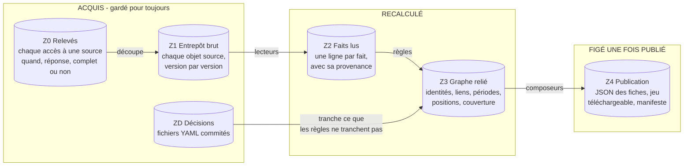

| Zone | Ce qu'elle contient | Où elle vit | Si on l'efface |
| --- | --- | --- | --- |
| **Z0 Relevés** | le journal des accès aux sources | entrepôt (*releases* du dépôt public) | perte irréparable |
| **Z1 Entrepôt brut** | chaque objet source, chaque version, filtré des données interdites et gardé sous forme canonique (re-sérialisé), en segments de 90 Mo au plus | entrepôt | perte irréparable |
| **ZD Décisions** | identité validée, filiation tranchée, levée de contrôle… | écrites dans `decisions/` du dépôt privé, recopiées chaque soir dans `decisions/` du dépôt public | perte irréparable (mais git en garde l'historique) |
| **Z2 Faits lus** | des tables normalisées, avec provenance | cache de GitHub Actions (accélérateur) | on relit Z1 |
| **Z3 Graphe relié** | tout ce que les règles calculent | temporaire, pendant la mise à jour | on recalcule |
| **Z4 Publication** | ce que le navigateur télécharge | GitHub Pages ; copies gardées pour la traçabilité | on rejoue |

Trois idées tiennent l'ensemble :

- **Un fait porte toujours sa provenance** : source, objet, version, adresse publique,
  licence. Sans provenance, il n'est pas servi.
- **Deux temps.** Le temps de la source (« mandat du 22/06/2022 au 09/06/2024 ») et le temps
  de la connaissance (« vu dans l'archive du 03/11/2026 »). Le second est porté par les
  versions de Z1.
- **Toute liaison est une règle** nommée, versionnée, publiée sur la page de méthodologie.
  Une règle qui ne conclut pas écrit « non établi », jamais une devinette. Une **décision**
  de la propriétaire ne corrige jamais une donnée publiée : c'est une **entrée** du calcul.

---

## 1.0 Huit principes

1. **L'acquis et le recalculé sont séparés.** Seuls trois choses sont précieuses et
   conservées pour toujours : ce qu'on a **relevé** aux sources (et quand), les **objets
   sources versionnés** qu'on en a tirés, et les **décisions** de la propriétaire. Tout le
   reste (faits lus, liens, positions, comptes, fiches) se **recalcule** à partir de ces trois
   choses. Conséquence directe : une correction de lecture ou un champ nouveau atteint tout
   l'historique sans rien recollecter (cahier 6.0).
2. **Chaque fait porte sa provenance** : source, objet source, version de cet objet, adresse
   publique quand elle existe, licence. Aucun fait sans provenance n'entre dans les données
   servies (règle 2).
3. **Deux temps distincts.** Le temps **de la source** (« mandat du 22/06/2022 au
   09/06/2024 ») et le temps **de la connaissance** (« vu dans l'archive du 03/11/2026 »). Le
   second est porté par les versions d'objets sources : il répond à « que disait la source à
   telle date ? » et à « quand le site l'a-t-il appris ? ».
4. **L'absence est typée.** Une valeur manquante est `null` accompagnée d'une raison, jamais
   0. Une liste vide est toujours accompagnée de sa **couverture** (vrai zéro, trou de la
   source, borne d'historique, non collecté par choix, panne, travail en cours, relu sans
   résultat).
5. **On garde les identifiants des sources**, préfixés par leur espace (`an:PA720614`). On
   n'en crée que pour les objets que le site construit lui-même (personne, lignée, groupe
   d'une législature, prise de parole). Un identifiant créé n'est jamais réutilisé ; une
   adresse publiée ne change jamais.
6. **Toute liaison est une règle nommée et versionnée** (`R-DERNIERE-LECTURE@2`), dont le
   texte est publié sur la page de méthodologie et dont chaque résultat garde la trace. Une
   règle qui ne conclut pas produit « non établi », jamais une devinette.
7. **Les données interdites n'entrent pas** : les lecteurs ne lisent pas les présences, les
   collaborateurs, et le format servi n'a aucun champ où les mettre (garantie par
   construction, doublée d'un contrôle).
8. **Le volet présidentiel est périphérique.** « Candidat » est une population et un
   drapeau, pas un pilier : supprimer les candidatures ne casse aucun autre objet.

---

## 1.1 Les zones de données

| Zone | Contenu | Acquis ou recalculé | Format | Où elle vit |
| --- | --- | --- | --- | --- |
| **Z0 Relevés** | le journal de chaque accès à une source : quoi, quand, réponse, empreinte, complétude | acquis | Parquet, un fichier par mois | entrepôt (actifs de *releases* du dépôt public) |
| **Z1 Entrepôt brut** | chaque fichier membre des archives reçues (un acteur, un scrutin, un amendement, une séance, un texte du JO…), **à l'octet près, version par version** | acquis | segments Parquet (octets exacts compressés zstd, 90 Mo au plus par segment) + index des versions | entrepôt |
| **ZD Décisions** | les décisions de la propriétaire (identité validée, filiation tranchée, levée de contrôle…) | acquis | fichiers YAML, un par décision | écrites dans `decisions/` du dépôt **privé**, importées chaque soir dans `decisions/` du dépôt public, où elles deviennent publiques et datées (versionné par git) |
| **ZI Registres d'identité** | l'attribution de chaque identifiant interne (`per:…`) et de chaque adresse publique, en ajout seul (étape 2, correction P1) | acquis | Parquet | entrepôt |
| **Z2 Faits lus** | tables normalisées, une ligne par fait, avec provenance | recalculé (mis en cache) | Parquet partitionné par famille et législature | cache de GitHub Actions (accélérateur seulement : s'il est évincé, Z2 se reconstruit depuis Z1, voir doc. 4) |
| **Z3 Graphe relié** | identités résolues, liens entre objets, classifications, périodes, positions, comptes, couverture | recalculé | Parquet / DuckDB | temporaire, pendant la mise à jour |
| **Z4 Publication** | fichiers JSON des fiches, jeu téléchargeable, manifeste | recalculé, puis **figé** une fois publié | JSON compact, Parquet/CSV | GitHub Pages ; manifestes et fichiers conservés dans l'entrepôt |

Seules Z0, Z1, ZD et ZI doivent survivre à tout. Z2 et Z3 peuvent être effacées : on les
reconstruit. Z4, une fois publiée, est conservée **pour la traçabilité** (5.4), pas pour le
calcul.

---

## 1.2 Identifiants

### 1.2.1 Identifiants repris des sources

Toujours stockés sous la forme `espace:valeur`, après **normalisation à la lecture** :

| Espace | Exemple | Normalisation |
| --- | --- | --- |
| `an` | `an:PA720614`, `an:PO800490`, `an:PM842012`, `an:VTANR5L17V4321`, `an:DLR5L17N48123`, `an:RUANR5L17S2026O1N031`, `an:AMANR5L17PO420120B1906P0D1N000123` | le préfixe `PA` est **rétabli** quand l'archive l'omet (comptes rendus, fichier des places, Wikidata P4123) ; aucune autre transformation |
| `senat` | `senat:19830X` (matricule) | majuscules ; Wikidata P1808 donne le **chemin** de la fiche (`senateur/melenchon_jean_luc86039k`), pas le matricule : on en garde la fin, remise en majuscules (`86039K` ; vérifié sur 2 personnes dans la table `sen` de l'export du 04/11/2026) |
| `pe` | `pe:197529` (identifiant eurodéputé) | entier en texte |
| `pt` | `pt:vote:…`, `pt:dossier:2023/0111(COD)` | les deux formes d'identifiant de scrutin Parltrack sont ramenées à une forme canonique ; l'autre est gardée en alias |
| `jorf` | `jorf:JORFTEXT000047561974` | — |
| `loi` | `loi:2023-270` | numéro de loi, **le** lien sûr entre dossier et JO (le NOR manque souvent) |
| `wd`, `syc`, `eurovoc` | `wd:Q3082206`, `syc:18235`, `eurovoc:4038` | — |

Un identifiant de source n'est jamais pris pour un autre type d'objet : la grammaire de 3.1
(`PA`, `PM`, `PO`, `VT…`, `DL…`, `RU…`, `CRS…`, `AM…`) est vérifiée à la lecture ; un
identifiant qui ne la respecte pas est rejeté en anomalie de lecture. Les scrutins du
**Congrès** (`VTCG…`, type `SSG`) respectent la grammaire mais sont hors périmètre (cahier
3.1.2) : lus, puis écartés en E4 par R-PERIMETRE avec la raison « Congrès », que C3 compte
parmi les faits écartés (un seul dans les archives du 04/11/2026 : `VTCGR5L16V1`, XVIe).

### 1.2.2 Identifiants créés par le site

| Objet | Identifiant interne | Adresse publique (stable) | Pourquoi créé |
| --- | --- | --- | --- |
| Personne | `per:000123` (séquentiel, jamais réutilisé ; l'attribution est **acquise**, gardée dans le registre des identités, 1.3.4) | `/personnes/francois-ruffin` | une personne existe dans plusieurs sources ; certaines (candidats sans mandat) n'ont aucun identifiant de l'Assemblée ; un sénateur peut devenir député et recevoir un `PA` plus tard |
| Groupe d'une législature (« maillon ») | `grp:17:PO845419` (législature + premier organe de la chaîne) | `/groupes/socialistes/17`, page de redirection vers la fiche de la lignée, ouverte sur cette législature (le maillon n'a pas de fiche propre, 4.3) | un même groupe peut changer d'organe en cours de législature |
| Lignée | `lig:socialistes` | `/groupes/socialistes` | aucune source ne relie les groupes d'une législature à l'autre |
| Prise de parole | `an:<uid du compte rendu>#<id_syceron>` (identifiant de la source) + empreinte de rapprochement | ancre `#int-…` sur la fiche, lien vers le paragraphe de l'Assemblée | c'est le **rang** du paragraphe qui est renuméroté quand l'Assemblée republie un compte rendu provisoire, pas `id_syceron` (stable pour 97 à 99 % des paragraphes, mesuré le 04/11/2026 sur les 2 comptes rendus provisoires de l'archive XVIIe) ; quelques paragraphes reviennent sous un nouvel `id_syceron` |
| Candidature | `cand:2027:per:000123` | — (drapeau sur la fiche personne) | élection datée, personne |
| Gouvernement, législature | repris de la source (`an:PO…`) ; `leg:17` | `/gouvernements/borne`, `/legislatures/17` | — |

**Clé d'une prise de parole** : l'identifiant de la source (`id_syceron`, unique dans
toute l'archive XVIIe), préfixé par le compte rendu. Le rang (`ordre_absolu_seance`) est un
**attribut** mis à jour à chaque version, pas la clé ; le texte, retouché en place par
l'Assemblée, aussi. Quand un `id_syceron` disparaît d'un compte rendu republié et qu'un
nouveau apparaît, une **empreinte de rapprochement** (séance, orateur, 200 premiers
caractères normalisés) les apparie : le rapport de mise à jour annonce une « correction » et
non un « retrait + ajout », et la prise de parole garde son ancre publique sur le site
(l'ancien identifiant devient un alias).

**Registre des adresses** (table `adresse` du registre des identités, 1.3.4, dans l'entrepôt, en ajout seul) :
chaque adresse publiée y est inscrite avec l'objet qu'elle désigne et sa date de première
publication. Une adresse n'en sort jamais ; si l'objet disparaît ou fusionne, elle devient
une redirection (page statique de redirection, GitHub Pages n'ayant pas de redirection
serveur). Les homonymes reçoivent un suffixe d'année de naissance (`/personnes/jean-martin-1962`).

### En image : les identifiants

**On garde les identifiants des sources, préfixés ; on n'en crée que pour ce que le site
construit ; une adresse publiée ne change jamais.**

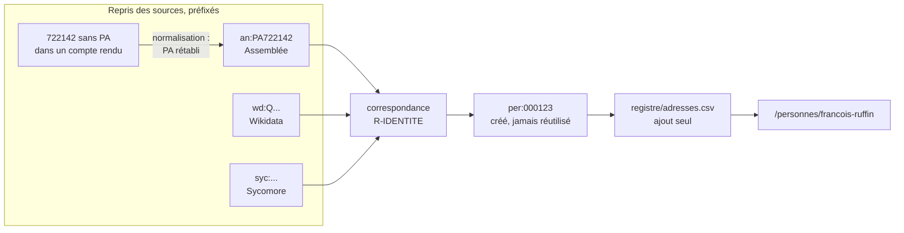

| Ce qui est repris | Ce qui est créé |
| --- | --- |
| `an:PA…` (personne), `an:PO…` (organe), `an:PM…` (mandat), `an:VT…` (scrutin), `an:DL…` (dossier), `an:AM…` (amendement) | `per:…` une personne, car elle existe dans plusieurs sources et un candidat sans mandat n'a pas de `PA` |
| `senat:…`, `pe:…`, `pt:…`, `jorf:…`, `loi:…`, `wd:…`, `syc:…`, `eurovoc:…` | `grp:17:PO…` un groupe d'une législature (législature + premier organe) |
| | `lig:…` une lignée, que personne d'autre ne définit |
| | `cand:2027:per:…` une candidature |

Règles simples :

- Un identifiant de source est **vérifié** à la lecture : un `VT…` ne peut pas désigner une
  personne. Un identifiant mal formé part en anomalie de lecture.
- Un identifiant créé ne **porte aucune information**. C'est pour ça qu'il ne change jamais.
- L'**adresse publique** est inscrite à part, dans un registre en ajout seul.

#### Comment une adresse reste stable

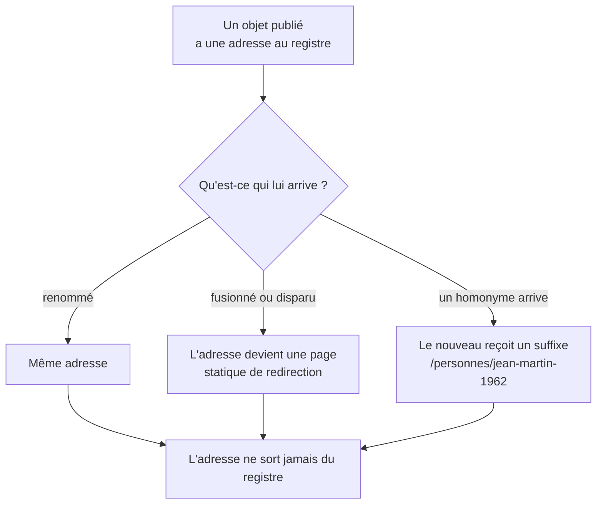

GitHub Pages ne sait pas rediriger côté serveur : la redirection est une petite page
statique. Le contrôle C2 vérifie qu'aucun lien publié ne vise une adresse absente du
registre.

#### Le cas des prises de parole

**Une prise de parole garde son ancre même quand l'Assemblée republie le compte rendu.**

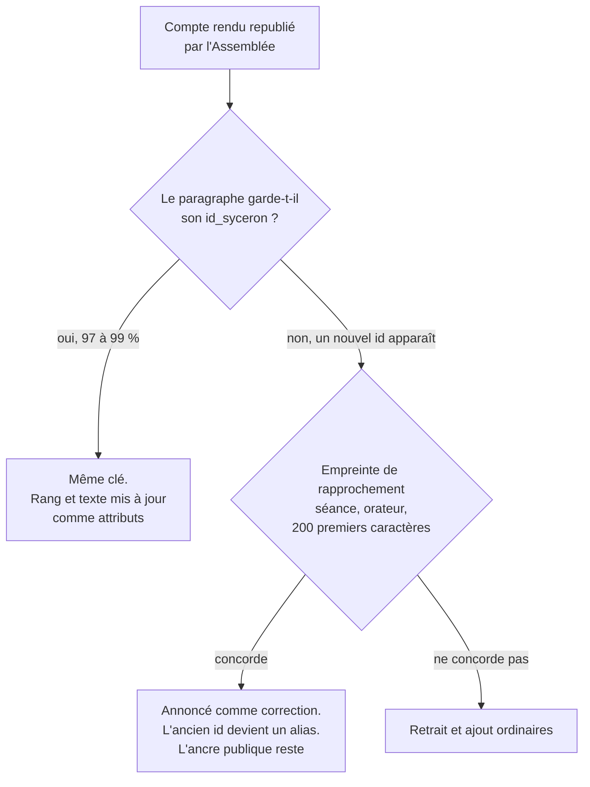

Le **rang** du paragraphe change à chaque republication : ce n'est donc pas la clé. Mesuré le
04/11/2026 sur les deux comptes rendus provisoires de l'archive XVIIe : `id_syceron` reste le
même pour 97 à 99 % des paragraphes.

La clé d'une prise de parole est donc `an:<uid du compte rendu>#<id_syceron>` : c'est
l'identifiant de la source, préfixé par le compte rendu. Sur la fiche, elle donne une ancre
`#int-…` et un lien vers le paragraphe de l'Assemblée.

---

## 1.3 Les objets acquis

### 1.3.1 Relevé (Z0)

Un relevé = une tentative d'accès à un point d'accès d'une source.

| Champ | Sens |
| --- | --- |
| `releve_id` | identifiant (horodatage + source + point d'accès) |
| `source`, `point_acces` | ex. `an`, `amo30-l17` |
| `url`, `methode` | adresse demandée, GET / HEAD / requête API |
| `debut`, `fin` | horodatages UTC |
| `http_statut`, `entetes` | dont `ETag`, `Last-Modified`, `Content-Length` |
| `taille`, `empreinte` | SHA-256 du fichier reçu |
| `date_source` | date de la donnée **à la source** (en-tête, date dans l'archive, date de livraison du JO) : c'est elle qu'affiche « à jour au » |
| `issue` | `inchange` (requête conditionnelle : rien de neuf), `nouveau`, `echec`, `suspect` |
| `complet` | booléen : la lecture couvre-t-elle tout ce que le point d'accès doit couvrir ? |
| `controles` | résultats des contrôles d'intégrité (zip lisible, taille plancher, nombre d'objets plausible, schéma reconnu) |
| `message` | cause de l'échec ou du soupçon |

Règle structurante : **seul un relevé `complet` peut faire constater un retrait.** Un
relevé en échec ou suspect ne change rien à Z1 ; il change seulement la couverture
(« panne depuis le … »).

### 1.3.2 Objet source versionné (Z1)

Une archive est **dépaquetée** en ses fichiers membres (un fichier JSON d'acteur, un
scrutin, un amendement, une séance Syceron, un texte du JO, le fichier unique d'une archive
de la XIVe, le dump du Sénat, une réponse d'API…), gardés **à l'octet près** : rien n'est
interprété ni filtré à ce stade. Tout ce qui interprète le contenu (un fichier qui contient
plusieurs objets, le choix des champs) est fait par les lecteurs (E3), versionnés et
rejouables : un découpage erroné se corrige donc comme une erreur de lecture (étape 2,
correction P2). Chaque relevé garde la liste des membres de l'archive reçue (chemin, taille,
CRC, empreinte), ce qui permet de retrouver son contenu exact. Pour chaque fichier membre :

| Champ | Sens |
| --- | --- |
| `source`, `type`, `uid`, `chemin` | ex. `an`, `scrutin`, `VTANR5L17V4321`, chemin du membre dans l'archive |
| `version` | 1, 2, 3… |
| `empreinte` | SHA-256 des octets exacts |
| `contenu` | les octets exacts du membre, compressés (zstd) |
| `vu_du`, `vu_jusqu_au` | premier et dernier relevé complet où cette version était présente |
| `etat` | `present` ou `retire_a_la_source` (absent d'un relevé complet) |
| `releve_id` | le relevé qui a créé la version |
| `archive` | quelle archive l'a fourni (courante, figée de la XIVe…) : un même objet peut venir de plusieurs archives (30 dossiers de la XIVe réapparaissent ensuite ; un compte rendu de la XVe est dans l'archive de la XVIe) |

Une nouvelle version n'est créée que si l'empreinte change. Un relevé `inchange` (réponse
304 à une requête conditionnelle, sur un point d'accès dont le dernier relevé était complet)
prolonge `vu_jusqu_au` de tous ses objets. Un objet `retire_a_la_source` qui réapparaît reçoit
une nouvelle version `present` : la période de retrait reste dans l'historique, et le rapport
annonce une « réapparition ». C'est ce qui rend la collecte
**incrémentale** (on ne relit que les objets qui ont changé) et qui fixe l'historique des
champs que l'archive courante réécrit (siège dans l'hémicycle, libellés d'organes, position
déclarée d'un groupe) : la version précédente reste, datée par `vu_du`/`vu_jusqu_au`.

**Rien n'est filtré avant stockage** (décision de la propriétaire du 06/11/2026). Les listes
de présence (clé `participants` de l'agenda AN, 36 % des octets de l'archive XVIIe ; table
`activite_participant` de l'export du Sénat, 683 522 lignes PRESENT/EXCUSE de 2015 à 2026,
mesuré le 04/11/2026) et les noms des collaborateurs parlementaires sont gardés dans
l'entrepôt comme à la source : ce sont des données publiques de la source, et les règles de la
partie 2 du cahier s'appliquent au site, pas au corpus. Ils ne sont **jamais servis** : aucun
lecteur ne les lit, aucun schéma de fichier servi n'a de champ pour eux, et le contrôle C4 le
vérifie.

**Sources « faits seulement »** (Sycomore, fichier des places de la XIVe, Wikipédia) : leur
contenu n'est pas recopié dans l'entrepôt public. On y garde les **faits extraits** (dates,
fonctions, noms de candidats), l'adresse de la page et l'empreinte de la page lue. Une
correction de lecture de ces sources passe par une nouvelle lecture des pages, qui restent en
ligne (et dont la page lue est vérifiable par son empreinte).

**Plusieurs archives pour une même législature** : un objet peut venir de l'archive
courante et d'une archive figée, qui ne disent pas la même chose (mesuré le 04/11/2026 : la
XVIe figée donne 591 sièges, dont 323 diffèrent et 202 sont effacés dans la courante ;
99 mandats de la XVIe figée et 402 de la XVe figée n'existent plus dans la courante — aucun mandat de député ni de groupe de l'Assemblée : surtout des fonctions au Sénat, des organismes extraparlementaires et des assemblées internationales ; 259 ont un remplaçant dans la courante, comme le mandat de ministre de Jean-Jacques Urvoas ouvert sans fin depuis le 27/01/2016, remplacé par deux mandats datés ;
l'archive figée de la XVe date du 09/06/2022, **avant** la fin de la législature, avec 567
mandats sans date de fin). Les versions sont donc rangées **par archive**, et la règle
R-ARBITRAGE-ARCHIVES (1.6) dit laquelle fait foi pour quel champ.

### 1.3.3 Décision (ZD)

Une décision est un fichier YAML dans `decisions/<type>/`, écrit par la propriétaire sur le
dépôt privé à tout moment, puis importé par la tâche du soir sur le dépôt public (doc. 2,
2.12) ; c'est ce commit d'import qui la rend publique et datée, avec son auteur :

```yaml
type: filiation            # ou identite, perimetre, levee_controle, rattachement_portefeuille,
                           # fin_legislature, libelle_ministere, absence_etablie, exception_regle…
date: 2026-11-04
objet: grp:17:PO845419
decision: suite_de [grp:16:PO800496]
motif: "La règle ne tranche pas (combinée 58 %, 21 députés communs)."
preuves: ["https://…"]     # pour une absence établie : la source lue, la date de lecture
portee: …                  # pour une levée : l'empreinte exacte de l'anomalie levée
```

Types prévus et ce qu'ils alimentent :

| Type | Alimente | Exemple |
| --- | --- | --- |
| `identite` | validation d'une personne nouvelle, rapprochement entre sources | « `per:000412` = `senat:…` = `wd:Q…` » |
| `candidature` | la liste des candidats, recopiée à la main de franceinfo (décision du 13/11/2026 : la page n'est pas collectée) : une entrée par candidat, nom, statut (`declaree`, `retiree`, `non_listee`), parti, élément Wikidata (validé par la propriétaire quand il a été trouvé par le nom) ; la liste en vigueur est celle du fichier le plus récent | liste des candidats, rattachement de l'identité, publication de la fiche |
| `perimetre` | sortie d'une personne avec sa raison | candidature retirée |
| `filiation` | cas que la règle de filiation ne tranche pas | 4.3 |
| `continuite_groupe` | un groupe qui change d'organe en cours de législature | 3.1.1 |
| `rattachement_portefeuille` | ministère de tutelle d'un ministre délégué quand la source ne le donne pas : `rattache_a` suivi d'un ou de plusieurs `PO…` (co-tutelle, dans l'ordre de la source), avec le texte qui l'établit (décret de composition au JO, sinon le libellé de l'Assemblée) | 4.4 |
| `libelle_ministere` | table des 260 libellés libres du JO → ministère normalisé | 3.6 |
| `fin_legislature` | mode de fin (dissolution / terme) avec le décret (lien Légifrance) | 4.5 |
| `absence_etablie` | « relu, aucun » : source lue en entier, date, ce qu'elle ne couvre pas | 4.7 |
| `levee_controle` | autoriser une publication refusée, pour **une** anomalie | 6.2 |
| `exception_regle` | un scrutin dont l'intitulé trompe la règle « ensemble du texte » | 4.6 |
| `publication_donnee` | décision de publier une donnée « à ne pas publier sans décision » | collaborateurs (refusé par défaut) |
| `fiche_hors_modele` | une fiche qui s'écarte du modèle (section ajoutée ou retirée), avec sa portée ; listée par A1 à chaque mise à jour | 6.2 |
| `rattachement_loi` | une loi que R-LOI-DOSSIER ne rattache pas à son dossier | 3.1.4 |

Les décisions sont des **entrées du traitement**, jamais des corrections de données publiées
(5.4 : « une donnée publiée ne se corrige jamais à la main »). Une décision qui ne s'applique
plus (l'objet a disparu, la règle tranche désormais) est signalée, pas appliquée en silence.

---

### 1.3.4 Registre des identités (ZI)

L'attribution d'un identifiant interne est un fait **acquis** : une fois donnée, elle ne
change plus (étape 2, correction P1).

| Table | Une ligne par | Colonnes |
| --- | --- | --- |
| `attribution` | (source, uid) rattaché à une personne | `per`, `source`, `uid`, `depuis`, `jusqu_au` (vide tant qu'elle vaut), `motif` (`nouvelle_personne`, `rapprochement`, `decision`) |
| `fusion` | personne absorbée | `per_absorbe`, `per_retenu`, `generation`, `decision` |
| `adresse` | adresse publique | `adresse`, `objet`, `premiere_publication`, `redirige_vers` |
| `compteur` | type d'identifiant | dernier numéro attribué |

R-IDENTITE lit d'abord ce registre : un (source, uid) déjà attribué garde son `per`, quel que
soit l'ordre de lecture ou l'arrivée d'une autre source. Une personne nouvelle reçoit le
numéro suivant. Deux personnes reconnues comme une seule gardent le numéro le plus ancien,
l'autre devient un alias. Un rapprochement reconnu faux clôt l'attribution fautive et donne
un numéro neuf au (source, uid) concerné. Le registre ne fait que croître ; seule la colonne
`jusqu_au` peut être remplie après coup.

## 1.4 Les faits lus (Z2)

Chaque table de Z2 porte, en plus de ses colonnes propres, les colonnes communes :

| Colonne commune | Sens |
| --- | --- |
| `prov_source`, `prov_type`, `prov_uid`, `prov_version` | l'objet source et sa version |
| `prov_url` | l'adresse publique du fait quand elle existe (scrutin, amendement, dossier, paragraphe de compte rendu, Légifrance…) |
| `licence` | dérivée de la source (`etalab-2.0`, `odbl-1.0`, `cc-by-4.0`, `faits-seulement`) |
| `lecteur` | nom et version du lecteur qui a produit la ligne |

Les tables sont groupées par domaine. Les colonnes listées sont les principales, pas toutes.

### A. Personnes

| Table | Clé | Colonnes principales | Sources |
| --- | --- | --- | --- |
| `identite_source` | (source, uid) | nom, prénom, civilité, date et lieu de naissance, date de décès, profession | AN, Sénat, PE, Wikidata, Sycomore, RNE |
| `identifiant_externe` | (source, uid) | identifiants d'autres bases déclarés par cette source (Wikidata P4123, P1045, P1808) | Wikidata |

### B. Organes, mandats, fonctions

| Table | Clé | Colonnes principales | Sources |
| --- | --- | --- | --- |
| `organe` | uid | type (ASSEMBLEE, GP, COMPER, CMP, MINISTERE, GOUVERNEMENT, MISINFO, CIRCONSCRIPTION…), libellés, sigle, dates, législature, organe créateur, position déclarée (`majoritaire`/`minoritaire`/`opposition`/`null`) | AN AMO |
| `mandat` | uid (`PM…` ; pour le Sénat, PE, RNE, Sycomore : uid synthétique stable) | personne source, organe, institution, qualité (membre, président, rapporteur, questeur, secrétaire…), début, fin, cause de fin, circonscription, suppléant, mandat remplacé | AN, Sénat, PE, RNE, Sycomore |
| `mandat_suspension` | (mandat, début) | début, fin, motif (entrée au gouvernement) — **reconstruite** : aucun champ dédié ; on lit la chaîne « mandat clos par nomination au Gouvernement → mandat du suppléant → mandat de reprise », et la date de reprise dans `mandature.datePriseFonction` (le `dateDebut` du mandat de reprise recopie celui du mandat d'origine dans les 113 cas mesurés) | AN |
| `fonction_gouvernementale` | (mandat GOUVERNEMENT, mandat MINISTERE) | les deux mandats d'un ministre, appariés par l'uid (`PM15` + numéro du mandat MINISTERE, 652 sur 659) ; les 408 mandats MINISTERE qui sont des **missions de parlementaires** sont écartés par leur qualité | AN |
| `succession_ministere` | (organe, organe suivant) | — | AN |
| `siege` | (personne, législature, date de constat) | numéro de siège, origine (archive figée / fichier des places XIVe / constat sur l'archive courante) ; les sièges de l'AMO20 XIVe ne sont pas lus (état de mars 2018) | AN |
| `deport` | uid | personne, objet, dates | AN |

### C. Travail législatif de l'Assemblée

| Table | Clé | Colonnes principales |
| --- | --- | --- |
| `dossier` | uid | titre, procédure, législature(s) de présence, lien Sénat, initiateurs |
| `document` | uid | dossier, nature (préfixe `PRJL`/`PION`/`PNRE`…), date, étape, auteurs |
| `acte` | uid | dossier, parent, type (`@xsi:type`, dont `DeclarationGouvernement_Type` et son `fam_code`), code, libellé, date, organe, conclusion (texte de la source), scrutins cités (AN et Sénat), textes associés/adoptés, rapporteurs, auteur (mandat MINISTERE cité pour un projet de loi), référence JO (NOR, numéro de loi), décision du Conseil constitutionnel |
| `echeancier` | (dossier, article de loi, mesure) | décret attendu, décret publié (`jorf:` quand il est cité) — lu dans l'échéancier des décrets d'application du dossier (cahier 3.1.4 ; forme non mesurée le 04/11/2026) |
| `scrutin` | uid | législature, numéro, date, séance, **type lu par son code** (`codeTypeVote` : SPO, SPS, MOC, SAT, SSG ; jamais par le libellé, qui nomme « scrutin public solennel » les motions de censure en XVe et XVIe, archives du 04/11/2026), mode de décompte (nominatif / dissidents seuls), intitulé, demandeur, sort, totaux officiels (votants, exprimés, majorité requise), référence de dossier quand la source la donne (XVIIe) |
| `position_vote` | (scrutin, personne source) | position (`pour`/`contre`/`abstention`/`non_votant`), **cause du non-vote** (`PAN` président de l'Assemblée, `PSE` président de séance, `MG` membre du gouvernement : un non-vote de fonction, compté à part, jamais comme un vote), par délégation, groupe déclaré par la source, siège au moment du vote |
| `mise_au_point` | (scrutin, personne source) | position déclarée après coup (gardée **à part** : elle ne remplace pas la position) |
| `decompte_groupe` | (scrutin, organe GP) | décomptes publiés par la source, **position majoritaire publiée** |
| `amendement` | uid | document visé, article visé, auteur principal, type d'auteur, date de dépôt, état, sous-état, exposé sommaire, dispositif, organe d'examen, examen (`examenRef`), numéro long |
| `signature` | (amendement, personne source) | rôle (`auteur`/`cosignataire`), rang, **lu dans la copie retenue** par R-AMENDEMENT |
| `question` | uid | type (écrite, au gouvernement, orale sans débat), auteur, ministère interrogé (organe), rubrique, date, texte, réponse, date de réponse ; pour une question au gouvernement, question et réponse forment **un seul bloc** à la source (1 857 sur 1 857 en XVIIe, archive du 04/11/2026) : gardé tel quel, les paroles séparées venant du compte rendu (R-QAG) |

### D. Séances et paroles

| Table | Clé | Colonnes principales |
| --- | --- | --- |
| `reunion` | uid | type (séance publique, commission, Sénat, Congrès), date, organe (« organe non référencé », sans lien, quand AMO ne le connaît pas : 984 réunions de 68 organes dans l'agenda XVIIe du 04/11/2026), statut (confirmée, annulée), lien compte rendu — **sans les présences** |
| `point_odj` | (réunion, rang) | libellé, niveau, parent, code de point, dossiers cités |
| `compte_rendu` | uid | séance, statut (provisoire / définitif), date de version |
| `intervention` | `an:<uid du compte rendu>#<id_syceron>` (1.2.2) | séance, point d'ODJ, orateur source (identifiant + libellé), qualité, texte, ancre/rang de paragraphe, indicateurs (`orateur_absent`, `orateur_collectif`, `president_seance`) |

### E. Gouvernement et Journal officiel

| Table | Clé | Colonnes principales |
| --- | --- | --- |
| `acte_reglementaire` | `jorf:…` | nature, titre, date de publication, date de signature (`2999-01-01` = sentinelle → `null` + raison : 28 actes des livraisons des 03 et 04/11/2026), ministère (libellé libre), NOR, numéro, rubrique du sommaire, mesure nominative (R-MESURE-NOMINATIVE), version (original/rectificatif) ; **signataires** (champ `SIGNATAIRES`, texte libre tel quel, servi avec l'acte ; aucun identifiant de personne n'en est tiré ; l'interface décide de l'afficher ou non : décision du 04/11/2026, doc. 5, Q11) |
| `lien_acte_loi` | (acte, loi) | type (`applique`/`cite`), source du lien (champ JO / échéancier AN / titre) ; la qualification « applique » du JO n'est plus posée depuis 2024 : couverture `trou_source` pour les lois postérieures |
| `loi` | `loi:…` | numéro, date de promulgation, date de publication, NOR, titre |

### F. Europe

| Table | Clé | Colonnes principales | Sources |
| --- | --- | --- | --- |
| `mandat_pe` | uid synthétique | personne, groupe politique (référence `org/…`, libellé lu dans `corporate-bodies/{id}`), rôle, délégation nationale, dates ; un changement de rôle est une nouvelle appartenance | PE |
| `scrutin_pe`, `position_vote_pe` | identifiant canonique Parltrack ; (scrutin, personne) | date, numéro, intitulé, dossier ; position **lue dans la liste de votants que porte le scrutin** d'`ep_votes` (`votes["+"].groups[…]`), jamais rapprochée par numéro et date | Parltrack |
| `dossier_pe`, `document_pe`, `concept` | — | titre français, stade atteint de la procédure (champ Parltrack non mesuré le 04/11/2026), concepts EuroVoc → microthésaurus → domaine (`skos:inScheme` renvoie aussi le schéma global `100141`, exclu) | PE, Parltrack, EuroVoc |
| `activite_pe` | uid synthétique | type (intervention, question, rapport, explication de vote…), date **avec indicateur de date douteuse** (22/11/2016, dates impossibles) | Parltrack |
| `amendement_pe` | uid | dossier, auteurs ; **aucun sort** (la source n'en donne pas) | Parltrack |

### G. Finances, mandats locaux, candidatures, métadonnées

| Table | Clé | Colonnes principales |
| --- | --- | --- |
| `montant_budget` | (exercice, nature, ministère/programme/impôt, type) | montant, unité, type (LFI, LFR, exécution), ministère (`null` + raison pour l'exécution 2023-2025, publiée sans ministère), source et date d'édition (les révisions silencieuses deviennent des versions) ; une source au format large (une colonne par mois) est remise en long, une ligne par série et par mois |
| `montant_protection_sociale` | idem | + `provisoire` (dernière année d'une édition Drees ou Unédic) |
| `mandat_local` | uid synthétique (RNE n'a pas d'identifiant) | nom, prénom, date de naissance, mandat, collectivité, début ; **pas de date de fin** (la source n'en a pas) ; dédoublonné par (nom, prénom, naissance, collectivité, fonction, début) quand un même mandat figure dans deux fichiers ; mandats de député, sénateur, eurodéputé non lus (déjà lus aux sources parlementaires) |
| `candidature` (Wikipédia) | (élection, personne source Wikipédia) | statut (`declaree`/`retiree`), date de déclaration (ou `null` + « non connue »), références citées par Wikipédia, révision Wikipédia lue. Depuis le 13/11/2026, ce n'est plus la liste des candidats (décision `candidature`, d'après franceinfo) : la date de déclaration en est reprise, et un écart avec la liste est signalé (avertissement A9) |
| `source`, `point_acces`, `licence` | — | catalogue des sources (ce qu'elles apportent, depuis quand, licence, pièges connus), **points d'accès non retenus compris**, avec leur raison (texte des articles, cahier 3.1.8 : aucun besoin de la partie 4 ; points d'accès de 3.12) ; licence lue jeu par jeu dans le catalogue de la source quand elle varie (data.economie.gouv.fr) : alimente la page des sources |

---

## 1.5 Le graphe relié (Z3, dérivé)

Tout ce qui suit est **calculé** à chaque mise à jour à partir de Z2 et des décisions. Chaque
ligne porte la règle qui l'a produite (`regle`, `version`) et, quand la règle hésite, la
raison de son abstention.

**Les faits lus (Z2) reprennent les objets des sources ; le graphe (Z3) ajoute ce que le site
construit lui-même : les personnes, les groupes d'une législature, les lignées, les liens et
les positions.**

Les schémas « En image » des sous-sections qui suivent sont découpés par domaine. Ils
montrent les relations principales, pas toutes les colonnes. Les noms sont ceux des tables de
ce document. Dans chaque schéma, les objets **dérivés** (Z3) sont listés sous le schéma ; les
autres sont des faits lus (Z2).

### 1.5.1 Personnes et populations

| Objet | Contenu | Règle |
| --- | --- | --- |
| `personne` | `per:…`, nom d'usage, identité retenue (et la source de chaque champ), adresse publique | R-IDENTITE |
| `correspondance` | `per:…` ↔ (source, uid), méthode (identifiant déclaré par Wikidata, état civil + date de naissance, décision), statut (`automatique`/`validee`/`a_relire`) | R-IDENTITE |
| `population` | (personne, population, depuis, jusqu'à, raison) — populations : `candidat`, `membre_groupe`, `membre_gouvernement`, `depute_ni` | R-PERIMETRE |
| `carriere` | une ligne par période de mandat ou de fonction, toutes institutions, avec le lien vers la fiche de législature ou de gouvernement, et les périodes **absentes de la source** déclarées comme telles | R-CARRIERE |

#### En image : personnes et mandats

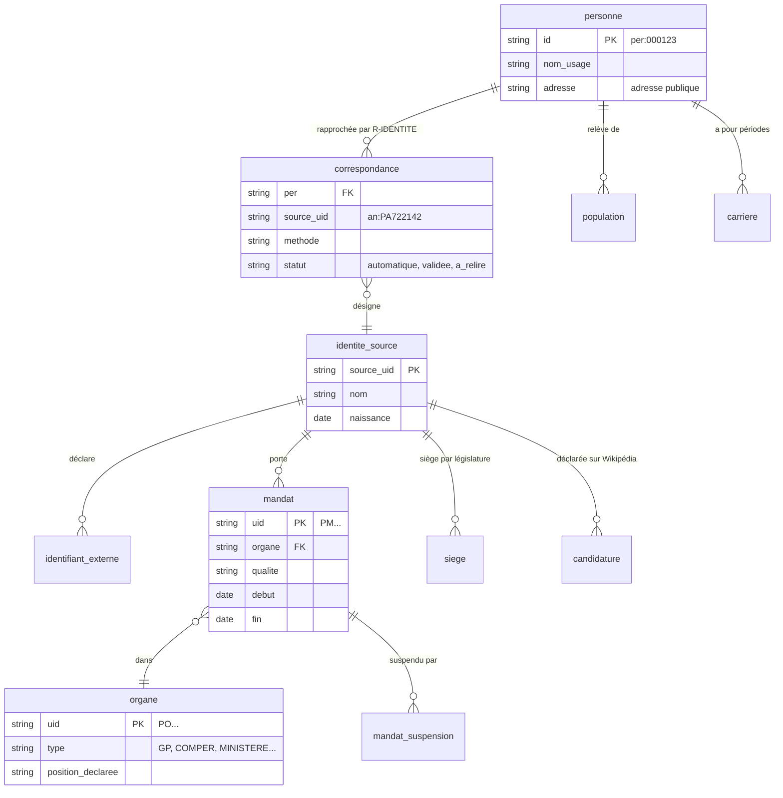

Dérivés (Z3) : `personne`, `correspondance`, `population`, `carriere`.

- Une **personne** existe une seule fois sur le site, même si quatre sources la connaissent.
  La `correspondance` dit par quelle méthode chaque identité de source lui est rattachée.
- La règle R-IDENTITE ne rapproche jamais sur le nom seul : il faut un identifiant déclaré
  (Wikidata, un `PA` dans une autre archive) ou le nom **et** la date de naissance. Sinon,
  `a_relire`, et une identité de candidat n'est jamais publiée sans validation.
- Une **population** (`candidat`, `membre_groupe`, `membre_gouvernement`, `depute_ni`) est un
  drapeau daté. « Candidat » n'est qu'une population : la supprimer ne casse rien.
- La **carrière** met bout à bout tous les mandats et fonctions, toutes institutions, et
  déclare les périodes absentes de la source.

### 1.5.2 Groupes, lignées, bancs

| Objet | Contenu | Règle |
| --- | --- | --- |
| `groupe` (maillon) | `grp:17:PO…` = un ou plusieurs organes GP successifs d'une même législature | R-CONTINUITE-GROUPE (même sigle, dates contiguës, membres communs ≥ 80 %) sinon décision |
| `appartenance` | (personne, groupe, début, fin) — **une suite de périodes**, pas une enveloppe | R-APPARTENANCE |
| `lignee`, `filiation` | (groupe, groupe précédent, part des réélus restés, part des venus de l'ancien, moyenne harmonique, communs, verdict `suite`/`pas_suite`/`a_trancher`) | R-FILIATION (4.3) |
| `position_declaree` | (groupe, début, fin, position, `divergente` si deux organes d'un même groupe déclarent des positions différentes), datée par les versions de Z1 | R-BANC |
| `periode_position` | (personne, début, fin, banc, gouvernement) : la période change quand change le banc **déclaré** ou le gouvernement | R-PERIODE |
| `place_mediane` | (groupe, législature, date, siège médian) | R-HEMICYCLE |

#### En image : groupes, lignées, bancs

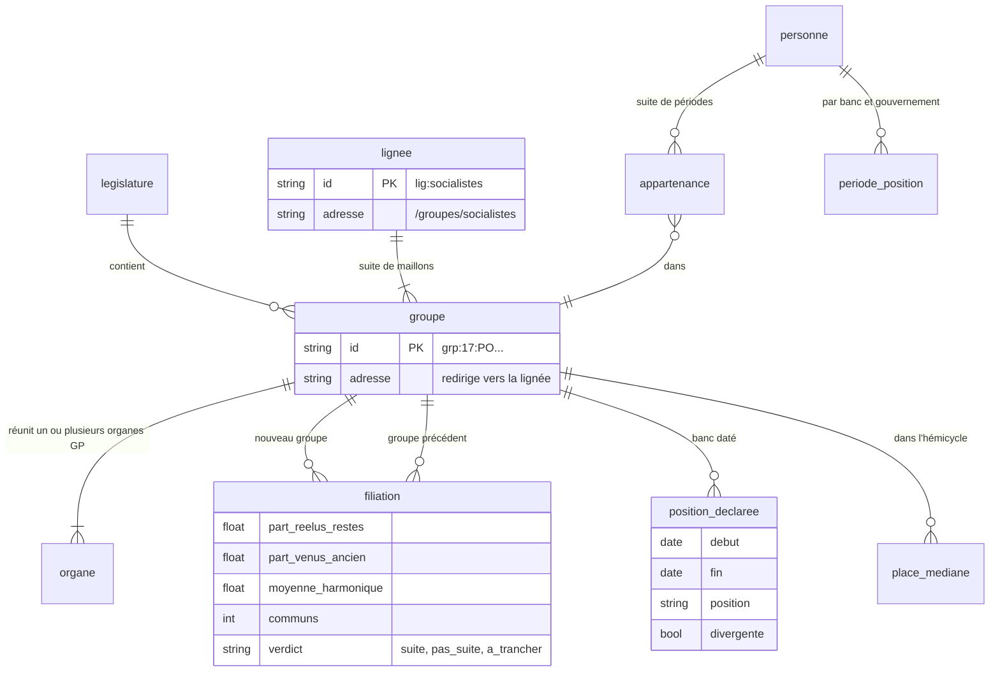

Tout ce schéma est dérivé (Z3), sauf `organe`, lu dans l'archive de l'Assemblée.

- Un **groupe** (ou « maillon ») est un groupe dans **une** législature. Il peut réunir
  plusieurs organes de l'Assemblée, si le groupe a changé d'organe en cours de route
  (R-CONTINUITE-GROUPE ; sinon décision `continuite_groupe`). Exemple : `grp:17:PO845419`,
  le groupe socialiste de la XVIIe.
- Un maillon n'a **pas de fiche propre**. Son adresse (`/groupes/socialistes/17`) est une
  page de redirection vers la fiche de la lignée, ouverte sur cette législature.
- Une **lignée** relie les maillons d'une législature à l'autre. Aucune source ne le fait :
  c'est la règle R-FILIATION (moyenne harmonique ≥ 60 % et au moins 5 députés communs). Ce
  qu'elle ne tranche pas attend une décision `filiation`.
- L'**appartenance** est une suite de périodes, pas une enveloppe : une personne peut partir
  et revenir.
- Le **banc** (majoritaire, minoritaire, opposition) n'est jamais déduit. Mesuré le
  04/11/2026 : aucun des 14 groupes de la XVIIe ne déclare de position. Leur banc est donc
  « non publié », et une période de position ne change, en XVIIe, qu'avec le gouvernement.

### 1.5.3 Textes, scrutins, amendements

| Objet | Contenu | Règle |
| --- | --- | --- |
| `scrutin_classe` | nature (`ensemble`, `partie_de_texte`, `article`, `amendement`, `motion_rejet`, `motion_censure`, `declaration`, `autre`, `non_etablie`), origine (`projet`/`proposition`/`non_etablie`), lecture (`premiere`, `nouvelle`, `cmp`, `definitive`…) | R-NATURE-SCRUTIN, R-ORIGINE |
| `lien_scrutin_dossier` | (scrutin, dossier, route : `reference_directe` / `acte_cite` / `seance_point_odj`, accord des routes) ; en cas de **désaccord**, pas de lien et une alerte | R-LIEN-SCRUTIN-DOSSIER |
| `derniere_lecture` | (dossier, scrutin retenu) : le scrutin `ensemble` le plus récent **sur tout le corpus** | R-DERNIERE-LECTURE |
| `matiere` | (dossier, commission saisie au fond à l'Assemblée, ou `senat_seulement`, ou `non_etablie`) | R-MATIERE |
| `sort_dossier` | (dossier, sort final, `par_49_3`, date) : sort lu dans la conclusion des actes, 49.3 lu dans l'acte qui l'engage | R-SORT-FINAL |
| `lien_loi_dossier` | (loi, dossier, route : `promulgation` / `titre` / `decision`) | R-LOI-DOSSIER |
| `etape_dossier` | étape atteinte (dépôt, examen en commission, séance, adopté, promulgué) par législature | R-ETAPE |
| `texte_porte` | (personne, dossier, rôle : `auteur`, `cosignataire`, `rapporteur`, `initiative_gouvernementale` ; publiable seulement à partir de l'examen en commission) | R-TEXTE-PORTE |
| `amendement_canonique` | une ligne par amendement (copies dédoublonnées), auteur principal, sort normalisé, commission du dossier visé, banc de l'auteur au dépôt | R-AMENDEMENT, R-SORT-AMENDEMENT |
| `position_groupe_scrutin` | (groupe, scrutin, décompte pour/contre/abstention/non-votants **de ses membres à la date**, dénominateur = membres à la date, position majoritaire publiée, `divise`) | R-POSITION-GROUPE |
| `divergence` | (personne, scrutin, sa position, position majoritaire du groupe) — seulement si les 5 conditions de 4.2 sont réunies ; **aucun total** | R-DIVERGENCE |

#### En image : textes et scrutins

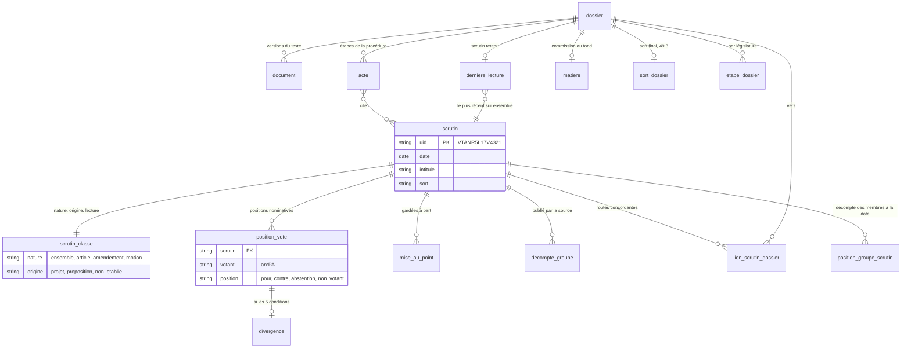

Dérivés (Z3) : `scrutin_classe`, `lien_scrutin_dossier`, `derniere_lecture`, `matiere`,
`sort_dossier`, `etape_dossier`, `position_groupe_scrutin`, `divergence`.

- Un scrutin ne dit presque jamais sur quel texte il porte. Le lien scrutin ↔ dossier passe
  par trois routes (référence directe, acte qui cite le scrutin, séance). Si deux routes se
  contredisent : pas de lien, et une alerte. Un lien faux est pire qu'un lien absent.
- La **dernière lecture** se choisit sur **tout** le corpus, pas seulement parmi les scrutins
  où la personne a voté.
- Une **mise au point** (« je voulais voter pour ») est gardée à côté de la position, jamais
  à sa place.

#### En image : amendements et textes portés

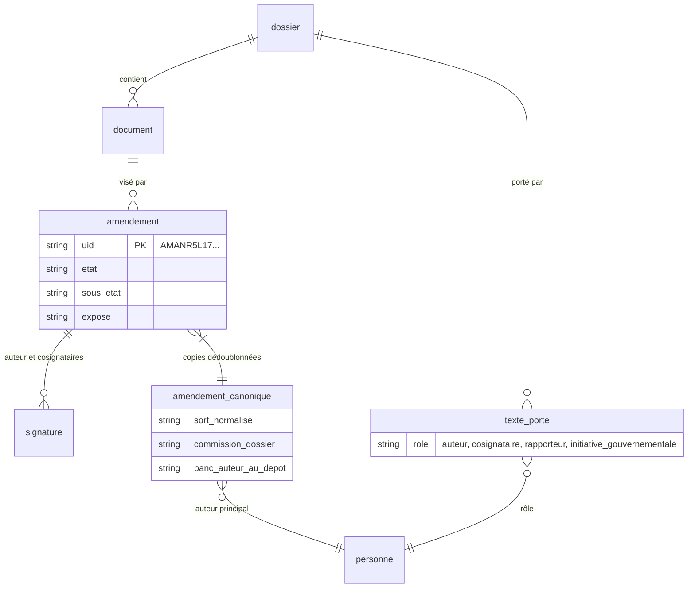

Dérivés (Z3) : `amendement_canonique`, `texte_porte`.

- Un amendement existe parfois en plusieurs copies : la copie qui fait foi est celle du
  premier signataire (R-AMENDEMENT). Un amendement compte une fois ; les signatures se
  comptent à part, sous ce nom.
- Un projet de loi est une **initiative gouvernementale**, pas un acte personnel du ministre
  (R-TEXTE-PORTE). Un texte porté n'est publiable qu'à partir de son examen en commission.

### 1.5.4 Paroles, questions, gouvernement, budget

| Objet | Contenu | Règle |
| --- | --- | --- |
| `intervention_attribuee` | (intervention, personne ou `non_attribuee` + raison, qualité retenue et son origine — `compte_rendu` ou `fonction_a_la_date` —, `preside`) | R-ORATEUR, R-QUALITE |
| `sujet_intervention` | (intervention, sujet = point d'ODJ **sous** le créneau, dossier lié ou `non_lie`) | R-SUJET |
| `question_reponse_parole` | (question au gouvernement ou orale sans débat, compte rendu, point, date de séance, interventions, intervenants), ou `non_appariee` + raison | R-QAG |
| `membre_gouvernement` | (personne, gouvernement, portefeuille exact, ministère de rattachement, début, fin), vagues de nominations | R-COMPOSITION, R-VAGUE |
| `projet_gouvernement` | (dossier, gouvernement en fonction au premier dépôt du projet de loi, ministère porteur ou `non_etabli`) ; « adopté » et « promulgué » = sort final de ces mêmes projets, daté | R-DEPOT-GOUVERNEMENT |
| `acte_rattache` | (acte, gouvernement par date de publication, ministère normalisé) — **jamais une personne** | R-RATTACHEMENT-ACTE |
| `exercice_rattache` | (exercice, gouvernement qui a promulgué la loi de finances initiale) | R-EXERCICE |

#### En image : séances et paroles

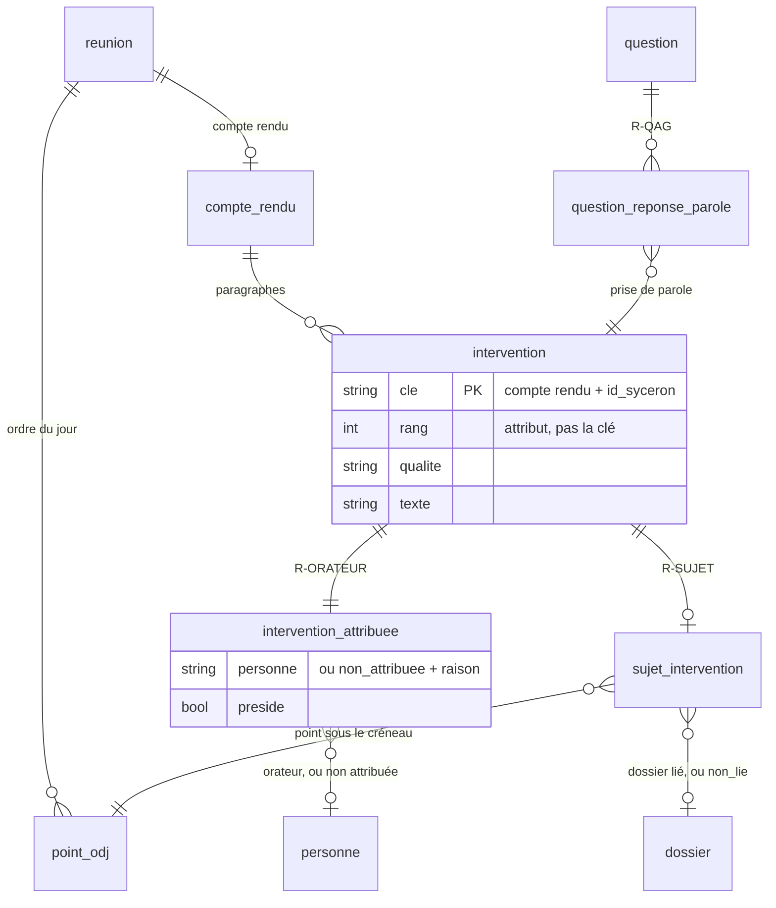

Dérivés (Z3) : `intervention_attribuee`, `sujet_intervention`, `question_reponse_parole`.

- L'identifiant d'orateur de l'Assemblée est parfois faux : orateur collectif, identifiant de
  repli, `PA0`, identifiant négatif, nom affiché qui ne correspond pas. Dans ces cas, la
  parole est **non attribuée**, avec sa raison.
- La **présidence de séance** est distinguée du débat (`preside`).
- Les **présences** n'entrent pas : la table `reunion` n'a pas de colonne pour elles, et elles
  sont filtrées avant même d'être stockées.

#### En image : gouvernement et Journal officiel

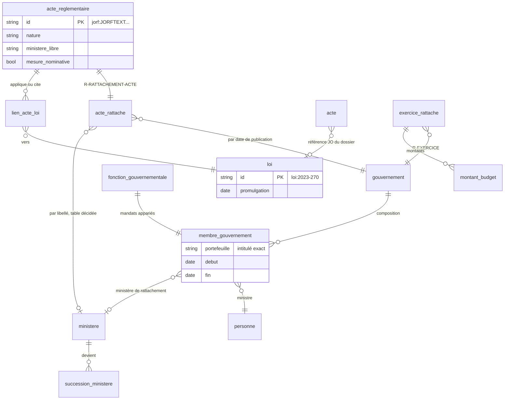

Dérivés (Z3) : `membre_gouvernement`, `acte_rattache`, `exercice_rattache`.

- Un acte réglementaire est rattaché à un **gouvernement** (par sa date) et à un
  **ministère** (par son libellé, via une table décidée). **Jamais à une personne** : le
  schéma n'a pas de relation entre `acte_rattache` et `personne`.
- Le **numéro de loi** est le lien sûr entre un dossier de l'Assemblée et le Journal officiel
  (le NOR manque souvent).
- Un ministre délégué est rattaché à son ministère de tutelle par son libellé (« auprès
  du ministre… »), confirmé par une table décidée (`rattachement_portefeuille`). Une
  co-tutelle (« auprès du ministre A et du ministre B ») garde toutes ses tutelles, dans
  l'ordre du libellé (`ministeres_tutelle`, décision du 14/11/2026, Q41) : aucune n'est choisie
  à la place de l'interface.

### 1.5.5 Couverture

`couverture` (portée, famille, période, statut, détail) où :

- **portée** = le corpus entier, une source, une population, une fiche, une section de fiche ;
- **famille** = mandats, votes, amendements, textes portés, paroles, questions, actes, budget,
  Europe, mandats locaux ;
- **statut** ∈ `complet` | `trou_source` | `borne_historique` | `non_collecte` (choix) |
  `panne` (avec date du dernier relevé réussi) | `en_cours` (travail commencé, pas fini) |
  `relu_aucun` (absence établie : source lue, date) | `non_relu` | `hors_perimetre` |
  `partiel` (lu sur une partie de la période seulement, dite par le détail ; ajouté le 13/11/2026) ;
- **détail** = numérateur, dénominateur et explication (« 3 886 prises de parole sur 3 953
  sans qualité indiquée »).

La couverture est calculée par des règles (R-COUVERTURE), jamais saisie, sauf les absences
établies, qui sont des décisions. Trous connus qu'elle déclare (mesures du 04/11/2026) :

- **scrutins XIVe** après le 24/11/2016 : `trou_source` (archive tronquée) ; 710 scrutins du
  17/07/2012 au 26/02/2014 ne nomment que les dissidents (R-NOMINATIF). Établi par
  R-CONTINUITE-SCRUTINS depuis le 13/11/2026 (issue #36), à partir des données : l'archive
  s'arrête au n° 1 354 du 24/11/2016, et des actes de dossiers de décembre 2016 citent les
  n° 1 358, 1 362 et 1 364, absents. La mesure du 04/11/2026 disait « au moins 10 scrutins cités
  par les dossiers » ; les actes de l'entrepôt g10 en citent 3. Le nombre de scrutins manquants
  n'est pas connu : la section dit le trou, sans le chiffrer ;
- **numérotation** : un contrôle de continuité par législature déclare chaque numéro manquant
  en `trou_source` (XVe : 3 781 et 3 782, mesuré de nouveau sur la g10 ; R-CONTINUITE-SCRUTINS,
  scrutins de l'Assemblée seulement : le Congrès, `VTCG…`, a sa propre numérotation) ;
- **scrutin cité absent** (scrutin AN hors archive, scrutin du Sénat `VTSN…`) : servi comme
  texte, avec son identifiant et son adresse publique s'il en a une, **sans lien interne**
  (C2 ne le vise donc pas) ;
- **ordre du jour XIVe** : `trou_source` (`Agenda_XIV` ne couvre que le 20/06/2017 →
  21/12/2018) ;
- **filtre par mot** : les amendements sans exposé ni dispositif (23 669 irrecevables et
  1 429 retirés avant publication, XVIIe) sont déclarés introuvables par mot ;
- **compte rendu provisoire** : la séance reste `en_cours` jusqu'au compte rendu définitif
  (407 interventions dans l'archive, 1 263 en ligne pour `CRSANR5L17S2027O1N051`) ;
- un **0** ou une liste vide n'est servi qu'avec le statut `complet` ou `relu_aucun` (C5). C'est elle qui fait la section « Ce qu'on n'a pas pu lire »
de chaque fiche et la page des sources.

#### En image : couverture et absences

**Une liste vide n'est jamais muette : la fiche sait, sans télécharger la section, si c'est un
vrai zéro, un trou de la source, une borne, un choix, une panne ou un travail en cours, et
l'écrit derrière « Pourquoi → ».**

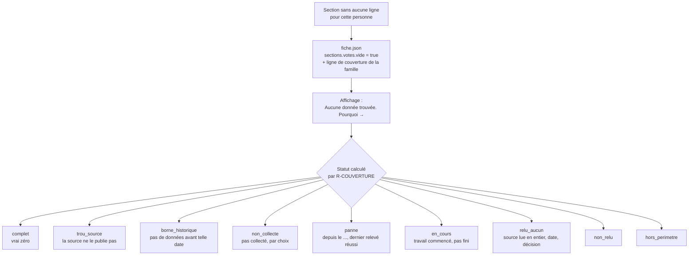

- La couverture a une **portée** (corpus, source, population, fiche, section), une
  **famille** (votes, paroles…), un **statut** et un **détail** (numérateur, dénominateur,
  explication).
- Elle est **calculée**, jamais saisie. Seule exception : l'absence établie à la main
  (« relu, aucun »), qui est une décision `absence_etablie` avec la source lue, la date et ce
  qu'elle ne couvre pas. « Relu, aucun » reste distinct de « non relu ».
- Le contrôle C5 empêche de dire « complet » quand un relevé contributeur ne l'est pas :
  dans ce cas, le statut doit être `panne`.
- Une valeur manquante est `null` avec une raison. **Jamais 0.**

Exemple, d'après la capture d'une candidate ou d'un candidat sans mandat parlementaire :
toutes les sections affichent « Aucune donnée trouvée. Pourquoi → », et « Ce qu'on n'a pas
pu lire » dit : « Nos sources ne connaissent aucun mandat parlementaire de cette personne. Il
n'y a donc ni vote, ni amendement, ni prise de parole à publier. » Avec ce modèle, cette
phrase sort de la couverture de la fiche, pas d'un texte écrit à la main.

---

## 1.6 Registre des règles

Chaque règle a : un identifiant, une version, un texte pour la page de méthodologie, ses
entrées, sa sortie, son comportement quand elle ne peut pas conclure, et un **chiffre de
couverture** recalculé à chaque mise à jour (« la matière est établie pour 711 des 1 160
positions »). La version de chaque règle est inscrite dans le manifeste de publication.

| Règle | Ce qu'elle fait | Quand elle ne conclut pas |
| --- | --- | --- |
| R-IDENTITE | **lit d'abord le registre des identités** (1.3.4) : une attribution existante ne change jamais. Puis rapproche les identités nouvelles : identifiant déclaré (Wikidata, `PA` dans une autre archive) ; sinon nom normalisé **et** date de naissance ; jamais le nom seul. Une date de naissance aberrante (avant 1900, ou sentinelle `1900-01-01` ; le RNE donne aussi 1072-03-05, relevé le 04/11/2026) ne sert pas au rapprochement | `a_relire` → file de relecture ; aucune fiche publiée tant qu'une identité de candidat n'est pas validée |
| R-PERIMETRE | calcule les populations attendues à partir des sources ; une sortie exige une raison ; écarte le Congrès (1.2.1) | personne attendue non incluse → anomalie bloquante (C7) |
| R-APPARTENANCE | appartenance à un groupe lue dans les seuls mandats GP (dates, suspension, reprise datée par `datePriseFonction`) ; **jamais** datée par l'organe que porte un scrutin (le groupe socialiste XVIe y alterne `PO800496` et `PO830170` en va-et-vient, mesuré le 04/11/2026) ni par une ligne `PO0` | « appartenance non établie » |
| R-CARRIERE | périodes de mandat et de fonction, toutes institutions. Priorités : sur une période couverte par AMO (depuis le 19/06/2002), les dates d'AMO l'emportent sur celles de Sycomore (qui diffèrent de quelques jours) ; Sycomore ne sert qu'avant ; le libellé d'un groupe du Sénat est celui, **daté**, de l'export du Sénat, jamais le libellé actuel d'AMO. Fonctions classées par famille (présidence, bureau, questure, rapport, membre…) par une table (type d'organe, qualité) → famille, publiée. À l'affichage, les périodes d'un même organe, d'une même qualité et d'une même législature séparées de N jours au plus (permutations de commission : trous de 1 à 3 jours, AMO30 du 03/11/2026) sont fusionnées, avec la durée réelle cumulée ; les périodes restent intactes dans les données | « période absente de la source » |
| R-CONTINUITE-GROUPE | relie deux organes GP d'une même législature | décision `continuite_groupe` |
| R-FILIATION | 4.3 : moyenne harmonique ≥ 60 % et ≥ 5 communs ; fusions (plusieurs prédécesseurs) et scissions | `a_trancher` → décision |
| R-ARBITRAGE-ARCHIVES | pour une législature close : siège et position déclarée lus dans l'archive figée **si elle est postérieure à la clôture** ; dates de fin et corrections lues dans l'archive la plus récente ; XIVe : siège lu dans le **seul** fichier des places (état du 20/06/2017), les sièges de l'AMO20 XIVe (mars 2018) étant ceux de 2018. Un mandat présent dans une archive figée mais effacé de la courante (relevé complet) est : une **correction** si la courante porte un remplaçant (même personne, même organe, période qui recouvre l'ancienne) — l'ancien mandat est retiré, le remplaçant affiché, le rapport annonce « corrigé par la source » ; un **retrait à la source** sinon — le mandat disparaît du site, le rapport le nomme (décision du 04/11/2026, doc. 5, Q4) | — |
| R-BANC / R-PERIODE | bancs déclarés, datés ; périodes de position. **XVIIe : aucun des 14 groupes ne déclare de position** (mesuré le 04/11/2026, AMO30 et AMO10) : tous les bancs sont « non déclarés » et les périodes ne changent qu'avec le gouvernement. La position déclarée reste collectée chaque soir : si un groupe en déclare une, elle est prise en compte d'elle-même | le site publie « non déclaré » (jamais déduit, jamais cherché ailleurs ; décision du 04/11/2026, doc. 5, Q2) |
| R-NOMINATIF | une position individuelle n'existe que si la source **nomme** le votant. XIVe : 710 scrutins (17/07/2012 → 26/02/2014) en mode « dissidents seuls » ne nomment que les dissidents ; les autres membres ont « position non nominative », jamais déduite de celle du groupe | « position non nominative » |
| R-NATURE-SCRUTIN | d'abord le **code** de type (`MOC` → `motion_censure`) ; puis l'intitulé normalisé (apostrophes, coquilles) : motifs écrits + exceptions décidées. « L'ensemble de la première partie… », « la première partie du PLF… » → `partie_de_texte` (10 en XVIIe), qui n'est pas un vote sur l'ensemble ; « la proposition de loi… », « le projet de loi… » en tête → `ensemble` (16 en XVIIe, dont les résolutions de l'article 34-1 : statut en question, doc. 5, Q20) | `non_etablie` (le scrutin ne compte pas dans les positions « ensemble ») |
| R-ORIGINE | projet / proposition d'après l'intitulé officiel, recoupé par le préfixe du document | `non_etablie` |
| R-LIEN-SCRUTIN-DOSSIER | routes, dans l'ordre : référence directe (XVIIe), acte qui cite le scrutin, séance du scrutin = réunion d'un acte de discussion ou de décision ; quand la séance mène à plusieurs dossiers, départage par le titre **parmi ces seuls dossiers**. Accord exigé quand plusieurs routes répondent. Mesuré sur la XVIIe (archive du 03/11/2026) : 3 924 scrutins par les deux premières routes, + 4 021 par la séance (2 761 conformes sur 2 762 recoupés), + 1 163 par le départage (587 sur 588), soit 9 108 sur 9 578 ; les 225 votes sur l'ensemble sont tous reliés | pas de lien + alerte « désaccord » ; 401 cas ambigus et 69 sans séance restent non liés |
| R-DERNIERE-LECTURE | scrutin `ensemble` le plus récent du dossier, sur tout le corpus ; égalité de date → numéro le plus grand. Version 2 (13/11/2026, Q32) : un vote sur l'ensemble plus récent, relié à aucun dossier mais dont ce dossier est candidat, est nommé (`votes_posterieurs_non_relies`) ; le vote retenu reste | position non retenue |
| R-MATIERE | commission saisie au fond à l'Assemblée, lue dans le dossier ; un dossier saisi au fond au seul Sénat reçoit la matière « saisi au Sénat seulement » (521 dossiers XVIIe, archive du 03/11/2026 ; décision du 04/11/2026, doc. 5, Q19) | « matière non établie » |
| R-SORT-FINAL / R-ETAPE | conclusion des actes, pas leur code ; « COM » ne prouve pas l'examen. Le **49.3** se lit dans l'acte `DeclarationGouvernement_Type` dont `fam_code = "Art.49.3"` (XVIIe : 16 engagements sur 11 dossiers, archive du 04/11/2026), jamais dans la conclusion, qui ne le dit que 5 fois. Un texte européen est « sorti de la phase préparatoire » d'après le stade atteint publié par Parltrack. Codes de conclusion classés d'après leur libellé ; un code non classé (`TSORTMOT01` « Motion adoptée », `TSORTFnull`) n'est jamais deviné : raison `conclusion_non_classee`, nommé par A7 (13/11/2026, issue #45) | « sort non connu » |
| R-LOI-DOSSIER | loi ↔ dossier par le numéro de loi de l'acte de promulgation ; à défaut (loi promulguée sous la législature suivante : 71 des 1 085 lois publiées depuis 2012, cahier 3.1.4), départage par le titre **parmi les seuls** dossiers de la législature close adoptés définitivement sans promulgation | « loi non rattachée » + A3 ; décision `rattachement_loi` |
| R-TEXTE-PORTE | rôle ; projet de loi = initiative gouvernementale, pas acte personnel | — |
| R-DEPOT-GOUVERNEMENT | un projet de loi est rattaché au gouvernement en fonction à la date de son **premier dépôt** (dans l'une ou l'autre chambre) ; ministère porteur = ministère du mandat MINISTERE cité comme auteur du document de dépôt (cahier 3.1.1), via `fonction_gouvernementale` | « ministère porteur non établi » |
| R-AMENDEMENT | copies dédoublonnées par la clé (`examenRef`, `numeroLong`) : 346 paires `B`/`BTC` dans l'archive XVIIe du 03/11/2026 (143 766 amendements pour 144 112 uid). La copie retenue est celle dont le texte égale celui de l'examen (la `BTC`, aussi la plus récente par `chronotag`) ; l'autre uid reste un **alias** (il a une adresse publique). Un amendement compte une fois ; si deux copies divergeaient, la liste de signatures retenue est celle de la copie retenue, et A4 le signale | — |
| R-SORT-AMENDEMENT | table (état, sous-état, contexte) → sort, publiée en annexe de la méthodologie | « sort non établi » |
| R-POSITION-GROUPE | décomptes des membres à la date ; position majoritaire **publiée par la source** | « position du groupe non établie » |
| R-RATIO | les décomptes d'un groupe (numérateur, dénominateur, couverture à la date) sont **toujours calculés et servis** ; le ratio lui-même n'est **jamais servi** : l'interface le calcule, ou affiche « N/D » sous le seuil de couverture, qui est un réglage de l'interface publié sur la page de méthodologie (décision du 04/11/2026, doc. 5, Q1) | « N/D » (à l'affichage) |
| R-DIVERGENCE | 5 conditions de 4.2 | pas de point sur la bande |
| R-ORATEUR | attribue une prise de parole ; orateur collectif, interpellation, personne hors Assemblée, identifiant de repli (2021 en XVe ; `PA793214` en XVIIe), `PA0`, identifiant négatif (`PA-125869`), **nom affiché qui ne correspond pas à l'identifiant** (39 paragraphes XVIIe, dont une ministre déléguée portant l'identifiant de Ruffin) → non attribuée. Présidence reconnue par `roledebat` **ou** par le libellé (« M. le président », « Mme la présidente ») : l'attribut manque sur 60 275 des 110 110 paragraphes de présidence XVIIe | `non_attribuee` + raison |
| R-QUALITE | qualité d'un orateur attribué : celle du compte rendu (`qualite`, vide pour 82 % des paragraphes attribués, Syceron XVIIe du 03/11/2026), sinon déduite des fonctions **à la date** de la séance : membre du gouvernement, sinon rapporteur du dossier du point (acte), sinon député ; l'origine (`compte_rendu` / `fonction_a_la_date`) est gardée et comptée dans la méthodologie. Paroles d'un gouvernement = membre à la date **et** qualité de membre du gouvernement (décision du 04/11/2026 ; qualité déduite : doc. 5, Q21) | « qualité non établie » |
| R-SUJET | sujet = niveau sous le créneau ; codes propres aux lois de finances | « intitulé non publié » |
| R-QAG | question au gouvernement ou orale sans débat ↔ point « question » d'un compte rendu (R-SUJET) : séance au plus 10 jours avant la date publiée de la question, qui est celle du JO (d'ordinaire le lendemain de la séance), **et** auteur qui y parle, par identifiant (R-ORATEUR, présidence et interruptions exclues), **et** intitulé du point égal à l'en-tête du bloc JO (seul titre publié en XVe) ; séance la plus proche ; aucun repli sur l'auteur seul ; un point partagé par deux questions est découpé à la prise de parole de chaque auteur (décision du 13/11/2026, doc. 5, Q38). Mesuré le 13/11/2026 : 98 % des questions au gouvernement de la XVe à la XVIIe appariées | `non_appariee` + raison (`intitule_different`, `auteur_sans_parole`, `seance_non_lue`, `ambigu`, `sans_date`, `titre_non_publie`) |
| R-COMPOSITION / R-VAGUE | ministres par ministère ; un délégué est rattaché à sa tutelle par le libellé (« auprès du ministre… », 322 libellés sur 758 : aucun champ ne le dit), confirmé par une table décidée (`rattachement_portefeuille`) ; vague = nominations à < 8 jours. La succession des ministères n'existe à la source que depuis le gouvernement Borne. Un mandat GOUVERNEMENT sans mandat MINISTERE apparié n'entre pas dans la composition (7 dans le gouvernement Bayrou, restés ouverts alors que la même personne a un mandat Bayrou clos ; AMO30 du 03/11/2026) : signalé par A8 | « rattachement non établi » |
| R-RATTACHEMENT-ACTE | date de publication → gouvernement ; libellé → ministère (table décidée) | « ministère non précisé » |
| R-MESURE-NOMINATIVE | un acte est une mesure nominative s'il est rangé sous la rubrique « Mesures nominatives » du sommaire du JO (`JORFCONT`) | « non établi » |
| R-EXERCICE | LFI → gouvernement promulgateur | — |
| R-HEMICYCLE | siège par législature : archive figée, fichier des places (XIVe), constat daté (législature en cours) | « siège non connu » |
| R-TERME-LEGAL | terme légal d'une législature = date d'expiration des pouvoirs de l'Assemblée fixée par le code électoral (article LO 121, texte cité dans la méthodologie), comptée depuis son élection | — |
| R-COUVERTURE | statuts de couverture ; trous connus (1.5.5) | — |
| R-CONTINUITE-SCRUTINS | trous de l'archive des scrutins de l'Assemblée (`trou_scrutins`) : numéros absents entre 1 et le plus grand numéro lu, datés par les scrutins qui les encadrent ; archive tronquée d'une législature close, quand un acte de dossier cite un scrutin absent postérieur au dernier scrutin lu. Les sections de votes touchées pendant la période d'un maillon ou d'un mandat passent en `trou_source`, le trou dit en clair (13/11/2026, issue #36) | aucun trou déclaré ; une législature en cours n'est jamais dite tronquée |

---

## 1.7 Les données servies au site

### 1.7.1 Principes

- **Une fiche ne télécharge que ce qu'elle affiche** (4.7). Chaque fiche est découpée en un
  fichier d'en-tête léger, chargé tout de suite, et des fichiers de section chargés quand la
  section approche de l'écran ou quand le lecteur l'ouvre. Les textes longs (exposés
  d'amendements, extraits de parole) sont dans des fichiers à part, chargés au clic ou pour
  les seuls résultats d'un filtre.
- **Fichiers servis pré-compressés** (`.json.gz`), décompressés dans le navigateur
  (`DecompressionStream`) : le site au format JSON brut ferait ≈ 0,82 Go pour XIVe–XVIIe et
  +0,37 Go par législature, donc dépasserait la limite de 1 Go de GitHub Pages pendant la
  XVIIe ; compressé, ≈ 0,21 Go (calculé sur prototype, doc. 4, 4.1.4). Le transfert ne change
  pas (Pages compressait déjà).
- **Filtre par mot par index** : chaque fiche a un index de mots (mot normalisé → textes qui
  le contiennent) découpé par les **deux premières lettres** du mot et par année ; un mot ne
  charge que sa tranche, puis les textes trouvés. Mesuré sur le prototype : 0,46 Mo au plus
  pour la lignée socialiste XVIIe au lieu de 7,7 Mo (doc. 4, 4.2.4).
- **Ordre neutre** (règle 1) : chaque liste de personnes ou de groupes déclare dans son schéma
  un ordre parmi alphabétique, chronologique, ordre de l'hémicycle ou ordre protocolaire
  publié par la source (`preseance`, sinon alphabétique) ; jamais un ordre par un compte. C4
  vérifie l'ordre servi.
- **Étiquettes thématiques** (matière, domaine EuroVoc, rubrique d'une question) : champ
  marqué `aide_a_la_lecture` dans le schéma ; l'interface et la méthodologie le disent
  (règle 8).
- **Comptes** : chaque compte porte sa date (`au`). Sur un maillon ou une législature close,
  `au` est la date de fin, et le compte ne prend que les faits de la période d'appartenance,
  jamais la situation actuelle des anciens membres. Un compte par thème est accompagné du
  compte des objets **distincts**.
- **Chaque fichier se suffit à lui-même** : il embarque les libellés des objets qu'il cite
  (titre de dossier, nom de commission). On paie un peu de stockage (duplication entre
  fiches) pour économiser des requêtes sur téléphone.
- **Format colonnes** pour les listes longues : `{"colonnes": [...], "lignes": [[...], ...]}`
  plutôt qu'une liste d'objets (les noms de champs ne sont pas répétés ; le gain est mesuré
  dans le document 4).
- **Chaque élément affiché renvoie à une source** : un index `src` vers la table `sources`
  du fichier (adresse publique + licence) ; les `licences` d'un fichier sont exactement
  l'union de celles de ses `src` (C4).
- **Chaque liste est accompagnée de sa couverture** et chaque compte de **sa date**.
- **Aucun champ libre** : un schéma JSON par type de fichier, en liste blanche ; un champ
  inconnu fait échouer la publication (garantie des règles 2 et 3).

### 1.7.2 Arborescence

Toutes les données d'une publication vivent sous un préfixe qui lui est propre
(`/donnees/<id-publication>/`), et le code du site, déployé avec elles, connaît cet
identifiant. Un lecteur qui a chargé la page avant une publication et demande ensuite une
section reçoit soit un fichier de **la même** publication, soit une erreur 404 qui provoque
le rechargement de la page : il ne voit jamais un mélange de deux publications (la
documentation de GitHub Pages ne garantit pas l'atomicité d'un déploiement, d'où ce
mécanisme). Le contrat (`1.0`) est écrit dans le manifeste et dans chaque fichier.

```
/donnees/<id-publication>/                tous les fichiers de données en .json.gz (1.7.1)
  manifeste.json                       version du contrat, date, empreinte de chaque fichier
  catalogue/personnes.json.gz          fiches publiées (nom, adresse, drapeaux) — fil d'Ariane
  catalogue/groupes.json.gz  lignees.json.gz  gouvernements.json.gz  legislatures.json.gz
  catalogue/articles.json.gz           articles datés : date, titre, période couverte, adresse
  accueil.json.gz                      frise législatures × gouvernements, hémicycle courant, articles
  sources.json.gz  methodologie.json.gz  fraicheur.json.gz
  personnes/<adresse>/
    fiche.json.gz                      en-tête, en bref (frise + compteurs), couverture, licences
    fonctions.json.gz
    proposes.json.gz                   textes portés + amendements (sans exposés)
    proposes-textes-<annee>.json.gz    exposés des amendements (clic, résultats d'un filtre)
    votes.json.gz                      positions retenues, par période, avec texte et sort
    divergences.json.gz                bande chronologique (positions + position du groupe)
    paroles.json.gz                    index : sujet, date, qualité, période (sans texte)
    paroles-textes-<semestre>.json.gz  extraits (≈300 caractères) + lien du paragraphe
    questions.json.gz                  questions (écrites, au gouvernement, orales) avec réponse et prises de parole liées
    europe.json.gz                     volet européen, s'il existe
    mots/<annee>-<xx>.json.gz          index de mots : tranche des mots commençant par « xx »
  lignees/<adresse>/
    fiche.json.gz  membres.json.gz  paroles.json.gz  proposes.json.gz
    votes-<legislature>.json.gz  avec-qui-<legislature>.json.gz
    paroles-textes-<semestre>.json.gz  proposes-textes-<annee>.json.gz  mots/<annee>-<xx>.json.gz
  gouvernements/<adresse>/
    fiche.json.gz  composition.json.gz  paroles.json.gz  deposes.json.gz  budgets.json.gz
    actes.json.gz                      agrégats par ministère et par nature (sans la liste)
    actes-<aaaa-mm>.json.gz            liste des actes d'un mois (Borne : ≈ 49 500 actes, 11,8 Mo bruts en un seul fichier)
    paroles-textes-<semestre>.json.gz  mots/<annee>-<xx>.json.gz
  legislatures/<numero>/
    fiche.json.gz  hemicycle.json.gz  ordre-du-jour-<annee>.json.gz  textes.json.gz  commissions.json.gz
  articles/<date>-<titre>/donnees.json.gz  copie figée, jamais régénérée
```

Le filtre par période (6 ou 12 derniers mois) s'applique côté navigateur sur les dates déjà
chargées ; les textes de parole étant découpés par **semestre** (et les exposés par année), le
filtre ne télécharge que les tranches récentes. L'adresse de la page porte les filtres
(`?periode=12m&mot=logement`). Les fiches de gouvernement et de législature listent leurs
« articles de la période » en lisant `catalogue/articles.json.gz` (chevauchement de dates).

#### En image : ce que télécharge le navigateur

**Une fiche est un petit fichier d'en-tête, chargé tout de suite, et des fichiers de section,
chargés quand on s'en approche ; chaque section est produite par quelques objets du graphe et
quelques règles nommées.**

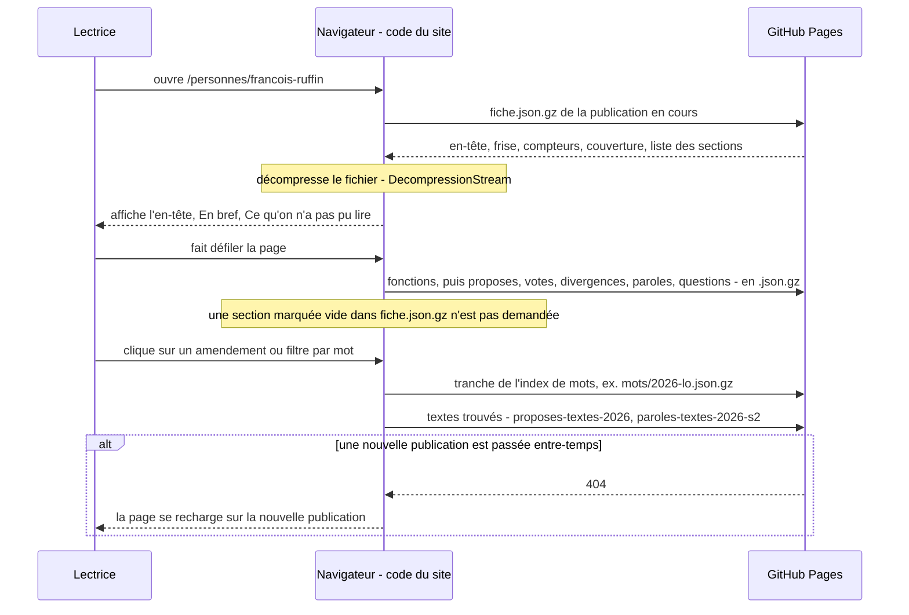

- Tous les fichiers d'une publication sont rangés sous `/donnees/<id-publication>/`. Le code
  du site connaît cet identifiant. La lectrice voit donc **une** publication complète,
  jamais un mélange de deux.
- Chaque fichier **embarque les libellés** qu'il cite (titre de dossier, nom de commission) :
  un peu de duplication, beaucoup moins de requêtes sur téléphone.
- Les fichiers de données sont publiés **déjà compressés** (`.json.gz`) et décompressés par
  le navigateur : le site tient ainsi en ≈ 0,21 Go au lieu de ≈ 0,82 Go, sous la limite de
  1 Go de GitHub Pages (calculé, doc. 4, 4.1.4). Dans la suite, les noms de fichiers omettent
  l'extension `.gz`.
- Le filtre par période (6 ou 12 mois) agit sur les dates déjà chargées ; les extraits de
  parole sont découpés par semestre, les exposés par année. Le filtre par mot charge d'abord
  la tranche d'un **index de mots** (les mots qui commencent par les deux mêmes lettres, pour
  une année), puis les seuls textes trouvés. L'adresse de la page porte les filtres
  (`?periode=12m&mot=logement`).

### 1.7.3 Contenu minimal de `fiche.json.gz` (personne), une fois décompressé

```json
{
  "contrat": "1.0",
  "genere_le": "2026-11-04T21:40:00Z",
  "personne": {"id": "per:000123", "nom": "…", "profession": {"valeur": "…", "src": 0},
               "naissance": {"date": "1975-10-18", "lieu": "…", "src": 0},
               "groupe_actuel": {"adresse": "/groupes/…", "libelle": "…", "src": 1}},
  "carriere": {"colonnes": ["institution","debut","fin","libelle","banc","siege","lien","src"], "lignes": [...]},
  "compteurs": [{"famille": "votes", "valeur": 152, "au": "2026-11-03", "couverture": "complet"}],
  "sections": {"votes": {"fichier": "votes.json.gz", "taille": 18342, "vide": false}, ...},
  "couverture": [{"famille": "paroles", "statut": "trou_source", "detail": "…"}],
  "fraicheur": {"an": "2026-11-03", "pe": "2026-11-01 (panne depuis le 2026-11-02)"},
  "licences": ["etalab-2.0", "cc-by-4.0"],
  "sources": [{"url": "https://…", "licence": "etalab-2.0", "libelle": "…"}]
}
```

Les **licences d'une fiche** sont l'union des licences des sources de ses faits (calculée,
jamais saisie). `sections.*.vide` et la couverture permettent d'afficher « Aucune donnée
trouvée. Pourquoi → » sans télécharger le fichier de section.

### En image : comment une fiche se compose

#### La fiche de François Ruffin, section par section

Exemple : François Ruffin, `an:PA722142`, adresse `/personnes/francois-ruffin`, d'après les
captures du site actuel (04/11/2026). Les chiffres marqués « mesuré » viennent des mesures du
04/11/2026 sur les archives de l'Assemblée (`livrables/annexes/mesures/`). L'identifiant
`per:000123` est un exemple.

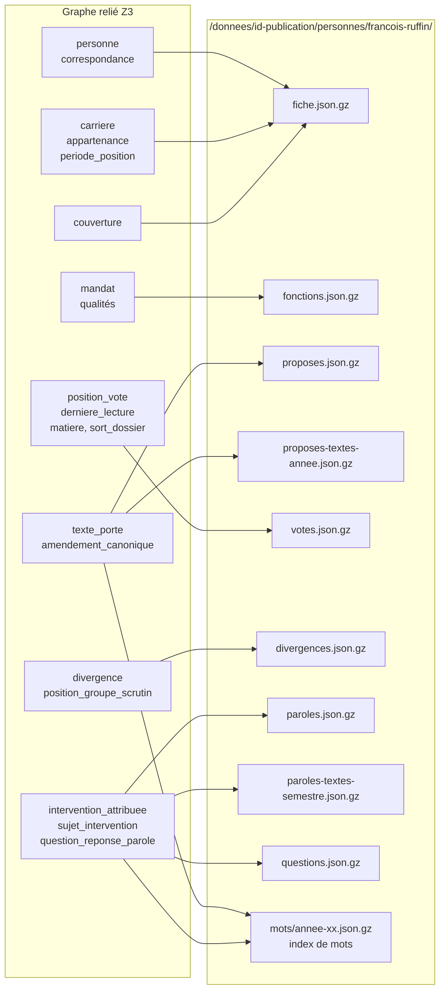

##### En-tête

> François Ruffin — Reporter · Groupe Écologiste et Social. Né le 18 octobre 1975 à Calais
> (Pas-de-Calais). [Source]

| Ce qu'on voit | Objet | Règle | Fichier |
| --- | --- | --- | --- |
| nom, profession, date et lieu de naissance | `personne` (identité retenue, et la source de chaque champ) ; une catégorie socioprofessionnelle publiée par l'Assemblée comme profession (« (33) - … ») perd son code et porte `nature` = `categorie_socioprofessionnelle` (doc. 5, Q39) | R-IDENTITE | `fiche.json` → `personne` |
| groupe actuel, avec lien | `appartenance` en cours → `groupe` (`grp:17:…`) → sa `lignee` | R-APPARTENANCE, R-FILIATION | `fiche.json` → `personne.groupe_actuel` |
| bouton « Source » | index `src` vers la table `sources` du fichier | — | `fiche.json` → `sources` |

Chaque valeur porte son `src`. Une valeur inconnue est `null` avec une raison, jamais vide
sans explication.

##### En bref

La frise montre trois mandats de député (2017, 2022, 2024), chacun avec son groupe et son
banc.

| Ce qu'on voit | Objet | Règle | Fichier |
| --- | --- | --- | --- |
| frise datée, par institution, chaque période reliée à sa législature | `carriere` | R-CARRIERE | `fiche.json` → `carriere` (en colonnes) |
| « FI · opposition », puis « ECOS » sans banc | `periode_position`, `position_declaree` | R-BANC, R-PERIODE | `fiche.json` → `carriere.banc` |
| siège par législature | `siege` | R-HEMICYCLE, R-ARBITRAGE-ARCHIVES | `fiche.json` → `carriere.siege` |
| compteurs datés par institution | comptes du graphe, avec leur date et leur couverture | R-COUVERTURE | `fiche.json` → `compteurs` |

- Le siège montre pourquoi l'entrepôt garde **toutes** les versions. Mesuré : Ruffin a le
  siège 627 dans l'archive figée de la XVe, 637 dans celle de la XVIe, et l'archive courante
  écrit 505 sur ses trois mandats. Seule l'archive figée dit le siège d'une législature close.
- Le groupe change trois fois (FI en XVe, LFI-NUPES en XVIe, ECOS en XVIIe) : ce sont trois
  groupes de trois législatures, chacun dans sa lignée.
- ECOS n'a pas de banc affiché : en XVIIe, aucun groupe ne déclare sa position. Le site écrit
  « non déclaré », il ne le devine pas.
- Poids mesuré : sa frise brute (141 mandats) pèse 1,4 Ko compressée ; la frise par
  institution tient en 9 lignes.

##### Les fonctions exercées

> Commissions · 9 intitulés · sur 9 ans 4 mois de mandat. 6 ans 5 mois : Commission des
> affaires économiques · Secrétaire…

| Ce qu'on voit | Objet | Règle | Fichier |
| --- | --- | --- | --- |
| fonctions par famille d'organe, avec durée et qualité (président, secrétaire, rapporteur…) | `mandat` (qualité, dates) → `organe` (type), mis en périodes par `carriere` | R-CARRIERE | `fonctions.json` |

Mesuré : 141 mandats pour Ruffin dans l'archive des acteurs de la XVIIe, dont 105 de
commissions permanentes, surtout des allers-retours de quelques jours.

##### Ce qu'il a proposé

> Les textes qu'il a portés : 2 examinés en commission, 3 discutés en séance, 0 adopté, 1
> promulgué ; 1 adopté sans vote (49.3, fait procédural). Les amendements dont il est l'auteur,
> par commission.

| Ce qu'on voit | Objet | Règle | Fichier |
| --- | --- | --- | --- |
| textes portés, par étape, avec matière et sort | `texte_porte`, `etape_dossier`, `matiere`, `sort_dossier` | R-TEXTE-PORTE, R-ETAPE, R-MATIERE, R-SORT-FINAL | `proposes.json` |
| « adopté sans vote (49.3) » | `sort_dossier.par_49_3` | R-SORT-FINAL | `proposes.json` |
| amendements **dont il est l'auteur principal**, par commission et par année, avec sort | `amendement_canonique` | R-AMENDEMENT, R-SORT-AMENDEMENT | `proposes.json` (sans exposés) |
| exposé d'un amendement, au clic ou sous filtre par mot | `amendement` | — | `proposes-textes-<annee>.json` |

- Mesuré, XVIIe : 136 amendements comme auteur principal, et 13 763 signatures comme
  cosignataire. Les deux ne se mélangent jamais.
- Pourquoi séparer les exposés : mesuré, sa liste d'amendements pèse 2,2 Ko compressée sans
  exposés, 45 Ko avec.
- Un 49.3 est un **fait de procédure** : il apparaît comme sort du dossier, jamais comme une
  position de vote (contrôle C4).

##### Ce qu'il a voté

> Sur 152 scrutins de textes en dernière lecture. Banc non publié · gouvernement Lecornu II.
> Par matière : Lois, 6 contre · 3 pour…

C'est la section la plus chargée en règles. Le schéma suit une position, de la source à
l'écran.

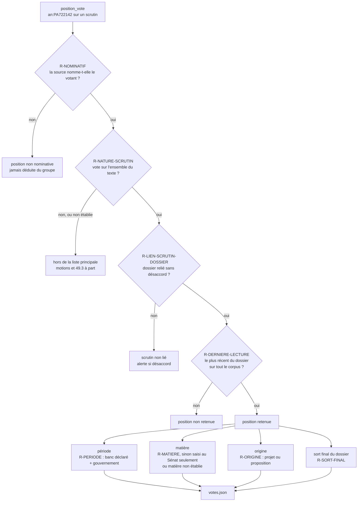

- Chaque position écartée l'est **avec sa raison** : le contrôle C3 vérifie que faits lus =
  faits servis + faits écartés avec raison.
- Mesuré, XVe à XVIIe : 1 729 positions nominatives de Ruffin, dont 282 sur l'ensemble d'un
  texte. La dernière lecture en garde moins (152 sur la capture du site actuel).
- Poids mesuré : la liste « ensemble d'un texte » pèse 2,9 Ko compressée.

##### Où il a voté autrement que son groupe

> Ce qui est comparable : 152 scrutins utilisés, 14 où son groupe s'est divisé. Puis une bande
> chronologique, et la liste des scrutins où il n'a pas voté comme la majorité de son groupe.

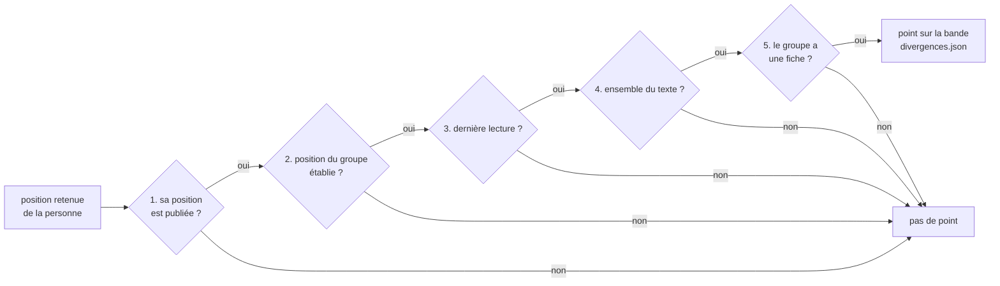

| Ce qu'on voit | Objet | Règle | Fichier |
| --- | --- | --- | --- |
| son groupe **à la date** du scrutin | `appartenance` | R-APPARTENANCE | `divergences.json` |
| la position majoritaire du groupe, **publiée par la source** | `position_groupe_scrutin` | R-POSITION-GROUPE | `divergences.json` |
| sa position à côté, scrutin par scrutin | `divergence` | R-DIVERGENCE | `divergences.json` |

**Jamais de total.** « A voté contre son groupe 47 fois » est interdit. Le fichier n'a aucun
champ pour un total, et le contrôle C4 cherche ce motif.

##### Ce qu'il a dit

> Banc non publié · gouvernement Lecornu II. Nature : Débats sur un texte de loi 94, Questions
> écrites et orales 38… Sujet : Projet de loi de finances pour 2026, 85…

| Ce qu'on voit | Objet | Règle | Fichier |
| --- | --- | --- | --- |
| prises de parole par qualité, par période, par sujet | `intervention_attribuee`, `sujet_intervention` | R-ORATEUR, R-SUJET | `paroles.json` (index sans texte) |
| extrait d'environ 300 caractères et lien vers le paragraphe | `intervention` | — | `paroles-textes-<semestre>.json` |
| questions (écrites, au gouvernement, orales) avec réponse et prises de parole liées | `question`, `question_reponse_parole` | R-QAG | `questions.json` |
| présidence de séance à part | `intervention_attribuee.preside` | R-ORATEUR | `paroles.json` |

- Mesuré, XVIIe : 193 paragraphes attribués à Ruffin. Un paragraphe de plus porte son
  identifiant mais le nom d'une ministre déléguée (Alice Rufo) : R-ORATEUR le classe **non
  attribué**, il n'apparaît pas sur sa fiche.
- Poids mesuré : l'index sans extraits pèse 2,7 Ko compressé, avec extraits 20,8 Ko. D'où le
  découpage par période.

##### Ce qu'on n'a pas pu lire

> Majorité ou opposition : l'Assemblée ne l'a pas déclaré pour 1 de ses 3 mandats. Votes :
> sur ses 152 votes, 9 n'ont pas de commission connue et 6 n'ont pas de sort connu. Prises de
> parole : sur 3 953, 3 886 n'indiquent pas à quel titre la personne parlait. Avant juin
> 2002 : nos sources ne connaissent aucun mandat avant le 19 juin 2002.

| Ligne affichée | D'où elle vient |
| --- | --- |
| Majorité ou opposition | couverture de R-BANC : banc « non déclaré » pour un mandat |
| Votes sans commission, sans sort | couverture de R-MATIERE (« saisi au Sénat seulement », « matière non établie ») et de R-SORT-FINAL (« sort non connu ») |
| Prises de parole sans qualité | couverture de la qualité dans `intervention` |
| Avant 2002 | couverture des mandats : borne de l'historique, ou absence établie si Sycomore a été relu (décision `absence_etablie`) |

Tout vient de `fiche.json` → `couverture`. Aucun texte n'est écrit à la main : chaque ligne
est calculée par R-COUVERTURE, avec numérateur et dénominateur (1.5.5, « En image : couverture
et absences »).

##### Pied

Les **licences** de la fiche sont l'union des licences des sources de ses faits, calculée
(`fiche.json` → `licences`). Pour Ruffin, sans volet européen : la Licence Ouverte de
l'Assemblée. Une fiche qui affiche des votes européens tirés de Parltrack ajouterait l'ODbL.

#### La fiche d'une lignée (exemple : les socialistes)

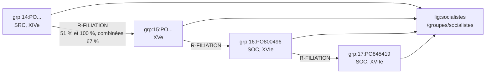

| Section | Objets et règles | Fichier |
| --- | --- | --- |
| En-tête, En bref (maillons, effectif jour par jour, banc déclaré) | `lignee`, `groupe`, `filiation`, `appartenance`, `position_declaree` (avec `divergente`) — R-FILIATION, R-CONTINUITE-GROUPE, R-BANC | `fiche.json` |
| Qui sont-ils (arrivées, départs, passages) | `appartenance`, `population` (drapeau candidat) | `membres.json` |
| Sur quoi ils ont pris la parole | paroles des membres **pendant leur appartenance** | `paroles.json` |
| Ce qu'ils ont proposé | `texte_porte`, `amendement_canonique` des membres pendant leur appartenance ; signatures à part | `proposes.json` |
| Ce qu'ils ont voté | `position_groupe_scrutin` : décompte des membres à la date, numérateur et dénominateur | `votes-<legislature>.json` |
| Avec qui ils votent | positions majoritaires des groupes de la législature, `place_mediane` — R-HEMICYCLE | `avec-qui-<legislature>.json` |
| Ce qu'on n'a pas pu lire | `couverture` par maillon | `fiche.json` |

Le chiffre 67 % vient de l'exemple du cahier (filiation de 2017). L'adresse d'un maillon
(`/groupes/socialistes/17`) redirige vers la fiche de la lignée, ouverte sur sa législature.

#### La fiche d'un gouvernement (exemple : Borne)

| Section | Objets et règles | Fichier |
| --- | --- | --- |
| En-tête, En bref (période, composition, vagues, majorité, projets de loi, 49.3) | `organe` GOUVERNEMENT, `membre_gouvernement` — R-COMPOSITION, R-VAGUE (nominations à moins de 8 jours) ; `position_declaree` des groupes à la date ; `sort_dossier` | `fiche.json` |
| Qui le composait | `membre_gouvernement`, ministère de rattachement — décision `rattachement_portefeuille` si le libellé ne suffit pas | `composition.json` |
| Sur quoi ils ont pris la parole | paroles pendant la fonction **et** en qualité de membre du gouvernement (tranché le 04/11/2026) | `paroles.json` |
| Ce qu'il a fait déposer | `texte_porte` rôle `initiative_gouvernementale`, `matiere`, `sort_dossier` | `deposes.json` |
| Ce qu'il a fait entrer en vigueur | `acte_rattache` — R-RATTACHEMENT-ACTE ; table `libelle_ministere` décidée ; jamais à une personne | `actes.json` (agrégats par ministère) et `actes-<aaaa-mm>.json` (la liste, mois par mois : ≈ 49 500 actes sous Borne) |
| Les budgets qu'il a fait voter | `exercice_rattache`, `montant_budget` — R-EXERCICE | `budgets.json` |
| Ce qu'on n'a pas pu lire | `couverture` (par exemple pas de textes avant le 20/06/2012) | `fiche.json` |

#### La fiche d'une législature (exemple : XVIIe)

| Section | Objets et règles | Fichier |
| --- | --- | --- |
| En-tête (période, mode de fin) | `leg:17` ; mode de fin par décision `fin_legislature` avec le décret, car l'Assemblée ne le publie pas | `fiche.json` |
| En bref (gouvernements, députés, lois, votes solennels, 49.3, censures) | comptes datés du graphe | `fiche.json` |
| Qui siégeait | `groupe`, effectif à une date, `place_mediane` — R-HEMICYCLE | `hemicycle.json` |
| À l'ordre du jour | `reunion` confirmées, `point_odj`, dossiers liés ou déclarés non liés | `ordre-du-jour-<annee>.json` |
| Les textes de la législature | `dossier`, `etape_dossier`, `sort_dossier`, `matiere` | `textes.json` |
| Le travail des commissions | `matiere` (commission saisie au fond), `etape_dossier` | `commissions.json` |

### 1.7.4 Jeu de données téléchargeable

Publié comme **actifs de *releases*** du dépôt public (pas sur GitHub Pages : il en
dépasserait la limite de 1 Go) : `donnees-derniere`, remplacée à chaque publication, et une
édition datée **par mois** (`donnees-<aaaa-mm>`), qui fige la dernière publication du mois.
Une édition datée chaque jour ferait ≈ 190 Go par an (≈ 0,53 Go par édition, calculé, doc. 4,
4.1.5) ; une par mois, ≈ 6 Go. Référencé sur data.gouv.fr par l'adresse stable et les
adresses mensuelles.

- Un paquet par **régime de licence** : `empreinte-etalab` (Licence Ouverte) et
  `empreinte-odbl` (tout ce qui dérive de Parltrack, partagé à l'identique), plus
  `empreinte-ccby` (PE, EuroVoc) ; chaque paquet contient ses fichiers Parquet et CSV, un
  `datapackage.json` (schéma, sources, licence) et un `LISEZMOI`.
- Les faits repris de Wikipédia, Sycomore et du fichier des places n'y figurent que comme
  faits (dates, fonctions), avec le lien de la source, conformément à 2.2.
- Les tables publiées sont celles de Z3 utiles à la réutilisation (personnes, mandats,
  groupes, lignées, scrutins classés, positions, amendements canoniques, signatures — la
  **liste complète des cosignataires** y est —, dossiers, liens, actes rattachés, couverture),
  jamais les indices de contrôle.
- L'**entrepôt public** (Z0, Z1 sur les *releases*) est lui aussi un jeu republié : chaque
  segment ne contient qu'une source (doc. 2, 2.4) et déclare sa licence ; les segments
  Parltrack sont sous ODbL, ce que dit le `LISEZMOI` des *releases* de l'entrepôt. Sycomore,
  Wikipédia et le fichier des places n'y ont que des faits.
- EuroVoc (CC BY 4.0, modifications à indiquer) : la page des sources et le `datapackage.json`
  disent ce qui est modifié (libellé français extrait, hiérarchie réduite au domaine).

---

## 1.8 Évolution du modèle

| Changement | Ce qui se passe | Ce qui ne bouge pas |
| --- | --- | --- |
| **Champ ajouté** à un fait | nouvelle version du lecteur ; la mise à jour suivante relit **toutes les versions conservées** dans Z1 (pas de recollecte) ; la colonne vaut `null` + raison là où la source ne la portait pas | Z0, Z1, décisions |
| **Lecture corrigée** | idem ; le rapport de mise à jour liste les faits changés par la correction | idem |
| **Règle modifiée** | nouvelle version ; recalcul complet de Z3 ; la méthodologie publie l'ancienne et la nouvelle version et la date du changement | Z2 |
| **Source ajoutée** | un collecteur, un dépaqueteur si le format d'archive est nouveau, un lecteur ; ses faits arrivent avec leur licence ; la couverture déclare son historique | tout le reste |
| **Type de fiche ajouté** | un composeur et un schéma de fichier ; aucune donnée existante n'est réécrite | Z0–Z3 |
| **Législature suivante (XVIIIe)** | détection : un organe ASSEMBLEE qui reçoit une date de fin, un nouvel organe ASSEMBLEE ou un nouveau dossier `repository/<n>/` ouvre l'alerte `legislature:<n>` et une entrée de relecture (A7 : décision `fin_legislature`, chemins à configurer) ; configuration : numéro, adresses des archives (découvertes depuis le catalogue de l'Assemblée, pas supposées), date d'ouverture ; à la clôture de la XVIIe, son archive figée est relevée une dernière fois et marquée figée | code des lecteurs (les variantes de schéma sont détectées, pas codées par législature) |
| **Contrat des données servies** | version `majeur.mineur` dans chaque fichier ; un ajout est mineur ; un changement incompatible passe le contrat en `2.0`, publié **avec** le code qui le lit, dans la même publication (le préfixe propre à chaque publication isole déjà les deux versions) | les articles datés, qui embarquent leur copie figée |
| **Adresse d'une fiche** | jamais changée ; un objet renommé garde son adresse ; un objet fusionné ou disparu devient une redirection | registre des adresses (ajout seul) |

### En image : comment le modèle évolue

**Ajouter un champ, changer une règle ou ouvrir une législature ne réécrit jamais l'acquis :
on change une entrée, et le recalcul fait le reste.**

#### Un champ ajouté (ou une lecture corrigée)

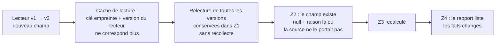

Rien ne bouge dans Z0, Z1 ni dans les décisions. C'est pour ça que l'entrepôt garde les
objets bruts et non les faits : une erreur de lecture découverte dans six mois se corrige
sur tout l'historique.

On relit **toutes les versions conservées**, pas seulement les dernières. C'est ce qui fait
atteindre au champ nouveau les anciennes versions (le siège d'une législature close, par
exemple).

Si la correction fait disparaître des faits publiés, la **note de version** du lecteur doit
l'annoncer (par exemple « R-ORATEUR@3 cesse d'attribuer les identifiants négatifs »). Le
contrôle C1 accepte alors ces pertes, et seulement celles qui correspondent à l'annonce.

#### Une règle changée

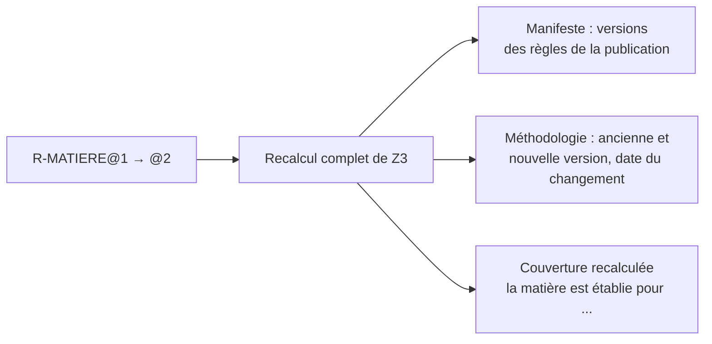

Z2 ne bouge pas. Chaque ligne du graphe garde la règle et la version qui l'ont produite.
Comme pour un lecteur, une perte de faits publiés doit être annoncée dans la note de version
de la règle, sinon C1 bloque.

#### La XVIIIe législature

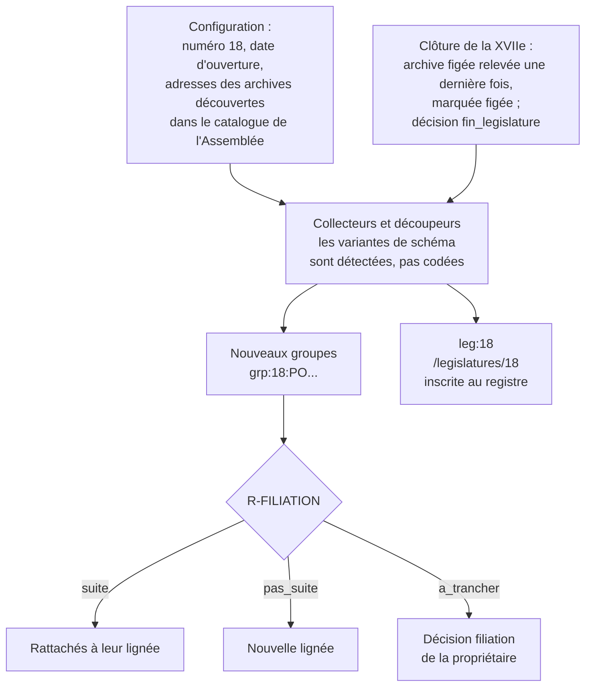

Le code des lecteurs ne change pas pour une législature nouvelle. Les fiches de la XVIIe
gardent leur adresse.

#### Récapitulatif

| Changement | Ce qui se passe | Ce qui ne bouge pas |
| --- | --- | --- |
| Champ ajouté, lecture corrigée | nouvelle version du lecteur ; relecture depuis Z1 | Z0, Z1, décisions |
| Règle modifiée | nouvelle version ; recalcul complet de Z3 ; méthodologie publiée | Z2 |
| Source ajoutée | un collecteur, un découpeur, un lecteur ; la couverture déclare son historique | tout le reste |
| Type de fiche ajouté | un composeur et un schéma de fichier | Z0 à Z3 |
| XVIIIe législature | configuration | le code des lecteurs |
| Contrat des données servies | version `majeur.mineur` dans chaque fichier ; un ajout est mineur ; un changement incompatible passe le contrat en `2.0`, publié avec le code qui le lit, dans la même publication | les articles datés, qui embarquent leur copie figée |
| Adresse d'une fiche | jamais changée ; redirection si l'objet fusionne ou disparaît | le registre des adresses |

Un changement incompatible n'a pas besoin d'un dossier à part : chaque publication vit déjà
sous son propre préfixe `/donnees/<id-publication>/`. Le contrat `2.0` et le code qui le lit
partent ensemble ; un navigateur resté sur l'ancienne publication reçoit une 404 et
recharge la page.
