# 2. Processus de collecte et de publication

Spécification du processus : étapes, ordre, entrées et sorties, cadence, pannes, contrôles,
publication. Les schémas qui l'expliquent (autrefois le document 6) sont à côté des sections
qu'ils illustrent, sous un intertitre « En image » ; en cas d'écart, c'est le texte de la
spécification qui fait foi. Les raisons des choix sont dans le document 3, les chiffres dans
le document 4. Les objets cités (relevé, objet source versionné, décision, zones Z0 à Z4) sont
définis dans le document 1.

---

## Le processus en une image

Quatre mots reviennent partout :

| Mot | Sens |
| --- | --- |
| **relevé** | la trace d'un accès à une source : quoi, quand, réponse, complet ou non (zone Z0) |
| **objet source versionné** | un morceau d'archive (un acteur, un scrutin, un amendement…), gardé version par version (zone Z1) |
| **décision** | un fichier YAML écrit par la propriétaire, quand une règle ne tranche pas (zone ZD) |
| **fait** | une affirmation élémentaire tirée d'un objet source, avec sa provenance (zone Z2) |

**Une mise à jour enchaîne neuf étapes : les trois premières acquièrent et gardent tout, les
six suivantes recalculent et peuvent être rejouées à volonté.**

```mermaid
flowchart LR
    subgraph ACQ["ACQUIS - conservé pour toujours"]
        direction TB
        E0["E0 Démarrer<br/>verrou, options, fenêtre, plan"]
        E1["E1 Relever<br/>un collecteur par source"]
        E2["E2 Découper et versionner<br/>un découpeur par format"]
        Z0[("Z0 Relevés")]
        Z1[("Z1 Objets sources<br/>versionnés")]
        ZD[("ZD Décisions<br/>fichiers YAML")]
        E0 --> E1
        E1 -- "fichiers reçus" --> E2
        E1 -- "relevés" --> Z0
        E2 -- "nouvelles versions,<br/>retraits constatés" --> Z1
    end

    subgraph REC["RECALCULÉ - rejouable"]
        direction TB
        E3["E3 Lire<br/>un lecteur par type d'objet"]
        Z2[("Z2 Faits lus")]
        E4["E4 Relier et dériver<br/>règles nommées"]
        Z3[("Z3 Graphe relié<br/>et couverture")]
        E5["E5 Composer<br/>un composeur par type de fiche"]
        Z4[("Z4 candidate<br/>fichiers JSON, jeu, manifeste")]
        E6{"E6 Contrôler<br/>C1 à C7, A1 à A8"}
        E7["E7 Publier"]
        E8["E8 Rendre compte"]
        E3 --> Z2 --> E4 --> Z3 --> E5 --> Z4 --> E6
        E6 -- "aucune anomalie bloquante" --> E7
        E6 -- "refus" --> E8
        E7 --> E8
    end

    Z1 -- "versions nouvelles<br/>ou toutes si un lecteur change" --> E3
    ZD -- "décisions" --> E4
    ZD -- "levées de contrôle" --> E6
    E7 --> SITE["Site en ligne<br/>et registre des publications"]
    E8 --> CR["Compte rendu public<br/>et alertes privées"]
```

Ce qu'il faut voir :

- **À gauche, l'acquis.** E1 et E2 écrivent au fil de l'eau, source par source. Ce qui est
  écrit reste, même si la suite échoue.
- **À droite, le recalculé.** Faits, graphe, fiches : tout se refait à partir de Z1 et des
  décisions. On peut effacer Z2 et Z3 sans rien perdre.
- **Ce qui circule** : des fichiers reçus et des relevés (E1), des versions d'objets (E2),
  des faits avec leur provenance (E3), un graphe relié avec la règle de chaque lien (E4),
  des fichiers de fiche et un manifeste (E5).
- **E6 est une porte.** Si un contrôle bloquant échoue, rien n'est publié ; le site reste
  dans son état précédent, complet.

---

## 2.0 Vue d'ensemble

Une mise à jour enchaîne neuf étapes. Les trois premières **acquièrent** ; ce qu'elles
écrivent est conservé même si la suite échoue. Les suivantes **recalculent** et peuvent être
rejouées à volonté.

| # | Étape | Lit | Produit | Persisté ? |
| --- | --- | --- | --- | --- |
| E0 | **Démarrer** | options, horloge, état de l'entrepôt, décisions | plan de la mise à jour, verrou | — |
| E1 | **Relever** | sources (réseau) | fichiers reçus + relevés (Z0) | oui, dès la fin de chaque source |
| E2 | **Dépaqueter et versionner** | fichiers reçus, index de Z1 | nouvelles versions d'objets, retraits constatés (Z1) | oui, dès la fin de chaque source |
| E3 | **Lire** | versions nouvelles de Z1 (ou toutes, si un lecteur a changé) | faits lus (Z2) | oui (cache) |
| E4 | **Relier et dériver** | Z2, décisions, règles | graphe relié (Z3), couverture | non (recalculé) |
| E5 | **Composer** | Z3 | fichiers des fiches, jeu téléchargeable, manifeste (Z4 candidate) | non |
| E6 | **Contrôler** | Z4 candidate, dernière publication, Z0/Z1, décisions | anomalies bloquantes, avertissements | oui (rapport) |
| E7 | **Publier** | Z4 candidate validée, code publié | site en ligne, registre des publications | oui |
| E8 | **Rendre compte** | tout ce qui précède | compte rendu public, alertes privées | oui |

Un « chantier » est un travail trop long pour une seule mise à jour (premier remplissage,
relecture complète, pages Sycomore d'un lot de personnes, vérification par échantillon). Il
avance d'une mise à jour à l'autre, dans un budget de temps, et ce qui n'est pas fait est
publié avec la couverture `en_cours`, jamais comme une absence.

### En image : une soirée normale

**Chaque soir à 19 h 30, une tâche prend le verrou, interroge les sources, ne garde que ce qui
a changé, recalcule tout le reste, contrôle, publie, puis rend compte ; à 21 h 30, un second
déclenchement voit que c'est fait et s'arrête.**

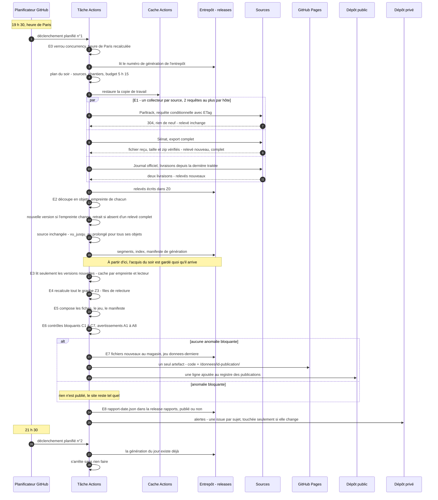

Ce qu'il faut voir, étape par étape :

1. **Déclenchement.** Deux horaires, parce que GitHub retarde ses tâches planifiées et en
   abandonne parfois. Le premier qui part fait le travail.
2. **Verrou.** Un seul traitement à la fois (groupe `concurrency`). En plus, l'entrepôt a un
   numéro de génération : si quelqu'un a écrit entre-temps, l'écriture échoue au lieu
   d'écraser.
3. **Relevés conditionnels.** Une source inchangée coûte une requête. Un téléchargement est
   vérifié contre sa taille annoncée, car l'Assemblée coupe des transferts en répondant
   « 200 ».
4. **Découpe.** Une archive devient des objets (un acteur, un scrutin…). On ne garde une
   version que si son empreinte change. Les présences et collaborateurs sont retirés ici.
5. **Lecture incrémentale.** On ne relit que les objets nouveaux ou changés, sauf si un
   lecteur a changé de version : alors on relit tout ce type d'objet, depuis l'entrepôt.
6. **Recalcul.** Le graphe est recalculé **en entier**, chaque soir. C'est plus simple et
   plus sûr que de suivre les dépendances (un nouveau scrutin change la « dernière lecture »
   d'un texte, donc des positions sur des dizaines de fiches).
7. **Composition.** Même entrée, mêmes octets : on peut comparer deux publications fichier
   par fichier.
8. **Contrôles.** Sept contrôles bloquants, huit avertissements (2.8).
9. **Publication.** Un seul déploiement : le code et les données d'une même publication.
10. **Rapport et alertes.** Le compte rendu est public : un fichier `rapport-<date>.json`
    dans la *release* `rapports`, écrit **même quand rien n'est publié**, avec une copie
    dans le résumé de la tâche ; la page des sources lie le dernier. Les alertes vont au
    dépôt privé. Rien ne se répète quand rien ne change.

Les heures intermédiaires ne sont pas données : la durée de chaque étape sera chiffrée dans
le document 4. Le schéma montre l'**ordre**, pas les durées.

Une source n'est pas relevée chaque soir : chacune a sa cadence (2.3). Par
exemple, les mandats locaux et les finances sont relevés chaque semaine, Sycomore et
Wikidata à l'arrivée d'une personne puis une fois par an.

---

## 2.1 E0 — Démarrer

1. **Verrou** : un seul traitement à la fois (groupe `concurrency` de GitHub Actions avec
   `queue: max`, sans annulation de celui qui tourne : les exécutions en attente forment une
   file au lieu que la dernière annule la précédente, comme le fait un groupe sans `queue` —
   documentation lue le 04/11/2026 ; un import de code en attente n'est donc jamais perdu)
   **et** un numéro de génération de l'entrepôt vérifié à
   l'écriture (si quelqu'un a écrit entre-temps, l'écriture échoue au lieu d'écraser).
2. **Options** (lancement manuel) : validées en premier. Une option inconnue, une personne
   introuvable, une combinaison impossible (« essai » + « publier ») arrêtent tout de suite
   avec la cause, en tête du résumé de la tâche et en alerte.
3. **Version du code** : le traitement planifié exécute **la dernière version publiée** du
   code (étiquette `code-publie` du dépôt public), jamais une branche de développement.
4. **Fenêtre d'activité** : l'heure de Paris est recalculée dans la tâche. Si le traitement
   tourne du lundi au vendredi entre 9 h et 19 h, **sauf jour férié français** (décision de la
   propriétaire du 04/11/2026), il collecte et calcule mais **diffère toute écriture
   visible** sur le dépôt public (publication, *release*, commit) jusqu'à 19 h. Un lancement
   manuel dans cette fenêtre est refusé d'emblée, avec ce motif.
5. **Plan** : liste des sources à relever aujourd'hui (cadence 2.3), chantiers en cours,
   budget de temps (5 h 15 sur les 6 h d'une tâche), mode (quotidien, complet, recalcul,
   essai). Les relevés propres à une personne (Sycomore, Wikidata, Parlement européen) ne
   visent que les personnes des populations en cours : une personne sortie du périmètre n'est
   plus relevée, ses données restent dans Z1, sa couverture devient `hors_perimetre` depuis la
   date de sortie.

### En image : la fenêtre horaire

**Du lundi au vendredi, de 9 h à 19 h (heure de Paris, jours fériés exclus), rien ne s'écrit
sur le dépôt public.**

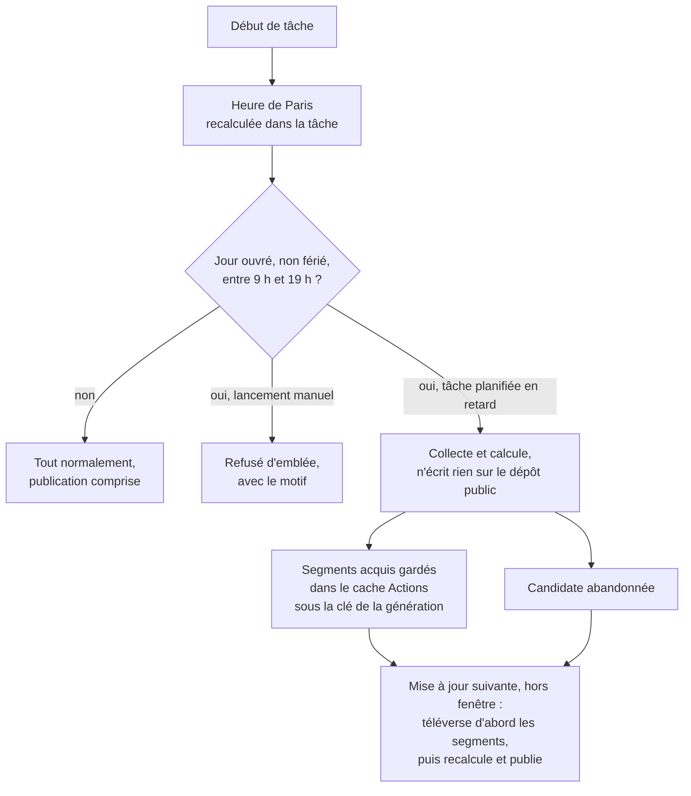

Pourquoi calculer l'heure dans la tâche : le planificateur de GitHub ne garantit pas
l'horaire. Une tâche prévue à 19 h 30 peut partir à 23 h, ou le lendemain matin.

Ce qui se passe quand une tâche tourne en fenêtre interdite :

- **L'acquis n'est pas perdu.** Téléverser dans l'entrepôt serait une écriture visible
  (l'entrepôt est fait d'actifs de *release* du dépôt public). Les segments sont donc gardés
  dans le cache Actions, invisible, qui les conserve 7 jours sans lecture. La mise à jour
  suivante, hors fenêtre, les téléverse avant tout le reste.
- **La candidate n'est pas reprise.** La mise à jour suivante la recalcule : E3 à E5 ne
  coûtent que quelques minutes.
- **Les décisions ne touchent jamais le dépôt public en journée.** La propriétaire les écrit
  quand elle veut dans `decisions/` du dépôt **privé** ; la tâche d'import du soir les
  recopie sur le dépôt public.

## 2.2 E1 — Relever

Un **collecteur** par source et par point d'accès. Les collecteurs tournent en parallèle
(deux requêtes simultanées au plus par hôte), chacun isolé : l'échec de l'un n'arrête pas les
autres.

Pour chaque point d'accès :

1. **Requête conditionnelle** quand la source le permet (`If-None-Match`,
   `If-Modified-Since`), sinon `HEAD` et comparaison de la taille et de la date, sinon
   téléchargement et comparaison d'empreinte. Une archive inchangée coûte une requête.
2. **Téléchargement vers un fichier temporaire, vérifié contre `Content-Length`.** Les
   transferts de l'Assemblée sont coupés **avec un statut 200** (mesuré le 04/11/2026 :
   AMO30 coupé à 10 Mio pile, amendements XVIIe à 57,7 Mo, scrutins XVe à 1,33 Mo sur 9,2) :
   seule la comparaison de la taille reçue et le test du zip le révèlent. Reprise par segments
   **uniquement avec `If-Range` sur l'`ETag`** du premier segment : si un autre serveur
   (`be: f1`/`f2`) sert une autre version, la réponse est le fichier entier et non un segment,
   et le mélange de deux versions devient impossible (l'`ETag` de l'Assemblée encode taille et
   date). Mesuré : les amendements XVIIe (351,9 Mo) ont ainsi été repris trois fois et
   reconstitués valides.
3. **Contrôles d'intégrité** : zip/tar lisible (CRC vérifiés), taille au-dessus d'un plancher
   (l'export du Sénat servi à 444 octets avec HTTP 200 est rejeté), JSON/XML bien formé,
   nombre d'objets plausible par rapport au relevé précédent (une chute de plus de 5 % rend
   le relevé `suspect`), schéma reconnu (empreinte des clés de premier niveau).
4. **Relevé** écrit dans Z0 avec son issue (`inchange`, `nouveau`, `echec`, `suspect`) et sa
   complétude.
5. **Nouvelles tentatives** : trois, espacées (30 s, 2 min, 10 min), puis abandon pour cette
   mise à jour. Le portail européen, muet sans erreur, est traité par délai d'attente
   (30 s) et débit adaptatif (une requête toutes les 2 s, ralenti à chaque silence).

Particularités par source (le traitement complet de chaque piège est dans le document 8) :

| Source | Particularité du relevé |
| --- | --- |
| Assemblée, archives courantes | chemins **découverts** depuis les pages de jeux du portail, mis en configuration par législature ; jamais supposés |
| Assemblée, archives figées (législatures closes) | relevées une fois, puis vérifiées par `HEAD` chaque mois ; marquées `figee`. Un chemin absent des pages de jeux (AMO30 figée XVe, `Agenda_XIV`, trouvés par `HEAD` le 04/11/2026) est saisi en configuration avec la façon dont il a été trouvé, et vérifié par `HEAD` à chaque relevé ; un 404 ouvre une alerte |
| Journal officiel | on relève **toutes** les livraisons parues depuis le nom de la dernière livraison traitée (deux par jour, week-end compris : le soir 2 à 6 Mo, surtout des redélivraisons ; la nuit, les actes du jour) ; rattrapage automatique après une panne ; on filtre par date de publication, pas de livraison |
| Parltrack | relevé chaque soir par requête conditionnelle (`ETag`). **Mesuré le 04/11/2026 : aucun fichier n'a changé depuis le 24/07/2026** (`ep_votes` arrêté au 26/03/2026), et `dumps/arch/` garde 3 492 instantanés depuis 2019, contrairement à la « rétention de trois jours » du cahier. La famille est affichée « source figée depuis le … » tant qu'elle ne bouge pas ; l'adresse à relever est `dumps/` (avec la barre finale ; sans, réponse 502) |
| Parlement européen | `User-Agent` qui nomme le site et une adresse de contact (cahier 3.3) ; personnes du volet européen (candidats anciens eurodéputés) chaque soir ; liste complète des eurodéputés français chaque semaine ; libellé de chaque groupe nouvellement cité lu dans `corporate-bodies/{id}`. Ni `ETag` ni `Last-Modified` : comparaison d'empreinte. Fin de pagination = **204 sans corps**, à distinguer d'un silence de limitation (délai d'attente) |
| Sénat | export complet chaque soir (régénéré vers 03 h 17 UTC) ; plancher de taille et nombre de tables (95) ; la table de présence `activite_participant` est écartée au découpage |
| Wikipédia | numéro de révision de l'article ; on ne relit la section que si la révision a changé. Complétude : nombre de candidats extraits = nombre de lignes du tableau, sinon relevé `suspect` ; un titre qui mène à une page d'homonymie (`pageprops`) part en relecture |
| Sycomore, Wikidata | à l'arrivée d'une personne dans le périmètre, puis une fois par an |
| Répertoire national des élus | chaque semaine : l'identifiant de ressource change à chaque publication, on le relit depuis la fiche du jeu ; seules les ressources des mandats locaux (pas celles des députés, sénateurs, eurodéputés) |
| Finances, Drees, Unédic | chaque semaine, comparaison d'empreinte (republications silencieuses). Un lecteur par format, reconnu à l'empreinte de schéma (11 formats de crédits) ; classeur Drees retrouvé sur la page du jeu à chaque édition ; licence lue jeu par jeu dans le catalogue (sans licence : non collecté). Exécution 2021-2022 publiée en PDF : `non_collecte`. Séries mensuelles antérieures à 2024 (absentes de l'API, mesuré le 04/11/2026) et budget de l'année (seulement sur `budget.gouv.fr`) : `trou_source` |
| Pages publiques de l'Assemblée | tirage au sort de 40 faits par mise à jour pour la vérification croisée (E6) |

## 2.3 Cadence

| Famille | Cadence | « À jour au » affiché |
| --- | --- | --- |
| Assemblée, législature en cours (acteurs, scrutins, amendements, dossiers, agenda, comptes rendus, questions) | chaque soir | date de l'archive à la source |
| Journal officiel | chaque soir | date de la dernière livraison lue |
| Gouvernement en cours | chaque soir (vient de l'archive des acteurs) | idem Assemblée |
| Parltrack | chaque soir (requête conditionnelle) | date du dump |
| Parlement européen | chaque soir pour les personnes du volet européen ; chaque semaine pour la liste des eurodéputés français | date de la réponse |
| Sénat | chaque soir (8 Mo) | date de l'export |
| Candidatures (Wikipédia) | chaque soir | révision lue |
| Mandats locaux | chaque semaine (la source est trimestrielle) | date de la ressource ; la famille **dit** qu'elle ne suit pas un rythme quotidien |
| Finances, protection sociale | chaque semaine (sources annuelles ou mensuelles) | date d'édition de la source |
| Législatures closes, Sycomore, Wikidata | mensuel / à l'arrivée d'une personne / annuel | date du relevé |

Planification : deux déclenchements `schedule` en heure de Paris (clé `timezone:
Europe/Paris`, 19 h 30 et 21 h 30) ; le premier qui démarre fait la mise à jour, le second
constate qu'elle est faite et s'arrête (la génération de l'entrepôt porte la date). Deux
déclenchements, parce que GitHub retarde les tâches planifiées et en **abandonne** parfois
(documentation lue le 04/11/2026). Le week-end, un troisième déclenchement le matin sert aux
chantiers longs. Chaque mise à jour vérifie la date de la précédente : un trou de plus de
26 h ouvre l'alerte `planification`. GitHub désactive les tâches planifiées d'un dépôt public
après 60 jours sans activité, et sa documentation ne dit pas qu'un commit fait par une tâche
compte comme activité (lue le 04/11/2026). Le commit nocturne du registre des publications
n'est donc qu'une précaution : la tâche d'import du soir vérifie l'état des tâches planifiées
par l'API et réactive celle qui serait désactivée (`…/actions/workflows/{id}/enable`), en
ouvrant l'alerte `planification`.

## 2.4 E2 — Dépaqueter et versionner

Un **dépaqueteur** par format d'archive (zip, tar.gz, fichier seul, réponse d'API) sort
chacun des fichiers membres de l'archive reçue et le garde **à l'octet près** : il
n'interprète rien et ne filtre rien (étape 2, corrections P2 ; décision du 06/11/2026). Les
variantes de schéma (un fichier par objet en XVe–XVIIe, un gros fichier en XIVe, dictionnaire
ou liste, clés différentes) ne le concernent pas : elles sont l'affaire des lecteurs (E3).

Chaque membre est identifié par l'**uid** qu'il porte dans son nom, jamais par son dossier :
un objet déplacé dans l'archive (170 amendements XVIIe rangés sous `json/incorrect_data/`,
archive du 03/11/2026) reste le même objet ; son chemin est un attribut. Un membre qui contient
plusieurs objets (fichier unique de la XIVe, dump du Sénat) est versionné comme un tout.

Pour chaque membre : empreinte des octets exacts ; si elle diffère de la dernière version,
**nouvelle version** ; sinon prolongation de `vu_jusqu_au`. Pour chaque membre connu et
**absent** de l'archive :

- si le relevé est `complet` et non `suspect` → il passe à `retire_a_la_source` ;
- sinon → rien ne change (on ne conclut pas d'une lecture partielle).

Le relevé garde la **liste des membres** de l'archive (chemin, taille, CRC, empreinte) : le
contenu exact de toute archive reçue se retrouve depuis l'entrepôt.

Les nouvelles versions sont rangées en **segments** (un fichier Parquet par source, type,
législature et mois de collecte, octets compressés zstd), **plafonnés à 90 Mo** et découpés par
tranche d'identifiants au-delà (un mois d'amendements XVe ferait ≈ 146 Mo, calculé, doc. 4,
4.1.6) ; une *release* d'entrepôt par année (1 000 actifs au plus par *release*).

La tâche qui collecte **n'écrit pas** dans l'entrepôt (2.15) : elle remet les segments, les
relevés et le manifeste de génération à la tâche `ecrire`, sous forme d'artefact de
l'exécution. `ecrire` les dépose dans l'entrepôt **même si le calcul échoue ou si un contrôle
bloque la publication** : ce qui est collecté reste acquis. Si `ecrire` n'a pas lieu (machine
perdue, fenêtre interdite), l'artefact reste disponible et la mise à jour suivante l'écrit en
premier. La candidate de publication, elle, n'est jamais reprise : elle est recalculée.

### En image : la vie d'un objet source

**Un objet source ne change d'état qu'au vu d'un relevé : il gagne une version quand son
contenu change, il est retiré quand un relevé complet ne le contient plus, et une panne ne
change rien.**

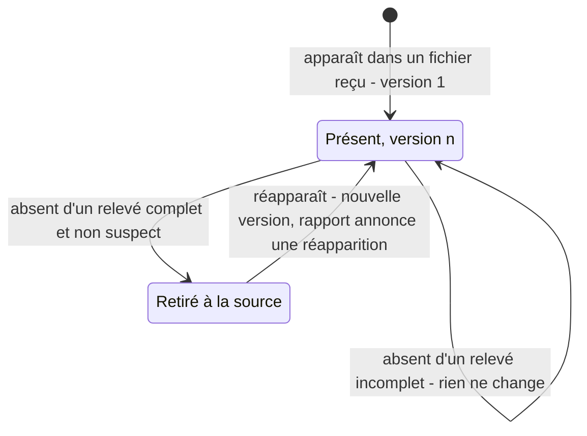

Les quatre cas de la vie courante :

| Cas | Ce que dit le relevé | Ce qui change dans Z1 | Ce que voit le lecteur du site |
| --- | --- | --- | --- |
| **Nouvelle version** | l'objet est là, son empreinte a changé (sort d'un amendement, fin d'un mandat) | version n+1 ; la version n reste, datée | le fait mis à jour |
| **Inchangé** | l'objet est là, même empreinte ; ou la source répond « 304 » à la requête conditionnelle | `vu_jusqu_au` avance (pour tous les objets de la source, en cas de 304) | rien |
| **Retiré à la source** | relevé **complet**, l'objet n'y est plus (cosignature retirée) | état `retire_a_la_source` ; les versions restent | le fait disparaît partout, et le rapport le **nomme** |
| **Source en panne** | relevé `echec` ou `suspect` | **rien** | les faits restent ; « à jour au » reste à la date du dernier relevé réussi ; couverture « panne depuis le … » |
| **Réapparition** | un objet retiré est de nouveau là | nouvelle version `present` ; la période de retrait reste dans l'historique | le fait revient ; le rapport annonce une « réapparition » |

La règle à retenir : **seul un relevé complet peut faire constater un retrait.** Sans elle,
un export du Sénat servi vide avec « 200 » effacerait tous les sénateurs.

Les anciennes versions ne sont jamais effacées. C'est ce qui garde l'historique des champs
que l'Assemblée réécrit chaque nuit (siège, libellés, position déclarée d'un groupe).

Un « 304 » ne prolonge `vu_jusqu_au` que si le dernier relevé de ce point d'accès était
complet.

## 2.5 E3 — Lire

Un **lecteur** par type d'objet, versionné, transforme une version d'objet en lignes de
faits (Z2), avec leur provenance. Le cache est indexé par (empreinte de l'objet, version du
lecteur) :

- en temps normal, on ne lit que les objets nouveaux ou changés ;
- si un lecteur change de version (correction, champ ajouté), **toutes** les versions
  conservées des objets de ce type (pas seulement les dernières) sont relues depuis Z1 — c'est ainsi qu'une correction
  atteint l'historique sans recollecte ;
- normalisations communes à tous les lecteurs : le « vide » écrit de trois façons (`null`,
  `""`, `{"@xsi:nil": "true"}`) devient `null` ; un uid écrit en objet (`uid.#text` des
  acteurs AMO) devient une chaîne ; un objet seul devient une liste d'un élément ; une date
  sentinelle (`2999-01-01` au JO, `1900-01-01` au RNE) devient `null` + « date sentinelle » ;
  le préfixe `PA` est rétabli (doc. 1, 1.2.1) ;
- une erreur de lecture sur un objet n'arrête pas les autres : l'objet est compté
  `illisible`, signalé, et ses faits précédents restent en place avec la couverture
  `trou_source` (si c'est la source) ou `en_cours` (si c'est notre lecteur).

## 2.6 E4 — Relier et dériver

Recalcul **complet** de Z3 à chaque mise à jour, dans DuckDB, à partir de Z2 et des
décisions : identités, populations, groupes et lignées, bancs et périodes, classification des
scrutins, liens scrutin ↔ dossier, dernières lectures, matières, sorts, amendements
canoniques, positions de groupe, divergences, attribution des paroles, sujets, composition
des gouvernements, rattachement des actes et des exercices, couverture. Chaque ligne porte
la règle et sa version.

Recalculer tout plutôt qu'incrémentalement : les règles se tiennent entre elles (une
nouvelle lecture change la « dernière lecture » d'un texte, donc des positions sur des
dizaines de fiches) ; le recalcul complet tient en quelques minutes (document 4) et supprime
toute une classe d'erreurs de mise à jour partielle.

E4 produit aussi les **files de relecture** : identités à valider, candidatures relevées,
filiations à trancher, désaccords de liens, libellés de ministère inconnus.

## 2.7 E5 — Composer

Un **composeur** par type de fiche produit les fichiers de 1.7 (compressés en `.json.gz`,
avec leur index de mots), plus les pages de contexte
(sources, méthodologie avec chiffres de couverture recalculés, fraîcheur), le jeu
téléchargeable et le **manifeste** (chemin → empreinte de chaque fichier). Tout est régénéré ;
la sortie est **déterministe** (même entrée, mêmes octets : tri stable, pas d'horodatage
dans les fichiers de données hors `genere_le`), ce qui permet de comparer deux publications
fichier par fichier et de rejouer une publication passée à l'identique.

Les articles datés ne sont jamais recomposés : leur copie figée est reprise telle quelle.

## 2.8 E6 — Contrôler

### 2.8.1 Contrôles bloquants (la publication est refusée)

| Contrôle | Méthode |
| --- | --- |
| **C1 Pertes non expliquées** | différence, fait par fait, entre la dernière publication et la candidate. Chaque fait disparu doit être justifié par un retrait constaté dans Z1 (relevé complet) — objet retiré, ou **fait absent de la nouvelle version de son objet**, issue d'un relevé complet (retrait à l'intérieur d'un objet : cosignature retirée d'un amendement) —, une décision, ou un **changement de lecteur ou de règle qui annonce cette perte** (la note de version du code déclare, par exemple, « R-ORATEUR@3 cesse d'attribuer les identifiants négatifs » ; les pertes doivent correspondre à cette annonce). Les autres sont **nommés** dans le refus (identifiant, fiche, famille) |
| **C2 Liens pendants** | chaque lien d'un fichier servi vise un fichier de la candidate ou une adresse du registre (redirection comprise) |
| **C3 Données laissées de côté** | bilan par famille : faits lus = faits servis + faits écartés par une règle **avec sa raison**. Un écart non expliqué bloque |
| **C4 Données interdites** | validation de chaque fichier contre son schéma en liste blanche ; recherche de motifs interdits (taux de présence, score, rang, total de divergences, taux d'adoption d'amendements, part d'actes « appliquant » une loi, 49.3 en position de vote, ratio servi tout fait au lieu de ses décomptes, ratio sans numérateur ou dénominateur, indices individuels) ; listes de personnes et de groupes dans l'ordre neutre déclaré (doc. 1, 1.7.1) ; aucun texte porté servi avant son examen en commission (ou, pour un texte européen, avant sa sortie de la phase préparatoire) ; licences de chaque fichier = union des licences de ses `src` |
| **C5 Lecture incomplète présentée comme complète** | une couverture `complet` exige que le dernier relevé de chaque source contributrice soit complet ; sinon le statut doit être `panne`. Un **0** ou une liste vide n'est servi qu'avec une couverture `complet` ou `relu_aucun` (règle 5) |
| **C6 Effondrement** | une famille qui tombe à zéro pour tout un type de fiche, ou baisse de plus de 20 % d'un coup sans retrait constaté (ex. : tous les gouvernements sans texte) |
| **C7 Personne attendue écartée en silence** | chaque personne des populations attendues (R-PERIMETRE) est dans la candidate, ou sortie avec une raison établie (décision `perimetre`) ; sinon elle est nommée dans le refus |

Chaque anomalie a une **empreinte** (contrôle + objets concernés). Une décision
`levee_controle` lève **une** anomalie d'empreinte donnée, pour une publication : si
l'anomalie change, la levée ne vaut plus. Une levée est un fichier commité : geste explicite,
daté, public.

### 2.8.2 Avertissements (publication maintenue, propriétaire avertie)

| Avertissement | Méthode |
| --- | --- |
| A1 Fiche hors modèle | une fiche qui s'écarte du modèle par décision `fiche_hors_modele` |
| A2 Vérification croisée | 40 faits tirés au sort (votes, sorts d'amendement, mandats, dates) relus sur les pages publiques de l'Assemblée ; écart → alerte avec le fait et l'adresse |
| A3 Totaux d'une autre source | effectif de chaque groupe à chaque scrutin (nos appartenances à la date) contre les décomptes publiés par le scrutin, hors scrutins à dissidents seuls (710 en XIVe) et lignes de groupe `PO0` (146 lignes sur 14 scrutins XVIIe), comptés à part ; lois promulguées par législature contre le JO (les lois sans dossier rattaché sont nommées) |
| A4 Double affichage | même objet sous deux clés (copies d'amendements, dossiers de la XIVe réapparus, compte rendu de la XVe dans l'archive de la XVIe, loi et son rectificatif, mandat local présent dans deux fichiers du RNE) |
| A5 Famille à zéro pour tout le monde | (cas non bloquant : famille nouvelle ou optionnelle) |
| A6 Couverture insuffisante | candidats sans fiche, personnes sans prise de parole sur une période couverte, groupes dont trop peu de membres ont des données |
| A7 Entrées non résolues | files de relecture non vides, décisions qui ne s'appliquent plus, fin ou ouverture d'une législature détectée (doc. 1, 1.8) |
| A8 Mandat ouvert dans un organe clos | mandat sans date de fin dans un organe qui en a une (7 mandats GOUVERNEMENT dans le gouvernement Bayrou, clos le 09/09/2025 ; AMO30 du 03/11/2026) |

### 2.8.3 À la main, sans rien publier

`empreinte audit` (sur la machine de la propriétaire) : volumes, complétude, cohérence,
fraîcheur, et les **indices de contrôle interdits de publication** (cohésion ou
participation individuelle rapportée au groupe). Ils sont écrits dans un dossier local hors
du dépôt, jamais dans les journaux de GitHub Actions, qui sont publics.

### En image : un contrôle bloquant, puis sa levée

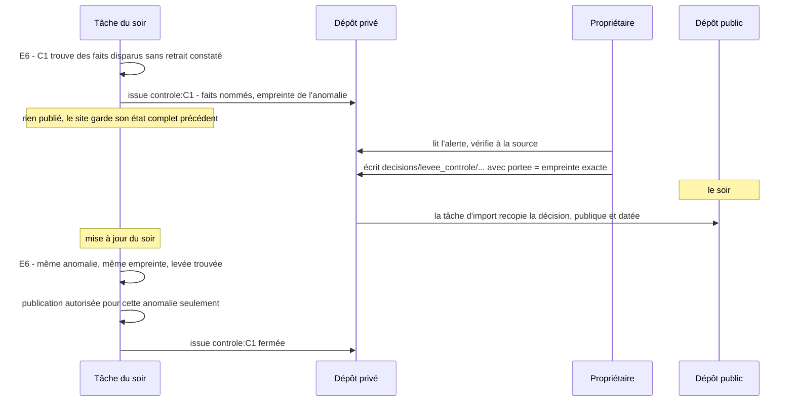

Les sept contrôles bloquants, en une ligne chacun :

| Contrôle | Il refuse si… |
| --- | --- |
| C1 Pertes non expliquées | un fait publié disparaît (objet entier, ou fait à l'intérieur d'un objet comme une cosignature) sans retrait constaté par comparaison des versions, sans décision, et sans être annoncé par la note de version d'un lecteur ou d'une règle (les faits sont nommés) |
| C2 Liens pendants | un lien vise un fichier ou une adresse qui n'existe pas |
| C3 Données laissées de côté | faits lus ≠ faits servis + faits écartés avec raison |
| C4 Données interdites | un champ hors schéma, un motif interdit (taux de présence, score, total de divergences…), une liste de personnes dans un ordre non neutre, un texte porté servi avant son examen en commission |
| C5 Lecture incomplète | une couverture dite « complète » alors qu'un relevé contributeur ne l'est pas, ou un 0 servi sans couverture `complet` ou `relu_aucun` |
| C6 Effondrement | une famille tombe à zéro, ou baisse de plus de 20 % sans retrait constaté |
| C7 Personne écartée en silence | une personne attendue d'après les sources n'est dans aucune population, sans raison établie |

Une levée vaut pour **une** anomalie, d'empreinte donnée. Si l'anomalie change (un treizième
fait disparaît), la levée ne vaut plus : il faut une nouvelle décision. Il n'existe pas de
case « forcer la publication ». Une levée urgente suit le même chemin que toute décision :
elle prend effet à la mise à jour du soir.

## 2.9 E7 — Publier

1. **Fenêtre** : rien d'écrit sur le dépôt public du lundi au vendredi entre 9 h et 19 h
   (heure de Paris), hors jours fériés. Dans la fenêtre interdite, la candidate n'est pas
   publiée ni gardée : la mise à jour suivante, hors de cette fenêtre, la recalcule (E3 à E5)
   après avoir téléversé les segments acquis qui attendaient dans le cache de GitHub Actions
   (2.4).
2. **Conservation** : les fichiers de la candidate dont l'empreinte est nouvelle sont
   ajoutés au magasin des publications (actifs de *release*, un fichier par empreinte, groupés
   en paquets) ; le manifeste de la publication est enregistré.
3. **Déploiement** : un seul artefact GitHub Pages = le code du site (construit depuis
   l'étiquette `code-publie`) + les données de la candidate, rangées sous
   `/donnees/<id-publication>/`. La documentation de GitHub ne promet pas l'atomicité d'un
   déploiement ; c'est le préfixe propre à chaque publication qui garantit que le lecteur
   voit l'ancien état complet ou le nouveau, jamais un mélange (doc. 1, 1.7.2). Aucun geste
   humain. Taille du site plafonnée à 1 Go par GitHub (limite, pas recommandation), contrôlée
   avant envoi, avec une alerte à 80 % ; les données servies en `.json.gz` la tiennent à
   ≈ 0,21 Go pour XIVe–XVIIe (calculé, doc. 4, 4.1.4).
4. **Registre** : une ligne ajoutée à `registre/publications.jsonl` (dépôt public) : date,
   identifiant du déploiement, version du code, génération de l'entrepôt, commit des
   décisions, versions des règles, **empreinte racine** du manifeste (arbre de Merkle des
   fichiers), empreinte de la ligne précédente (chaîne). L'empreinte racine est aussi inscrite
   dans la description du jeu sur data.gouv.fr (un tiers horodaté).
5. **Jeu téléchargeable** : actifs de `donnees-derniere`, remplacés à chaque publication ; la
   dernière publication du mois est aussi figée dans la *release* `donnees-<aaaa-mm>` (doc. 1,
   1.7.4).

Une publication ne contient que des données et du code : ni journaux de travail, ni fichiers
de l'entrepôt, ni indices de contrôle.

## 2.10 E8 — Rendre compte

**Compte rendu public** (actif `rapport-<date>.json` de la *release* `rapports`, qu'une
publication ait eu lieu ou non ; copie dans le résumé de la tâche ; la page des sources du
site lie le dernier) :
publiée ou non et pourquoi ; ajouts et retraits par famille, avec les retraits **nommés** et
leur raison (retrait à la source, décision) ; ce qui attend une décision ; ce qui n'a pas pu
être vérifié ; sources en panne et depuis quand ; durée de chaque étape. Il respecte les
règles du site : comptes et identifiants, jamais d'indice individuel.

**Journaux de la tâche** (publics) : le traitement n'y écrit que des messages d'un catalogue
fermé (étape, source, comptes, identifiants, durées, causes d'échec) ; un test vérifie que
chaque message du code en fait partie ; le module d'audit (2.8.3) refuse de tourner sur
GitHub Actions.

**Alertes privées** : une **issue par sujet** dans le dépôt privé de développement (le
dépôt public n'en reçoit aucune, conformément à 5.3), créée par un jeton limité à ce dépôt.
Clé de sujet stable (`panne:parltrack`, `controle:C1`, `relecture:identites`…) ; l'issue
est mise à jour seulement si son contenu change, fermée quand le sujet disparaît. GitHub
envoie la notification. Rien ne se répète quand rien ne change, y compris les jours sans
publication.

## 2.11 Pannes

| Situation | Effet sur les données | Effet visible |
| --- | --- | --- |
| Source injoignable ou réponse invalide | aucun changement dans Z1 pour cette source ; ses faits restent ceux du dernier relevé complet, et il n'y en a aucun si la source n'a jamais été relevée avec succès (la couverture et l'alerte le disent : « aucun relevé n'a encore abouti », 13/11/2026, issue #33) | fiches : « à jour au » de la famille reste à la date du dernier relevé réussi, couverture `panne depuis le …` ; page des sources : état de la source ; alerte `panne:<source>` ouverte une fois |
| Réponse suspecte (taille, nombre d'objets) | idem, plus le relevé gardé pour examen | alerte avec la cause ; la propriétaire peut confirmer par décision que la baisse est réelle |
| Objet illisible | prévu : ses faits précédents restent. **Réalisé** (13/11/2026, issue #39) : la version illisible ne donne aucun fait, pas même les lots lus avant l'erreur, et elle est relue à la mise à jour suivante ; ses faits manquent donc tant qu'elle reste illisible, et C1 bloque la publication (la perte n'est pas expliquée par le changement de la source). Garder les faits de la version précédente reste à faire | compté dans le rapport, alerte `lecture:illisibles` ; C1 nomme les faits perdus |
| Tâche interrompue (6 h, panne de machine) | tout ce qui est passé par E2 est acquis ; le cache de lecture est conservé | la mise à jour suivante reprend sans relever deux fois |
| Contrôle bloquant | rien publié ; l'acquis est gardé | alerte `controle:<id>` avec les faits nommés ; le site reste dans son état précédent complet |
| Panne de GitHub Pages au déploiement | registre non écrit | nouvelle tentative à la mise à jour suivante |

### En image : ce qui se passe en cas de panne

**Une panne ne fait jamais perdre ce qui est acquis, ne fait jamais disparaître un fait, et se
voit à la fois sur le site et dans une alerte.**

#### Source injoignable ou réponse suspecte

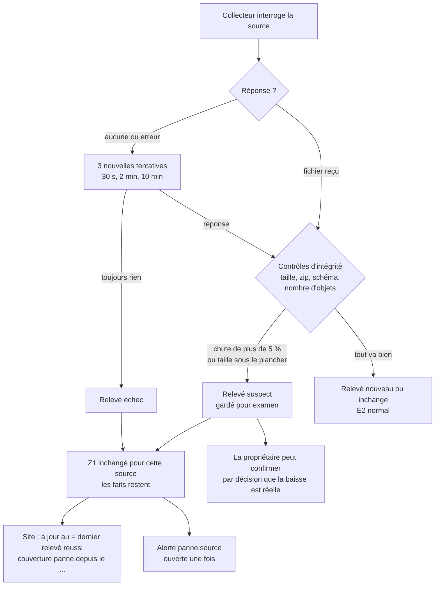

- Les collecteurs sont **isolés** : une source en panne n'empêche pas les autres d'être
  relevées, ni la publication.
- Une réponse **suspecte** est traitée comme une panne. Si la baisse est réelle, la
  propriétaire le dit par une décision.
- L'alerte est ouverte **une fois**. Elle est mise à jour si son contenu change, fermée quand
  la source revient.

#### Tâche interrompue

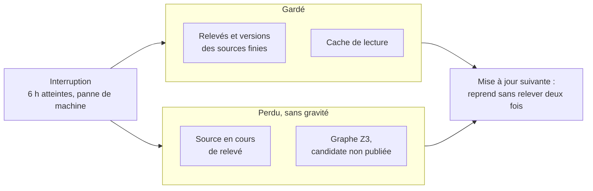

Une interruption coûte au plus le travail de la source en cours. Le reste est soit acquis
(E1–E2 écrivent source par source), soit recalculable (E3–E5).

#### Les autres cas

| Situation | Données | Ce qui se voit |
| --- | --- | --- |
| Objet illisible (un acteur mal formé) | ses faits précédents restent | compté dans le rapport ; alerte au-delà d'un seuil |
| Panne de GitHub Pages au déploiement | registre non écrit | nouvelle tentative le lendemain |
| Pas de mise à jour depuis plus de 26 h | — | alerte `planification` |

## 2.12 Exploitation

**Lancer à la main** : un déclenchement `workflow_dispatch` avec des listes de choix lisibles :

| Option | Valeurs |
| --- | --- |
| Mode | `quotidien` · `complet` (relire toutes les sources sans requête conditionnelle) · `recalcul` (sans collecte, depuis l'entrepôt) · `essai` |
| Sources | toutes · une liste |
| Personnes (essai) | adresses ou identifiants |
| Publier | oui · non (forcé à non en essai) |

La relecture complète forcée = mode `complet`. Un **essai** suit les mêmes étapes, limite E4
et E5 aux personnes demandées (et à ce qu'elles touchent), ne publie rien et dépose le
résultat comme artefact. Le même essai se lance en local
(`empreinte essai --personnes … --hors-ligne`) sur un extrait de l'entrepôt, dans les
7,8 Gio de la machine de développement.

**Instantané d'un article daté** : `empreinte instantane --date <jour> --extrait <requête>`
écrit `articles/<date>-<titre>/donnees.json.gz` et l'inscrit au catalogue des articles. Les
données sont l'**état connu à la date** (décision du 04/11/2026, doc. 5, Q10) : les versions de
Z1 vues à cette date (`vu_du` ≤ date < `vu_jusqu_au`), relues et reliées par le code inscrit
au registre pour cette date. La
copie n'est plus jamais recomposée (2.7).

**Décisions** : la propriétaire les écrit à tout moment dans le dossier `decisions/` du dépôt
**privé** ; la tâche d'import du soir (ci-dessous) les recopie sur le dépôt public, où elles
deviennent publiques et datées. Une levée de contrôle urgente suit le même chemin : elle prend
effet à la mise à jour du soir.

**Code et données** : le développement continue sur le dépôt privé. Une étiquette
`publiable` y désigne la version à publier ; une tâche planifiée du dépôt public (le soir)
l'importe en un commit unique, l'étiquette `code-publie`, puis lance un `recalcul` qui publie
code et données **ensemble**. Si le changement ne touche que l'interface et garde le même
contrat de données, le déploiement reprend les données **de la dernière publication** (jamais
des données plus anciennes). Une mise à jour en cours et une publication de code ne peuvent
pas se croiser (même groupe `concurrency`).

**Tester** : les collecteurs passent par une couche de transport remplaçable ; les tests
utilisent des **extraits réels** des sources (quelques objets par format et par
législature, chacun avec son adresse d'origine, sa date et sa licence), y compris les
réponses pathologiques (202 vide, export de 444 octets, zip tronqué, archive mélangée,
liste au lieu de dictionnaire). Les sorties des composeurs sont comparées à des fichiers de
référence pour trois personnes, un groupe, un gouvernement, une législature. Aucun accès
réseau.

### En image : publier du code, l'essai, la relecture complète

#### Publier du code sans écraser les données

**Le code ne part jamais seul : la propriétaire pose une étiquette sur le dépôt privé, et le
soir une tâche du dépôt public importe ce code puis publie code et données ensemble.**

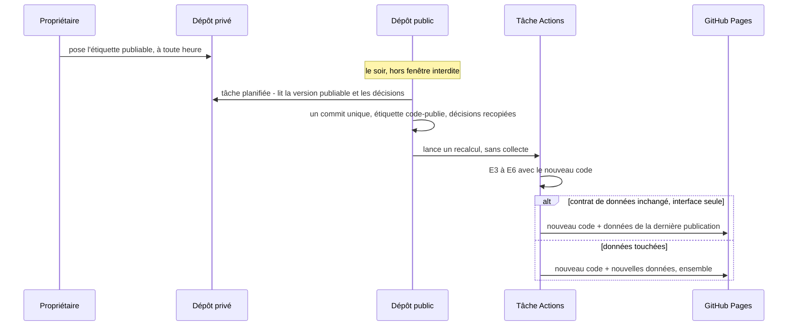

- Le dépôt public ne reçoit **pas** l'historique du développement : un seul commit par
  import.
- Les données publiées correspondent toujours au code publié : ils partent dans le même
  artefact.
- Un import de code et une mise à jour ne se croisent jamais : même groupe `concurrency`.
- Quand seul l'affichage change, on reprend les données **de la dernière publication**,
  jamais des données plus anciennes.

#### L'essai sur quelques personnes

**Un essai suit les mêmes étapes, limite le calcul à quelques personnes et ne publie rien.**

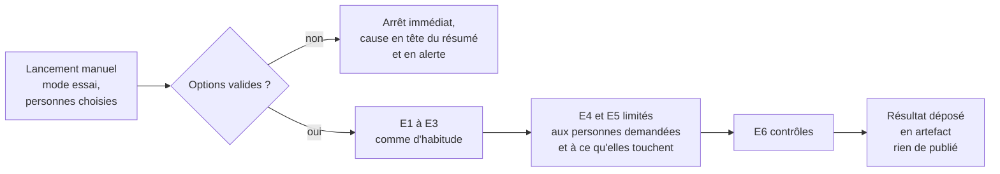

Le même essai tourne sur la machine de la propriétaire, sans réseau, sur un extrait de
l'entrepôt : `empreinte essai --personnes … --hors-ligne`. Il tient dans ses 7,8 Gio.

Les options du lancement manuel :

| Option | Valeurs |
| --- | --- |
| Mode | `quotidien` · `complet` · `recalcul` · `essai` |
| Sources | toutes · une liste |
| Personnes (essai) | adresses ou identifiants |
| Publier | oui · non (toujours non en essai) |

« Essai » + « publier : oui » est refusé tout de suite, avec la cause.

#### La relecture complète

**Forcer une relecture complète, c'est lancer le mode `complet` : toutes les sources sont
relues sans requête conditionnelle.** Les objets qui n'ont pas changé ne créent pas de
version nouvelle (même empreinte) : la relecture complète coûte du réseau, pas du stockage.

Le mode `recalcul`, lui, ne relève rien : il repart de l'entrepôt. C'est celui qu'on lance
après un changement de code.

## 2.13 Premier remplissage

Le corpus se construit à partir de rien comme une suite de chantiers, dans l'ordre :

1. **Sources qui réécrivent le passé d'abord** : l'archive courante de l'Assemblée (republiée
   chaque nuit), puis les instantanés Parltrack (source figée, mais qui peut disparaître).
2. Archives figées de l'Assemblée (XIVe, XVe, XVIe), Sénat, livraisons récentes du JO.
3. Dump global du JO (1,67 Go) et livraisons depuis le 13/07/2025.
4. Europe (portail, EuroVoc), Wikidata, Sycomore pour les personnes du périmètre, finances.
5. Premier E3–E7 complet.

Chaque chantier tient dans une tâche de 6 h ou se découpe (une tâche par législature, en
parallèle quand la mémoire le permet). Durée et mémoire : document 4.

## 2.14 Traçabilité de ce qui a été publié

- Le **registre** (chaîne d'empreintes, dans git) dit, pour toute date, quelle publication
  était en ligne et ce qu'elle contenait (manifeste).
- Le **magasin des publications** garde chaque fichier publié une fois (par empreinte) :
  seuls les fichiers qui changent coûtent du stockage.
- **Réduction** : au-delà d'un an, on ne garde les fichiers que des publications de fin de
  mois ; les autres restent **reconstructibles** en rejouant E3–E5 avec la version du code, la
  génération de l'entrepôt et le commit des décisions inscrits au registre, et **vérifiables**
  par l'empreinte racine. Un contrôle mensuel rejoue une publication tirée au sort pour
  prouver que c'est toujours possible. Les manifestes, eux, sont gardés pour toujours (ils
  sont petits).
- Une donnée publiée ne se corrige qu'en changeant une entrée (source, lecteur, règle,
  décision) : le registre montre quand et pourquoi elle a changé.

### En image : savoir ce qui était publié à une date

**Le registre des publications dit quelle publication était en ligne à une date ; le magasin
garde ses fichiers ; au-delà d'un an, on peut la reconstruire en rejouant le traitement, et
l'empreinte racine prouve qu'elle est identique.**

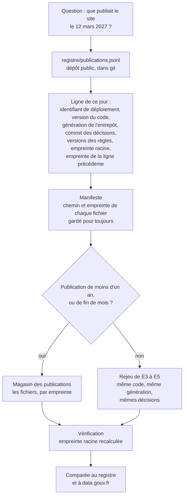

Comment ça tient :

- **Le registre** est une chaîne : chaque ligne contient l'empreinte de la précédente. On
  ne peut pas modifier une ligne ancienne sans que ça se voie. L'empreinte racine est aussi
  recopiée sur data.gouv.fr, un tiers qui date l'information.
- **Le magasin** garde chaque fichier publié **une seule fois**, par empreinte. Une fiche qui
  ne change pas ne coûte rien de plus.
- **La réduction** : au-delà d'un an, on ne garde les fichiers que des publications de fin de
  mois. Les autres se reconstruisent, parce que la composition est déterministe et que
  l'entrepôt garde toutes les versions.
- **La preuve que le rejeu marche encore** : chaque mois, une publication tirée au sort est
  rejouée et comparée.

Une donnée publiée ne se corrige jamais à la main. Elle change parce qu'une entrée a changé
(une source, un lecteur, une règle, une décision), et le registre dit quand.

## 2.15 Droits d'écriture

Chaque tâche du workflow déclare ses droits (clé `permissions`) ; le droit par défaut du
dépôt est la lecture seule. **Seule la tâche qui publie écrit** (étape 2, correction P3).
Aucun secret n'est nécessaire : le jeton fourni à chaque exécution suffit.

| Tâche | Étapes | Droits | Elle produit |
| --- | --- | --- | --- |
| `preparer` | E0 | `contents: read` | le plan de la nuit ; refus immédiat d'une option invalide |
| `collecter` | E1, E2, E3 | `contents: read` | artefact « acquis » (relevés, nouvelles versions, listes des membres) ; cache de lecture |
| `calculer` | E4, E5, E6 | `contents: read` | artefact « candidate » (fichiers servis, export plat, page minimale, ajouts aux registres, rapport, anomalies) |
| `ecrire` | E7 | `contents: write` | **seule écriture** : entrepôt (acquis, registres), magasin des publications, export, rapport. Si `calculer` a échoué ou qu'un contrôle bloque : l'acquis et les ajouts aux registres seulement |
| `alerter` | E8 | `issues: write` | les issues d'alerte, une par sujet ; aucun fichier |

Un test du dépôt relit le workflow et vérifie cette table : lecture seule par défaut,
`contents: write` dans la seule tâche `ecrire`, `issues: write` dans la seule tâche `alerter`.

### En image : où vivent les choses

**Les données précieuses vivent dans les *releases* du dépôt public ; le calcul se fait sur
une machine GitHub Actions jetable ; le site est un artefact GitHub Pages ; les alertes
restent privées.**

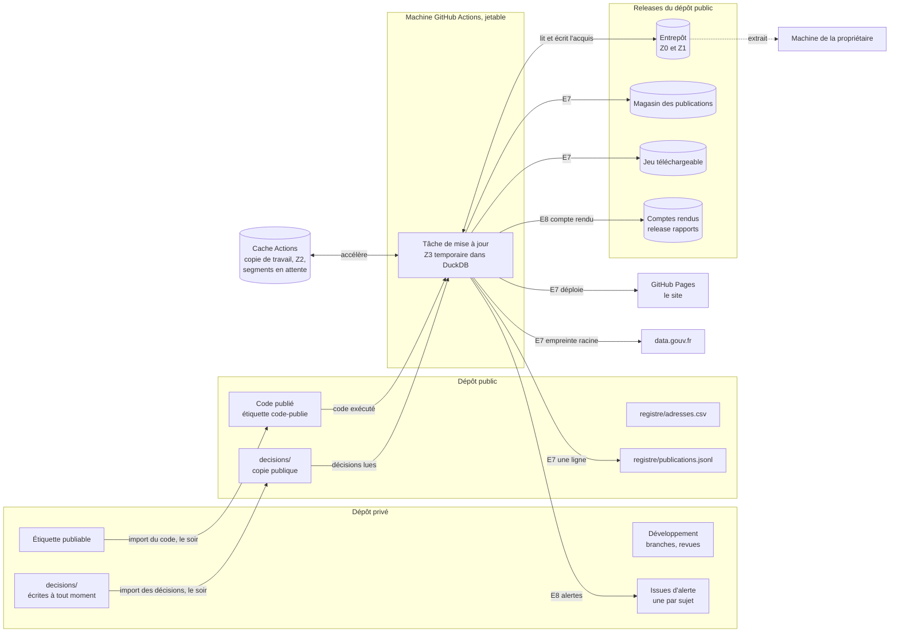

| Lieu | Ce qu'on y trouve | Si on le perd |
| --- | --- | --- |
| **Dépôt privé** | le développement, les tickets, les **alertes** (issues), les **décisions** au moment où la propriétaire les écrit | rien de publié n'est touché |
| **Dépôt public** | le code publié, la copie publique des **décisions** (importée chaque soir), le registre des adresses, le registre des publications, les tâches planifiées | les décisions et registres sont dans git : ils ont un historique |
| ***Releases*** | l'**entrepôt** (Z0, Z1 : segments de 90 Mo au plus, une *release* par année), le **magasin des publications**, le **jeu téléchargeable** (`donnees-derniere`, remplacée chaque soir, et une édition datée par mois), les **comptes rendus** (*release* `rapports`) | c'est l'acquis : à protéger (document 3, J4 ; sauvegarde hebdomadaire, question ouverte Q16) |
| **Cache Actions** | une copie de travail ; les faits lus **Z2** ; les segments acquis en fenêtre interdite, en attente de téléversement | Z2 se reconstruit depuis Z1 ; des segments en attente non lus pendant 7 jours seraient perdus (voir 2.1, « En image : la fenêtre horaire ») |
| **Machine Actions** | le graphe Z3, le temps du calcul | rien : tout se recalcule |
| **GitHub Pages** | le site : code et données d'**une** publication, en fichiers `.json.gz` (≈ 0,21 Go, sous la limite de 1 Go) | on redéploie depuis le magasin |
| **Machine de la propriétaire** | l'audit, l'essai hors ligne, les indices de contrôle interdits de publication (dossier local, hors dépôt) | rien de publié |

Deux remarques :

- L'entrepôt est **public** : c'est voulu (transparence). C'est pourquoi les présences et
  les collaborateurs sont filtrés **avant** tout stockage (E2).
- Les journaux de GitHub Actions sont publics aussi. Les indices de contrôle interdits n'y
  passent jamais : ils restent sur la machine de la propriétaire.

La zone Z2 (faits lus) vit dans le cache Actions. C'est un accélérateur : s'il est évincé,
Z2 se reconstruit en relisant Z1.
