# 6. Le processus, expliqué

Ce document explique en images comment les données vont des sources au site. Il ne décide
rien : la spécification est le document 2, le vocabulaire des données est le document 1, les
raisons des choix sont dans le document 3. En cas de doute, ce sont eux qui font foi.

Pour qui : la propriétaire, ou une contributrice qui découvre le projet. Chaque section
commence par la phrase à retenir, puis un schéma, puis quelques lignes.

Quatre mots reviennent partout :

| Mot | Sens |
| --- | --- |
| **relevé** | la trace d'un accès à une source : quoi, quand, réponse, complet ou non (zone Z0) |
| **objet source versionné** | un morceau d'archive (un acteur, un scrutin, un amendement…), gardé version par version (zone Z1) |
| **décision** | un fichier YAML écrit par la propriétaire, quand une règle ne tranche pas (zone ZD) |
| **fait** | une affirmation élémentaire tirée d'un objet source, avec sa provenance (zone Z2) |

---

## 6.1 Le processus en une image

**Une mise à jour enchaîne neuf étapes : les trois premières acquièrent et gardent tout, les
six suivantes recalculent et peuvent être rejouées à volonté.**

```mermaid
flowchart LR
    subgraph ACQ["ACQUIS - conservé pour toujours"]
        direction TB
        E0["E0 Démarrer<br/>verrou, options, fenêtre, plan"]
        E1["E1 Relever<br/>un collecteur par source"]
        E2["E2 Découper et versionner<br/>un découpeur par format"]
        Z0[("Z0 Relevés")]
        Z1[("Z1 Objets sources<br/>versionnés")]
        ZD[("ZD Décisions<br/>fichiers YAML")]
        E0 --> E1
        E1 -- "fichiers reçus" --> E2
        E1 -- "relevés" --> Z0
        E2 -- "nouvelles versions,<br/>retraits constatés" --> Z1
    end

    subgraph REC["RECALCULÉ - rejouable"]
        direction TB
        E3["E3 Lire<br/>un lecteur par type d'objet"]
        Z2[("Z2 Faits lus")]
        E4["E4 Relier et dériver<br/>règles nommées"]
        Z3[("Z3 Graphe relié<br/>et couverture")]
        E5["E5 Composer<br/>un composeur par type de fiche"]
        Z4[("Z4 candidate<br/>fichiers JSON, jeu, manifeste")]
        E6{"E6 Contrôler<br/>C1 à C7, A1 à A8"}
        E7["E7 Publier"]
        E8["E8 Rendre compte"]
        E3 --> Z2 --> E4 --> Z3 --> E5 --> Z4 --> E6
        E6 -- "aucune anomalie bloquante" --> E7
        E6 -- "refus" --> E8
        E7 --> E8
    end

    Z1 -- "versions nouvelles<br/>ou toutes si un lecteur change" --> E3
    ZD -- "décisions" --> E4
    ZD -- "levées de contrôle" --> E6
    E7 --> SITE["Site en ligne<br/>et registre des publications"]
    E8 --> CR["Compte rendu public<br/>et alertes privées"]
```

Ce qu'il faut voir :

- **À gauche, l'acquis.** E1 et E2 écrivent au fil de l'eau, source par source. Ce qui est
  écrit reste, même si la suite échoue.
- **À droite, le recalculé.** Faits, graphe, fiches : tout se refait à partir de Z1 et des
  décisions. On peut effacer Z2 et Z3 sans rien perdre.
- **Ce qui circule** : des fichiers reçus et des relevés (E1), des versions d'objets (E2),
  des faits avec leur provenance (E3), un graphe relié avec la règle de chaque lien (E4),
  des fichiers de fiche et un manifeste (E5).
- **E6 est une porte.** Si un contrôle bloquant échoue, rien n'est publié ; le site reste
  dans son état précédent, complet.

Un **chantier** est un travail trop long pour une soirée (premier remplissage, relecture
complète). Il avance d'une mise à jour à l'autre. Ce qui n'est pas fait est publié comme
« en cours », jamais comme une absence.

---

## 6.2 Où vivent les choses

**Les données précieuses vivent dans les *releases* du dépôt public ; le calcul se fait sur
une machine GitHub Actions jetable ; le site est un artefact GitHub Pages ; les alertes
restent privées.**

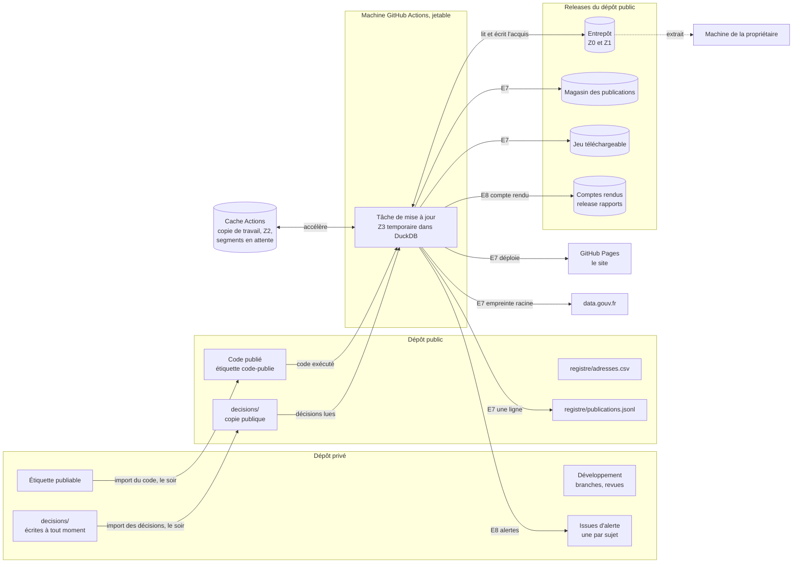

| Lieu | Ce qu'on y trouve | Si on le perd |
| --- | --- | --- |
| **Dépôt privé** | le développement, les tickets, les **alertes** (issues), les **décisions** au moment où la propriétaire les écrit | rien de publié n'est touché |
| **Dépôt public** | le code publié, la copie publique des **décisions** (importée chaque soir), le registre des adresses, le registre des publications, les tâches planifiées | les décisions et registres sont dans git : ils ont un historique |
| ***Releases*** | l'**entrepôt** (Z0, Z1 : segments de 90 Mo au plus, une *release* par année), le **magasin des publications**, le **jeu téléchargeable** (`donnees-derniere`, remplacée chaque soir, et une édition datée par mois), les **comptes rendus** (*release* `rapports`) | c'est l'acquis : à protéger (document 3, J4 ; sauvegarde hebdomadaire, question ouverte Q16) |
| **Cache Actions** | une copie de travail ; les faits lus **Z2** ; les segments acquis en fenêtre interdite, en attente de téléversement | Z2 se reconstruit depuis Z1 ; des segments en attente non lus pendant 7 jours seraient perdus (voir 6.6) |
| **Machine Actions** | le graphe Z3, le temps du calcul | rien : tout se recalcule |
| **GitHub Pages** | le site : code et données d'**une** publication, en fichiers `.json.gz` (≈ 0,21 Go, sous la limite de 1 Go) | on redéploie depuis le magasin |
| **Machine de la propriétaire** | l'audit, l'essai hors ligne, les indices de contrôle interdits de publication (dossier local, hors dépôt) | rien de publié |

Deux remarques :

- L'entrepôt est **public** : c'est voulu (transparence). C'est pourquoi les présences et
  les collaborateurs sont filtrés **avant** tout stockage (E2).
- Les journaux de GitHub Actions sont publics aussi. Les indices de contrôle interdits n'y
  passent jamais : ils restent sur la machine de la propriétaire.

La zone Z2 (faits lus) vit dans le cache Actions. C'est un accélérateur : s'il est évincé,
Z2 se reconstruit en relisant Z1.

---

## 6.3 Une soirée normale

**Chaque soir à 19 h 30, une tâche prend le verrou, interroge les sources, ne garde que ce qui
a changé, recalcule tout le reste, contrôle, publie, puis rend compte ; à 21 h 30, un second
déclenchement voit que c'est fait et s'arrête.**

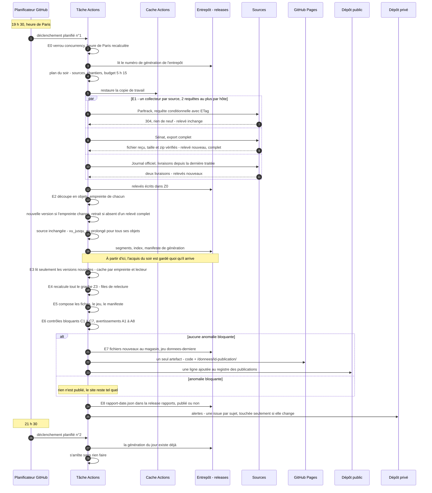

Ce qu'il faut voir, étape par étape :

1. **Déclenchement.** Deux horaires, parce que GitHub retarde ses tâches planifiées et en
   abandonne parfois. Le premier qui part fait le travail.
2. **Verrou.** Un seul traitement à la fois (groupe `concurrency`). En plus, l'entrepôt a un
   numéro de génération : si quelqu'un a écrit entre-temps, l'écriture échoue au lieu
   d'écraser.
3. **Relevés conditionnels.** Une source inchangée coûte une requête. Un téléchargement est
   vérifié contre sa taille annoncée, car l'Assemblée coupe des transferts en répondant
   « 200 ».
4. **Découpe.** Une archive devient des objets (un acteur, un scrutin…). On ne garde une
   version que si son empreinte change. Les présences et collaborateurs sont retirés ici.
5. **Lecture incrémentale.** On ne relit que les objets nouveaux ou changés, sauf si un
   lecteur a changé de version : alors on relit tout ce type d'objet, depuis l'entrepôt.
6. **Recalcul.** Le graphe est recalculé **en entier**, chaque soir. C'est plus simple et
   plus sûr que de suivre les dépendances (un nouveau scrutin change la « dernière lecture »
   d'un texte, donc des positions sur des dizaines de fiches).
7. **Composition.** Même entrée, mêmes octets : on peut comparer deux publications fichier
   par fichier.
8. **Contrôles.** Sept contrôles bloquants, huit avertissements (section 6.5).
9. **Publication.** Un seul déploiement : le code et les données d'une même publication.
10. **Rapport et alertes.** Le compte rendu est public : un fichier `rapport-<date>.json`
    dans la *release* `rapports`, écrit **même quand rien n'est publié**, avec une copie
    dans le résumé de la tâche ; la page des sources lie le dernier. Les alertes vont au
    dépôt privé. Rien ne se répète quand rien ne change.

Les heures intermédiaires ne sont pas données : la durée de chaque étape sera chiffrée dans
le document 4. Le schéma montre l'**ordre**, pas les durées.

Une source n'est pas relevée chaque soir : chacune a sa cadence (document 2, 2.3). Par
exemple, les mandats locaux et les finances sont relevés chaque semaine, Sycomore et
Wikidata à l'arrivée d'une personne puis une fois par an.

---

## 6.4 La vie d'un objet source

**Un objet source ne change d'état qu'au vu d'un relevé : il gagne une version quand son
contenu change, il est retiré quand un relevé complet ne le contient plus, et une panne ne
change rien.**

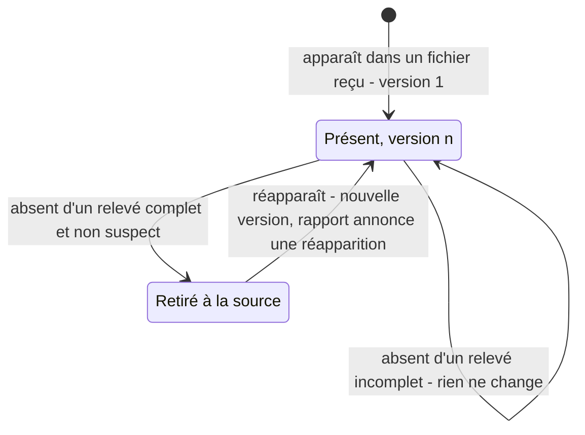

Les quatre cas de la vie courante :

| Cas | Ce que dit le relevé | Ce qui change dans Z1 | Ce que voit le lecteur du site |
| --- | --- | --- | --- |
| **Nouvelle version** | l'objet est là, son empreinte a changé (sort d'un amendement, fin d'un mandat) | version n+1 ; la version n reste, datée | le fait mis à jour |
| **Inchangé** | l'objet est là, même empreinte ; ou la source répond « 304 » à la requête conditionnelle | `vu_jusqu_au` avance (pour tous les objets de la source, en cas de 304) | rien |
| **Retiré à la source** | relevé **complet**, l'objet n'y est plus (cosignature retirée) | état `retire_a_la_source` ; les versions restent | le fait disparaît partout, et le rapport le **nomme** |
| **Source en panne** | relevé `echec` ou `suspect` | **rien** | les faits restent ; « à jour au » reste à la date du dernier relevé réussi ; couverture « panne depuis le … » |
| **Réapparition** | un objet retiré est de nouveau là | nouvelle version `present` ; la période de retrait reste dans l'historique | le fait revient ; le rapport annonce une « réapparition » |

La règle à retenir : **seul un relevé complet peut faire constater un retrait.** Sans elle,
un export du Sénat servi vide avec « 200 » effacerait tous les sénateurs.

Les anciennes versions ne sont jamais effacées. C'est ce qui garde l'historique des champs
que l'Assemblée réécrit chaque nuit (siège, libellés, position déclarée d'un groupe).

Un « 304 » ne prolonge `vu_jusqu_au` que si le dernier relevé de ce point d'accès était
complet.

---

## 6.5 Ce qui se passe en cas de panne

**Une panne ne fait jamais perdre ce qui est acquis, ne fait jamais disparaître un fait, et se
voit à la fois sur le site et dans une alerte.**

### Source injoignable ou réponse suspecte

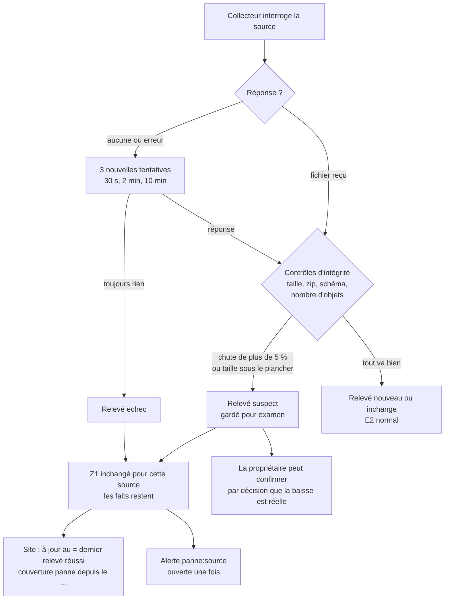

- Les collecteurs sont **isolés** : une source en panne n'empêche pas les autres d'être
  relevées, ni la publication.
- Une réponse **suspecte** est traitée comme une panne. Si la baisse est réelle, la
  propriétaire le dit par une décision.
- L'alerte est ouverte **une fois**. Elle est mise à jour si son contenu change, fermée quand
  la source revient.

### Contrôle bloquant, puis levée

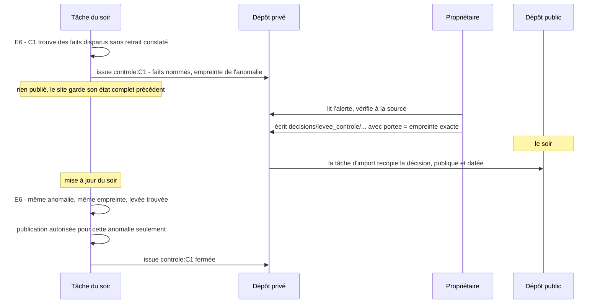

Les sept contrôles bloquants, en une ligne chacun :

| Contrôle | Il refuse si… |
| --- | --- |
| C1 Pertes non expliquées | un fait publié disparaît (objet entier, ou fait à l'intérieur d'un objet comme une cosignature) sans retrait constaté par comparaison des versions, sans décision, et sans être annoncé par la note de version d'un lecteur ou d'une règle (les faits sont nommés) |
| C2 Liens pendants | un lien vise un fichier ou une adresse qui n'existe pas |
| C3 Données laissées de côté | faits lus ≠ faits servis + faits écartés avec raison |
| C4 Données interdites | un champ hors schéma, un motif interdit (taux de présence, score, total de divergences…), une liste de personnes dans un ordre non neutre, un texte porté servi avant son examen en commission |
| C5 Lecture incomplète | une couverture dite « complète » alors qu'un relevé contributeur ne l'est pas, ou un 0 servi sans couverture `complet` ou `relu_aucun` |
| C6 Effondrement | une famille tombe à zéro, ou baisse de plus de 20 % sans retrait constaté |
| C7 Personne écartée en silence | une personne attendue d'après les sources n'est dans aucune population, sans raison établie |

Une levée vaut pour **une** anomalie, d'empreinte donnée. Si l'anomalie change (un treizième
fait disparaît), la levée ne vaut plus : il faut une nouvelle décision. Il n'existe pas de
case « forcer la publication ». Une levée urgente suit le même chemin que toute décision :
elle prend effet à la mise à jour du soir.

### Tâche interrompue

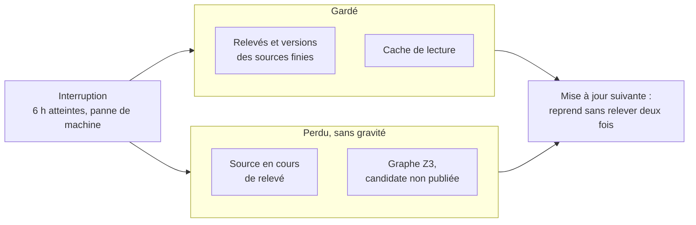

Une interruption coûte au plus le travail de la source en cours. Le reste est soit acquis
(E1–E2 écrivent source par source), soit recalculable (E3–E5).

### Les autres cas

| Situation | Données | Ce qui se voit |
| --- | --- | --- |
| Objet illisible (un acteur mal formé) | ses faits précédents restent | compté dans le rapport ; alerte au-delà d'un seuil |
| Panne de GitHub Pages au déploiement | registre non écrit | nouvelle tentative le lendemain |
| Pas de mise à jour depuis plus de 26 h | — | alerte `planification` |

---

## 6.6 Publier du code, la fenêtre horaire, l'essai, la relecture complète

### Publier du code sans écraser les données

**Le code ne part jamais seul : la propriétaire pose une étiquette sur le dépôt privé, et le
soir une tâche du dépôt public importe ce code puis publie code et données ensemble.**

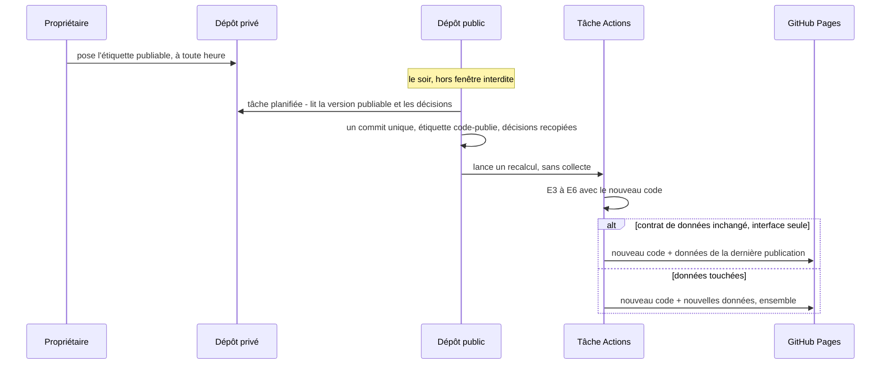

- Le dépôt public ne reçoit **pas** l'historique du développement : un seul commit par
  import.
- Les données publiées correspondent toujours au code publié : ils partent dans le même
  artefact.
- Un import de code et une mise à jour ne se croisent jamais : même groupe `concurrency`.
- Quand seul l'affichage change, on reprend les données **de la dernière publication**,
  jamais des données plus anciennes.

### La fenêtre horaire

**Du lundi au vendredi, de 9 h à 19 h (heure de Paris, jours fériés exclus), rien ne s'écrit
sur le dépôt public.**

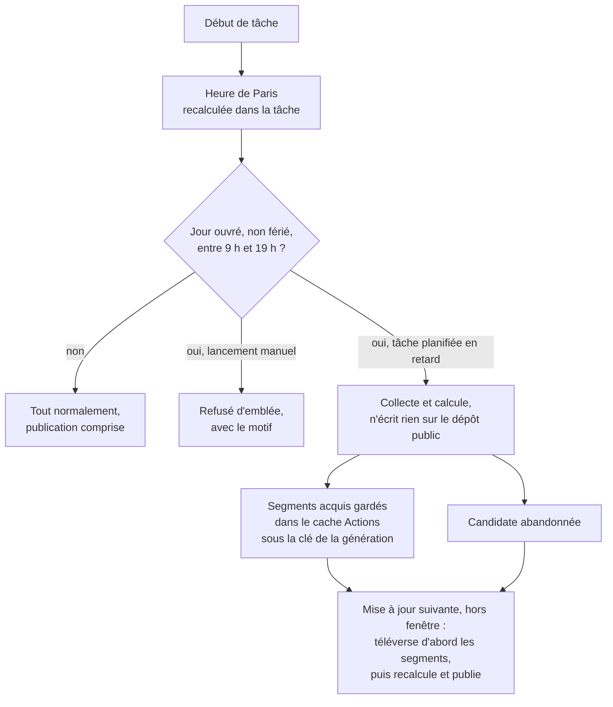

Pourquoi calculer l'heure dans la tâche : le planificateur de GitHub ne garantit pas
l'horaire. Une tâche prévue à 19 h 30 peut partir à 23 h, ou le lendemain matin.

Ce qui se passe quand une tâche tourne en fenêtre interdite :

- **L'acquis n'est pas perdu.** Téléverser dans l'entrepôt serait une écriture visible
  (l'entrepôt est fait d'actifs de *release* du dépôt public). Les segments sont donc gardés
  dans le cache Actions, invisible, qui les conserve 7 jours sans lecture. La mise à jour
  suivante, hors fenêtre, les téléverse avant tout le reste.
- **La candidate n'est pas reprise.** La mise à jour suivante la recalcule : E3 à E5 ne
  coûtent que quelques minutes.
- **Les décisions ne touchent jamais le dépôt public en journée.** La propriétaire les écrit
  quand elle veut dans `decisions/` du dépôt **privé** ; la tâche d'import du soir les
  recopie sur le dépôt public.

### L'essai sur quelques personnes

**Un essai suit les mêmes étapes, limite le calcul à quelques personnes et ne publie rien.**

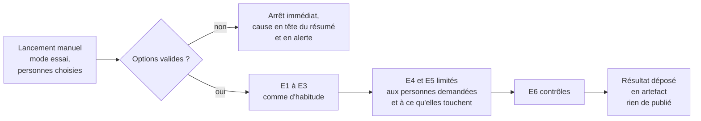

Le même essai tourne sur la machine de la propriétaire, sans réseau, sur un extrait de
l'entrepôt : `empreinte essai --personnes … --hors-ligne`. Il tient dans ses 7,8 Gio.

Les options du lancement manuel :

| Option | Valeurs |
| --- | --- |
| Mode | `quotidien` · `complet` · `recalcul` · `essai` |
| Sources | toutes · une liste |
| Personnes (essai) | adresses ou identifiants |
| Publier | oui · non (toujours non en essai) |

« Essai » + « publier : oui » est refusé tout de suite, avec la cause.

### La relecture complète

**Forcer une relecture complète, c'est lancer le mode `complet` : toutes les sources sont
relues sans requête conditionnelle.** Les objets qui n'ont pas changé ne créent pas de
version nouvelle (même empreinte) : la relecture complète coûte du réseau, pas du stockage.

Le mode `recalcul`, lui, ne relève rien : il repart de l'entrepôt. C'est celui qu'on lance
après un changement de code.

---

## 6.7 Savoir ce qui était publié à une date

**Le registre des publications dit quelle publication était en ligne à une date ; le magasin
garde ses fichiers ; au-delà d'un an, on peut la reconstruire en rejouant le traitement, et
l'empreinte racine prouve qu'elle est identique.**

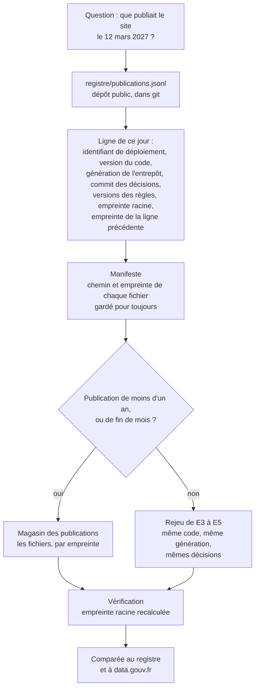

Comment ça tient :

- **Le registre** est une chaîne : chaque ligne contient l'empreinte de la précédente. On
  ne peut pas modifier une ligne ancienne sans que ça se voie. L'empreinte racine est aussi
  recopiée sur data.gouv.fr, un tiers qui date l'information.
- **Le magasin** garde chaque fichier publié **une seule fois**, par empreinte. Une fiche qui
  ne change pas ne coûte rien de plus.
- **La réduction** : au-delà d'un an, on ne garde les fichiers que des publications de fin de
  mois. Les autres se reconstruisent, parce que la composition est déterministe et que
  l'entrepôt garde toutes les versions.
- **La preuve que le rejeu marche encore** : chaque mois, une publication tirée au sort est
  rejouée et comparée.

Une donnée publiée ne se corrige jamais à la main. Elle change parce qu'une entrée a changé
(une source, un lecteur, une règle, une décision), et le registre dit quand.
