# 7. Le modèle de données, expliqué

Ce document explique en images de quoi sont faites les données et comment une page du site
se compose. Il ne décide rien : la spécification est le document 1, le processus le
document 2, les raisons des choix le document 3. En cas de doute, ce sont eux qui font foi.

Pour qui : la propriétaire, ou une contributrice qui découvre le projet. Chaque section
commence par la phrase à retenir, puis un schéma, puis quelques lignes.

Vocabulaire : une **source** est un producteur de données (Assemblée, Sénat, Journal
officiel…) ; un **fait** est une affirmation élémentaire tirée d'une source (« `PA720614` a
voté contre au scrutin `VTANR5L17V4321` ») ; une **fiche** est une page du site (personne,
lignée, gouvernement, législature) ; une **règle** est un calcul nommé et versionné qui relie
ou classe des faits (`R-DERNIERE-LECTURE@2`).

---

## 7.1 Le modèle en une image

**Trois choses seulement sont précieuses — ce qu'on a relevé, les objets sources versionnés,
les décisions de la propriétaire — et tout le reste se recalcule à partir d'elles.**

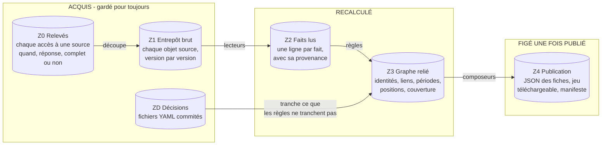

| Zone | Ce qu'elle contient | Où elle vit | Si on l'efface |
| --- | --- | --- | --- |
| **Z0 Relevés** | le journal des accès aux sources | entrepôt (*releases* du dépôt public) | perte irréparable |
| **Z1 Entrepôt brut** | chaque objet source, chaque version, filtré des données interdites et gardé sous forme canonique (re-sérialisé), en segments de 90 Mo au plus | entrepôt | perte irréparable |
| **ZD Décisions** | identité validée, filiation tranchée, levée de contrôle… | écrites dans `decisions/` du dépôt privé, recopiées chaque soir dans `decisions/` du dépôt public | perte irréparable (mais git en garde l'historique) |
| **Z2 Faits lus** | des tables normalisées, avec provenance | cache de GitHub Actions (accélérateur) | on relit Z1 |
| **Z3 Graphe relié** | tout ce que les règles calculent | temporaire, pendant la mise à jour | on recalcule |
| **Z4 Publication** | ce que le navigateur télécharge | GitHub Pages ; copies gardées pour la traçabilité | on rejoue |

Trois idées tiennent l'ensemble :

- **Un fait porte toujours sa provenance** : source, objet, version, adresse publique,
  licence. Sans provenance, il n'est pas servi.
- **Deux temps.** Le temps de la source (« mandat du 22/06/2022 au 09/06/2024 ») et le temps
  de la connaissance (« vu dans l'archive du 03/11/2026 »). Le second est porté par les
  versions de Z1.
- **Toute liaison est une règle** nommée, versionnée, publiée sur la page de méthodologie.
  Une règle qui ne conclut pas écrit « non établi », jamais une devinette. Une **décision**
  de la propriétaire ne corrige jamais une donnée publiée : c'est une **entrée** du calcul.

---

## 7.2 Les objets et leurs relations

**Les faits lus (Z2) reprennent les objets des sources ; le graphe (Z3) ajoute ce que le site
construit lui-même : les personnes, les groupes d'une législature, les lignées, les liens et
les positions.**

Les schémas qui suivent sont découpés par domaine. Ils montrent les relations principales,
pas toutes les colonnes. Les noms sont ceux des tables du document 1. Dans chaque schéma,
les objets **dérivés** (Z3) sont listés sous le schéma ; les autres sont des faits lus (Z2).

### Personnes et mandats

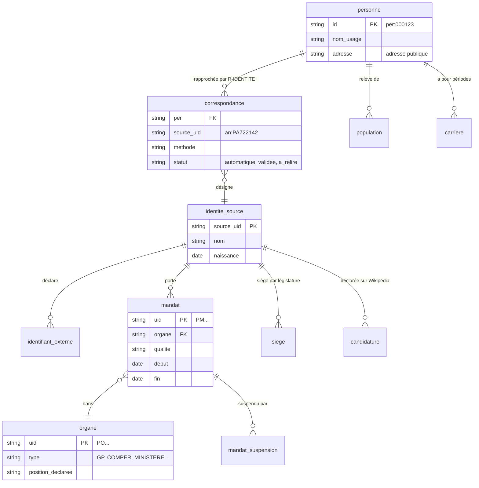

Dérivés (Z3) : `personne`, `correspondance`, `population`, `carriere`.

- Une **personne** existe une seule fois sur le site, même si quatre sources la connaissent.
  La `correspondance` dit par quelle méthode chaque identité de source lui est rattachée.
- La règle R-IDENTITE ne rapproche jamais sur le nom seul : il faut un identifiant déclaré
  (Wikidata, un `PA` dans une autre archive) ou le nom **et** la date de naissance. Sinon,
  `a_relire`, et une identité de candidat n'est jamais publiée sans validation.
- Une **population** (`candidat`, `membre_groupe`, `membre_gouvernement`, `depute_ni`) est un
  drapeau daté. « Candidat » n'est qu'une population : la supprimer ne casse rien.
- La **carrière** met bout à bout tous les mandats et fonctions, toutes institutions, et
  déclare les périodes absentes de la source.

### Groupes, lignées, bancs

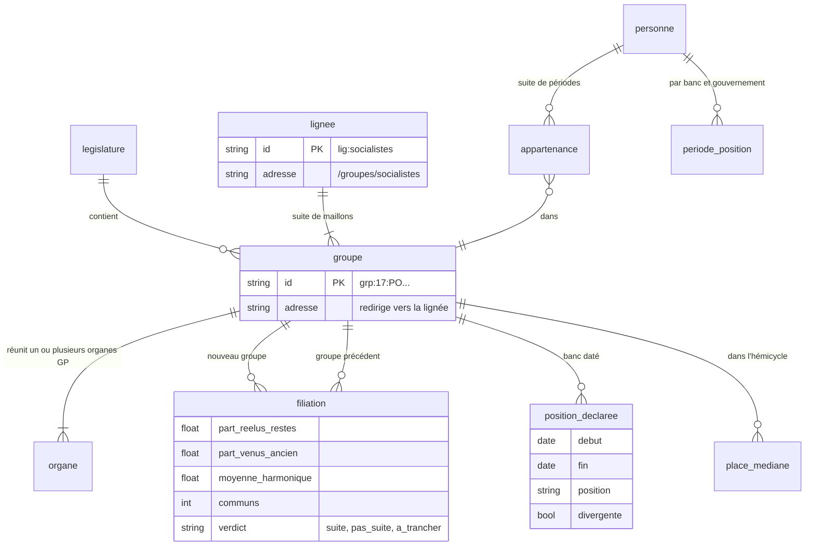

Tout ce schéma est dérivé (Z3), sauf `organe`, lu dans l'archive de l'Assemblée.

- Un **groupe** (ou « maillon ») est un groupe dans **une** législature. Il peut réunir
  plusieurs organes de l'Assemblée, si le groupe a changé d'organe en cours de route
  (R-CONTINUITE-GROUPE ; sinon décision `continuite_groupe`). Exemple : `grp:17:PO845419`,
  le groupe socialiste de la XVIIe.
- Un maillon n'a **pas de fiche propre**. Son adresse (`/groupes/socialistes/17`) est une
  page de redirection vers la fiche de la lignée, ouverte sur cette législature.
- Une **lignée** relie les maillons d'une législature à l'autre. Aucune source ne le fait :
  c'est la règle R-FILIATION (moyenne harmonique ≥ 60 % et au moins 5 députés communs). Ce
  qu'elle ne tranche pas attend une décision `filiation`.
- L'**appartenance** est une suite de périodes, pas une enveloppe : une personne peut partir
  et revenir.
- Le **banc** (majoritaire, minoritaire, opposition) n'est jamais déduit. Mesuré le
  04/11/2026 : aucun des 14 groupes de la XVIIe ne déclare de position. Leur banc est donc
  « non publié », et une période de position ne change, en XVIIe, qu'avec le gouvernement.

### Textes et scrutins

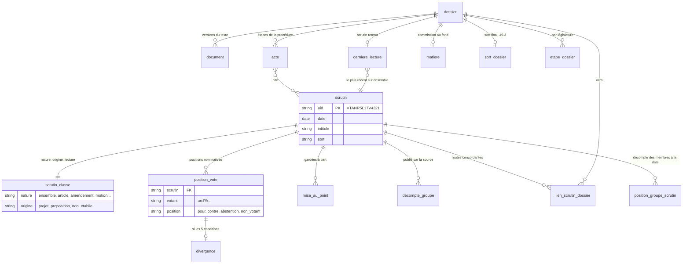

Dérivés (Z3) : `scrutin_classe`, `lien_scrutin_dossier`, `derniere_lecture`, `matiere`,
`sort_dossier`, `etape_dossier`, `position_groupe_scrutin`, `divergence`.

- Un scrutin ne dit presque jamais sur quel texte il porte. Le lien scrutin ↔ dossier passe
  par trois routes (référence directe, acte qui cite le scrutin, séance). Si deux routes se
  contredisent : pas de lien, et une alerte. Un lien faux est pire qu'un lien absent.
- La **dernière lecture** se choisit sur **tout** le corpus, pas seulement parmi les scrutins
  où la personne a voté.
- Une **mise au point** (« je voulais voter pour ») est gardée à côté de la position, jamais
  à sa place.

### Amendements et textes portés

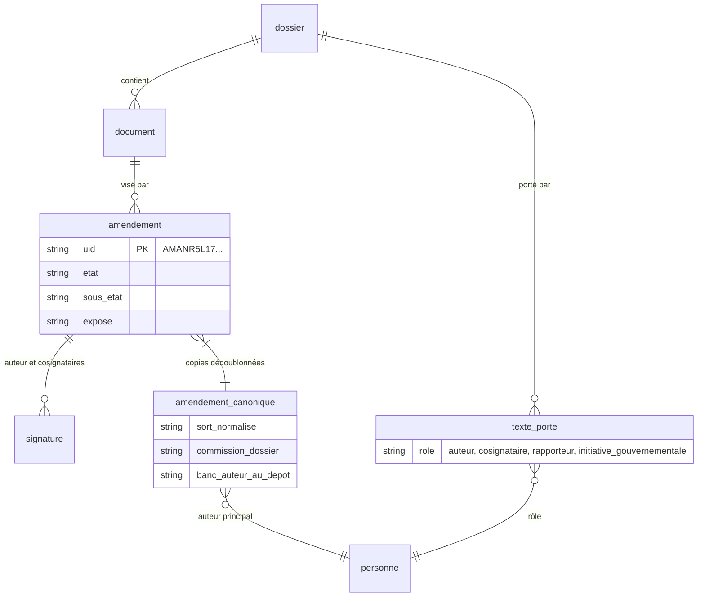

Dérivés (Z3) : `amendement_canonique`, `texte_porte`.

- Un amendement existe parfois en plusieurs copies : la copie qui fait foi est celle du
  premier signataire (R-AMENDEMENT). Un amendement compte une fois ; les signatures se
  comptent à part, sous ce nom.
- Un projet de loi est une **initiative gouvernementale**, pas un acte personnel du ministre
  (R-TEXTE-PORTE). Un texte porté n'est publiable qu'à partir de son examen en commission.

### Séances et paroles

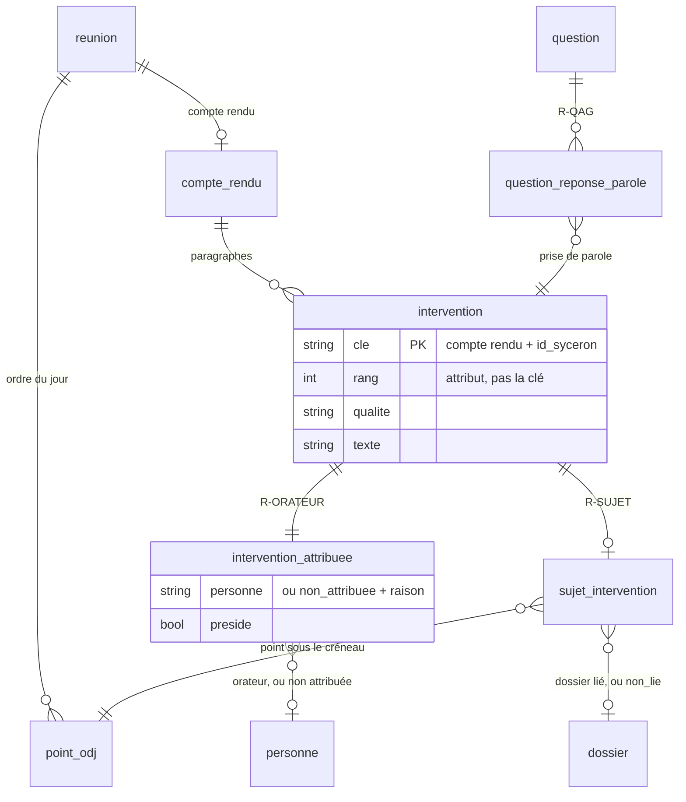

Dérivés (Z3) : `intervention_attribuee`, `sujet_intervention`, `question_reponse_parole`.

- L'identifiant d'orateur de l'Assemblée est parfois faux : orateur collectif, identifiant de
  repli, `PA0`, identifiant négatif, nom affiché qui ne correspond pas. Dans ces cas, la
  parole est **non attribuée**, avec sa raison.
- La **présidence de séance** est distinguée du débat (`preside`).
- Les **présences** n'entrent pas : la table `reunion` n'a pas de colonne pour elles, et elles
  sont filtrées avant même d'être stockées.

### Gouvernement et Journal officiel

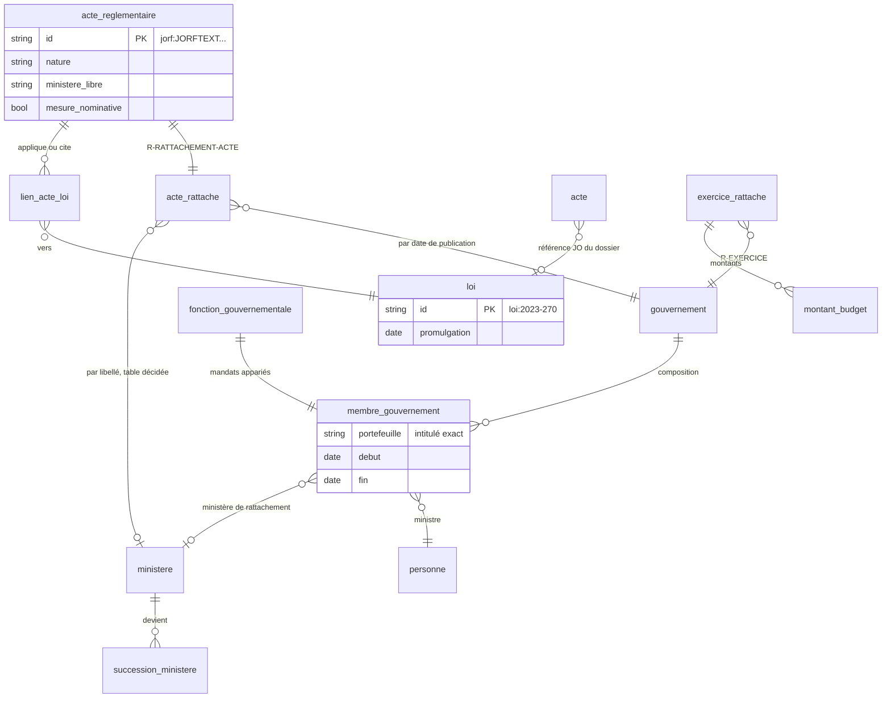

Dérivés (Z3) : `membre_gouvernement`, `acte_rattache`, `exercice_rattache`.

- Un acte réglementaire est rattaché à un **gouvernement** (par sa date) et à un
  **ministère** (par son libellé, via une table décidée). **Jamais à une personne** : le
  schéma n'a pas de relation entre `acte_rattache` et `personne`.
- Le **numéro de loi** est le lien sûr entre un dossier de l'Assemblée et le Journal officiel
  (le NOR manque souvent).
- Un ministre délégué est rattaché à son ministère de tutelle par son libellé (« auprès
  du ministre… »), confirmé par une table décidée (`rattachement_portefeuille`).

---

## 7.3 Les identifiants

**On garde les identifiants des sources, préfixés ; on n'en crée que pour ce que le site
construit ; une adresse publiée ne change jamais.**

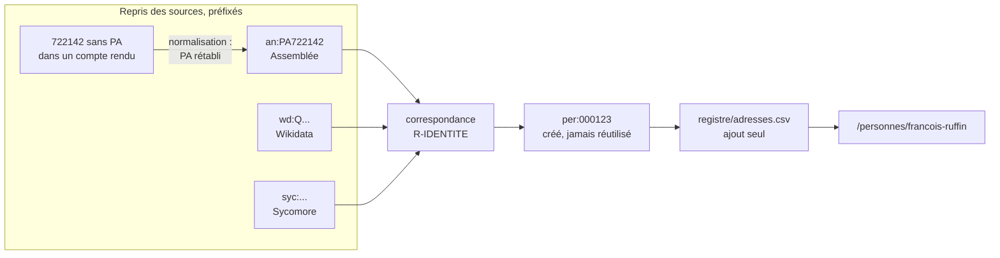

| Ce qui est repris | Ce qui est créé |
| --- | --- |
| `an:PA…` (personne), `an:PO…` (organe), `an:PM…` (mandat), `an:VT…` (scrutin), `an:DL…` (dossier), `an:AM…` (amendement) | `per:…` une personne, car elle existe dans plusieurs sources et un candidat sans mandat n'a pas de `PA` |
| `senat:…`, `pe:…`, `pt:…`, `jorf:…`, `loi:…`, `wd:…`, `syc:…`, `eurovoc:…` | `grp:17:PO…` un groupe d'une législature (législature + premier organe) |
| | `lig:…` une lignée, que personne d'autre ne définit |
| | `cand:2027:per:…` une candidature |

Règles simples :

- Un identifiant de source est **vérifié** à la lecture : un `VT…` ne peut pas désigner une
  personne. Un identifiant mal formé part en anomalie de lecture.
- Un identifiant créé ne **porte aucune information**. C'est pour ça qu'il ne change jamais.
- L'**adresse publique** est inscrite à part, dans un registre en ajout seul.

### Comment une adresse reste stable

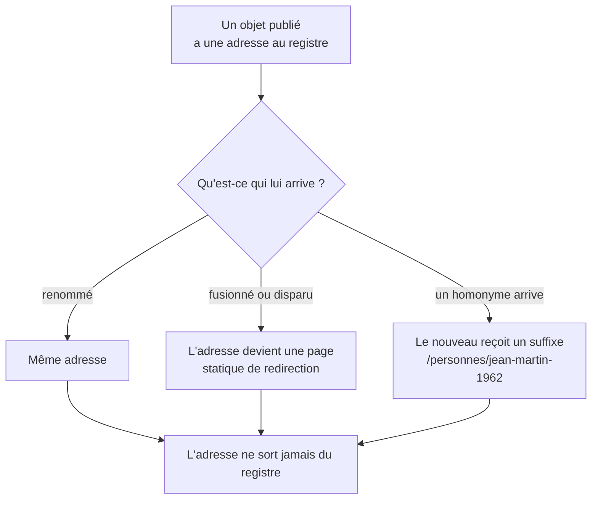

GitHub Pages ne sait pas rediriger côté serveur : la redirection est une petite page
statique. Le contrôle C2 vérifie qu'aucun lien publié ne vise une adresse absente du
registre.

### Le cas des prises de parole

**Une prise de parole garde son ancre même quand l'Assemblée republie le compte rendu.**

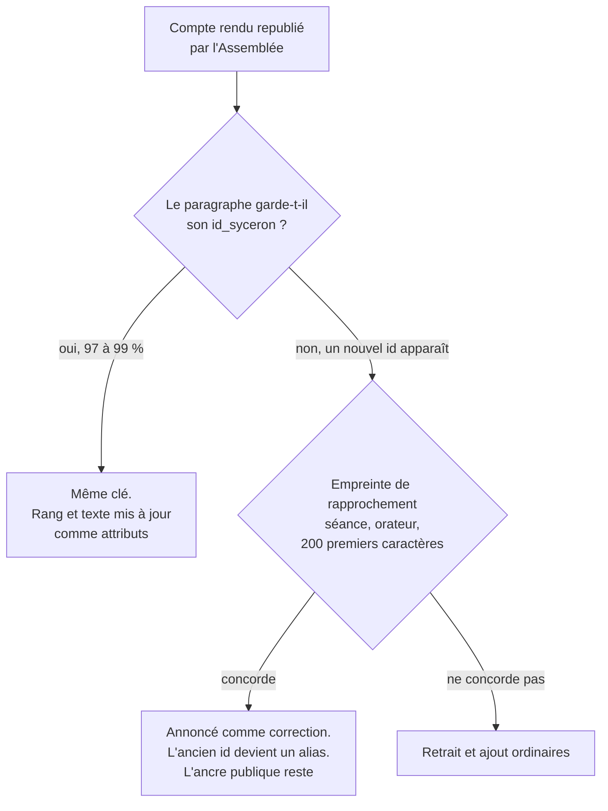

Le **rang** du paragraphe change à chaque republication : ce n'est donc pas la clé. Mesuré le
04/11/2026 sur les deux comptes rendus provisoires de l'archive XVIIe : `id_syceron` reste le
même pour 97 à 99 % des paragraphes.

La clé d'une prise de parole est donc `an:<uid du compte rendu>#<id_syceron>` : c'est
l'identifiant de la source, préfixé par le compte rendu. Sur la fiche, elle donne une ancre
`#int-…` et un lien vers le paragraphe de l'Assemblée.

---

## 7.4 Comment une fiche se compose

**Une fiche est un petit fichier d'en-tête, chargé tout de suite, et des fichiers de section,
chargés quand on s'en approche ; chaque section est produite par quelques objets du graphe et
quelques règles nommées.**

### Ce que télécharge le navigateur

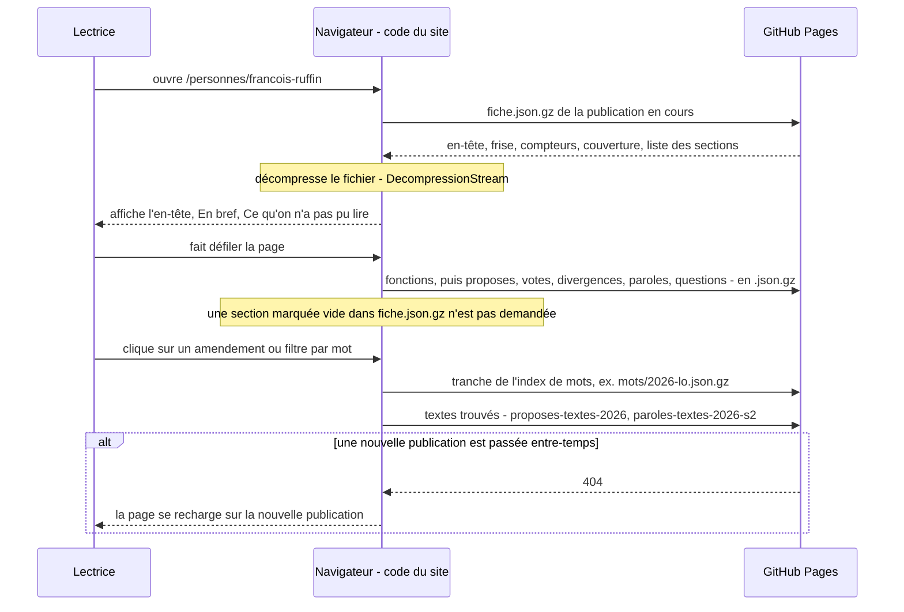

- Tous les fichiers d'une publication sont rangés sous `/donnees/<id-publication>/`. Le code
  du site connaît cet identifiant. La lectrice voit donc **une** publication complète,
  jamais un mélange de deux.
- Chaque fichier **embarque les libellés** qu'il cite (titre de dossier, nom de commission) :
  un peu de duplication, beaucoup moins de requêtes sur téléphone.
- Les fichiers de données sont publiés **déjà compressés** (`.json.gz`) et décompressés par
  le navigateur : le site tient ainsi en ≈ 0,21 Go au lieu de ≈ 0,82 Go, sous la limite de
  1 Go de GitHub Pages (calculé, doc. 4, 4.1.4). Dans la suite, les noms de fichiers omettent
  l'extension `.gz`.
- Le filtre par période (6 ou 12 mois) agit sur les dates déjà chargées ; les extraits de
  parole sont découpés par semestre, les exposés par année. Le filtre par mot charge d'abord
  la tranche d'un **index de mots** (les mots qui commencent par les deux mêmes lettres, pour
  une année), puis les seuls textes trouvés. L'adresse de la page porte les filtres
  (`?periode=12m&mot=logement`).

### La fiche de François Ruffin, section par section

Exemple : François Ruffin, `an:PA722142`, adresse `/personnes/francois-ruffin`, d'après les
captures du site actuel (04/11/2026). Les chiffres marqués « mesuré » viennent des mesures du
04/11/2026 sur les archives de l'Assemblée (`livrables/annexes/mesures/`). L'identifiant
`per:000123` est un exemple.

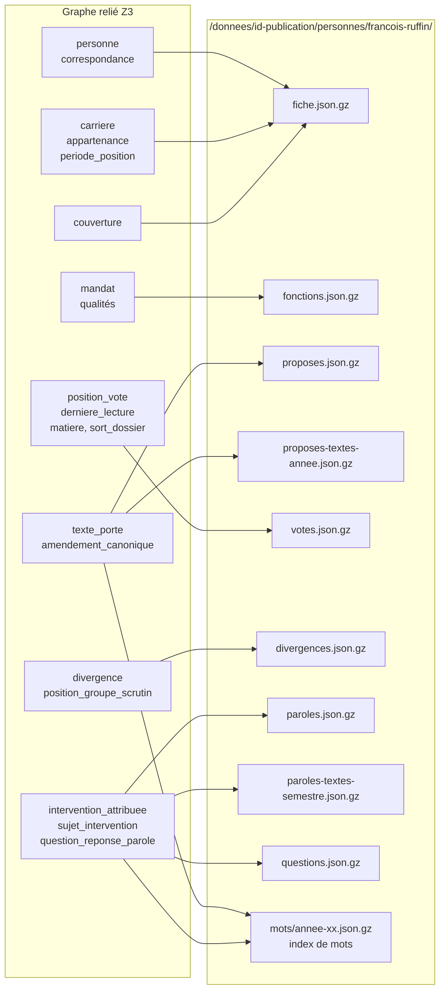

#### En-tête

> François Ruffin — Reporter · Groupe Écologiste et Social. Né le 18 octobre 1975 à Calais
> (Pas-de-Calais). [Source]

| Ce qu'on voit | Objet | Règle | Fichier |
| --- | --- | --- | --- |
| nom, profession, date et lieu de naissance | `personne` (identité retenue, et la source de chaque champ) | R-IDENTITE | `fiche.json` → `personne` |
| groupe actuel, avec lien | `appartenance` en cours → `groupe` (`grp:17:…`) → sa `lignee` | R-APPARTENANCE, R-FILIATION | `fiche.json` → `personne.groupe_actuel` |
| bouton « Source » | index `src` vers la table `sources` du fichier | — | `fiche.json` → `sources` |

Chaque valeur porte son `src`. Une valeur inconnue est `null` avec une raison, jamais vide
sans explication.

#### En bref

La frise montre trois mandats de député (2017, 2022, 2024), chacun avec son groupe et son
banc.

| Ce qu'on voit | Objet | Règle | Fichier |
| --- | --- | --- | --- |
| frise datée, par institution, chaque période reliée à sa législature | `carriere` | R-CARRIERE | `fiche.json` → `carriere` (en colonnes) |
| « FI · opposition », puis « ECOS » sans banc | `periode_position`, `position_declaree` | R-BANC, R-PERIODE | `fiche.json` → `carriere.banc` |
| siège par législature | `siege` | R-HEMICYCLE, R-ARBITRAGE-ARCHIVES | `fiche.json` → `carriere.siege` |
| compteurs datés par institution | comptes du graphe, avec leur date et leur couverture | R-COUVERTURE | `fiche.json` → `compteurs` |

- Le siège montre pourquoi l'entrepôt garde **toutes** les versions. Mesuré : Ruffin a le
  siège 627 dans l'archive figée de la XVe, 637 dans celle de la XVIe, et l'archive courante
  écrit 505 sur ses trois mandats. Seule l'archive figée dit le siège d'une législature close.
- Le groupe change trois fois (FI en XVe, LFI-NUPES en XVIe, ECOS en XVIIe) : ce sont trois
  groupes de trois législatures, chacun dans sa lignée.
- ECOS n'a pas de banc affiché : en XVIIe, aucun groupe ne déclare sa position. Le site écrit
  « non déclaré », il ne le devine pas.
- Poids mesuré : sa frise brute (141 mandats) pèse 1,4 Ko compressée ; la frise par
  institution tient en 9 lignes.

#### Les fonctions exercées

> Commissions · 9 intitulés · sur 9 ans 4 mois de mandat. 6 ans 5 mois : Commission des
> affaires économiques · Secrétaire…

| Ce qu'on voit | Objet | Règle | Fichier |
| --- | --- | --- | --- |
| fonctions par famille d'organe, avec durée et qualité (président, secrétaire, rapporteur…) | `mandat` (qualité, dates) → `organe` (type), mis en périodes par `carriere` | R-CARRIERE | `fonctions.json` |

Mesuré : 141 mandats pour Ruffin dans l'archive des acteurs de la XVIIe, dont 105 de
commissions permanentes, surtout des allers-retours de quelques jours.

#### Ce qu'il a proposé

> Les textes qu'il a portés : 2 examinés en commission, 3 discutés en séance, 0 adopté, 1
> promulgué ; 1 adopté sans vote (49.3, fait procédural). Les amendements dont il est l'auteur,
> par commission.

| Ce qu'on voit | Objet | Règle | Fichier |
| --- | --- | --- | --- |
| textes portés, par étape, avec matière et sort | `texte_porte`, `etape_dossier`, `matiere`, `sort_dossier` | R-TEXTE-PORTE, R-ETAPE, R-MATIERE, R-SORT-FINAL | `proposes.json` |
| « adopté sans vote (49.3) » | `sort_dossier.par_49_3` | R-SORT-FINAL | `proposes.json` |
| amendements **dont il est l'auteur principal**, par commission et par année, avec sort | `amendement_canonique` | R-AMENDEMENT, R-SORT-AMENDEMENT | `proposes.json` (sans exposés) |
| exposé d'un amendement, au clic ou sous filtre par mot | `amendement` | — | `proposes-textes-<annee>.json` |

- Mesuré, XVIIe : 136 amendements comme auteur principal, et 13 763 signatures comme
  cosignataire. Les deux ne se mélangent jamais.
- Pourquoi séparer les exposés : mesuré, sa liste d'amendements pèse 2,2 Ko compressée sans
  exposés, 45 Ko avec.
- Un 49.3 est un **fait de procédure** : il apparaît comme sort du dossier, jamais comme une
  position de vote (contrôle C4).

#### Ce qu'il a voté

> Sur 152 scrutins de textes en dernière lecture. Banc non publié · gouvernement Lecornu II.
> Par matière : Lois, 6 contre · 3 pour…

C'est la section la plus chargée en règles. Le schéma suit une position, de la source à
l'écran.

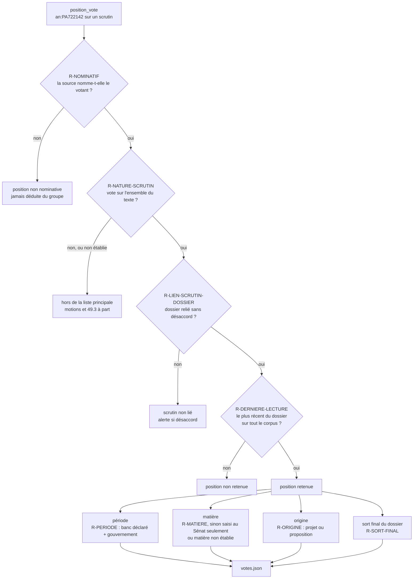

- Chaque position écartée l'est **avec sa raison** : le contrôle C3 vérifie que faits lus =
  faits servis + faits écartés avec raison.
- Mesuré, XVe à XVIIe : 1 729 positions nominatives de Ruffin, dont 282 sur l'ensemble d'un
  texte. La dernière lecture en garde moins (152 sur la capture du site actuel).
- Poids mesuré : la liste « ensemble d'un texte » pèse 2,9 Ko compressée.

#### Où il a voté autrement que son groupe

> Ce qui est comparable : 152 scrutins utilisés, 14 où son groupe s'est divisé. Puis une bande
> chronologique, et la liste des scrutins où il n'a pas voté comme la majorité de son groupe.

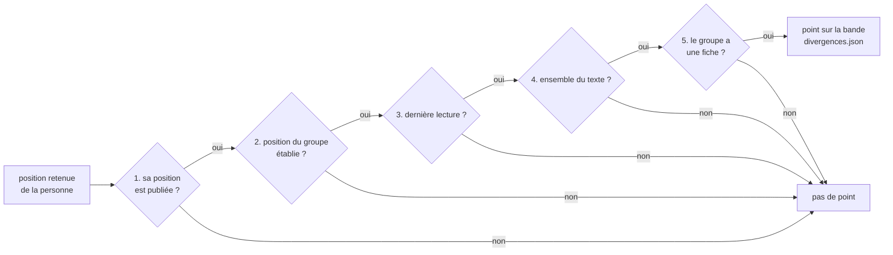

| Ce qu'on voit | Objet | Règle | Fichier |
| --- | --- | --- | --- |
| son groupe **à la date** du scrutin | `appartenance` | R-APPARTENANCE | `divergences.json` |
| la position majoritaire du groupe, **publiée par la source** | `position_groupe_scrutin` | R-POSITION-GROUPE | `divergences.json` |
| sa position à côté, scrutin par scrutin | `divergence` | R-DIVERGENCE | `divergences.json` |

**Jamais de total.** « A voté contre son groupe 47 fois » est interdit. Le fichier n'a aucun
champ pour un total, et le contrôle C4 cherche ce motif.

#### Ce qu'il a dit

> Banc non publié · gouvernement Lecornu II. Nature : Débats sur un texte de loi 94, Questions
> écrites et orales 38… Sujet : Projet de loi de finances pour 2026, 85…

| Ce qu'on voit | Objet | Règle | Fichier |
| --- | --- | --- | --- |
| prises de parole par qualité, par période, par sujet | `intervention_attribuee`, `sujet_intervention` | R-ORATEUR, R-SUJET | `paroles.json` (index sans texte) |
| extrait d'environ 300 caractères et lien vers le paragraphe | `intervention` | — | `paroles-textes-<semestre>.json` |
| questions (écrites, au gouvernement, orales) avec réponse et prises de parole liées | `question`, `question_reponse_parole` | R-QAG | `questions.json` |
| présidence de séance à part | `intervention_attribuee.preside` | R-ORATEUR | `paroles.json` |

- Mesuré, XVIIe : 193 paragraphes attribués à Ruffin. Un paragraphe de plus porte son
  identifiant mais le nom d'une ministre déléguée (Alice Rufo) : R-ORATEUR le classe **non
  attribué**, il n'apparaît pas sur sa fiche.
- Poids mesuré : l'index sans extraits pèse 2,7 Ko compressé, avec extraits 20,8 Ko. D'où le
  découpage par période.

#### Ce qu'on n'a pas pu lire

> Majorité ou opposition : l'Assemblée ne l'a pas déclaré pour 1 de ses 3 mandats. Votes :
> sur ses 152 votes, 9 n'ont pas de commission connue et 6 n'ont pas de sort connu. Prises de
> parole : sur 3 953, 3 886 n'indiquent pas à quel titre la personne parlait. Avant juin
> 2002 : nos sources ne connaissent aucun mandat avant le 19 juin 2002.

| Ligne affichée | D'où elle vient |
| --- | --- |
| Majorité ou opposition | couverture de R-BANC : banc « non déclaré » pour un mandat |
| Votes sans commission, sans sort | couverture de R-MATIERE (« saisi au Sénat seulement », « matière non établie ») et de R-SORT-FINAL (« sort non connu ») |
| Prises de parole sans qualité | couverture de la qualité dans `intervention` |
| Avant 2002 | couverture des mandats : borne de l'historique, ou absence établie si Sycomore a été relu (décision `absence_etablie`) |

Tout vient de `fiche.json` → `couverture`. Aucun texte n'est écrit à la main : chaque ligne
est calculée par R-COUVERTURE, avec numérateur et dénominateur (section 7.5).

#### Pied

Les **licences** de la fiche sont l'union des licences des sources de ses faits, calculée
(`fiche.json` → `licences`). Pour Ruffin, sans volet européen : la Licence Ouverte de
l'Assemblée. Une fiche qui affiche des votes européens tirés de Parltrack ajouterait l'ODbL.

### La fiche d'une lignée (exemple : les socialistes)

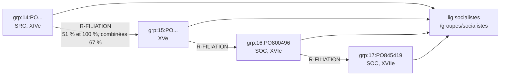

| Section | Objets et règles | Fichier |
| --- | --- | --- |
| En-tête, En bref (maillons, effectif jour par jour, banc déclaré) | `lignee`, `groupe`, `filiation`, `appartenance`, `position_declaree` (avec `divergente`) — R-FILIATION, R-CONTINUITE-GROUPE, R-BANC | `fiche.json` |
| Qui sont-ils (arrivées, départs, passages) | `appartenance`, `population` (drapeau candidat) | `membres.json` |
| Sur quoi ils ont pris la parole | paroles des membres **pendant leur appartenance** | `paroles.json` |
| Ce qu'ils ont proposé | `texte_porte`, `amendement_canonique` des membres pendant leur appartenance ; signatures à part | `proposes.json` |
| Ce qu'ils ont voté | `position_groupe_scrutin` : décompte des membres à la date, numérateur et dénominateur | `votes-<legislature>.json` |
| Avec qui ils votent | positions majoritaires des groupes de la législature, `place_mediane` — R-HEMICYCLE | `avec-qui-<legislature>.json` |
| Ce qu'on n'a pas pu lire | `couverture` par maillon | `fiche.json` |

Le chiffre 67 % vient de l'exemple du cahier (filiation de 2017). L'adresse d'un maillon
(`/groupes/socialistes/17`) redirige vers la fiche de la lignée, ouverte sur sa législature.

### La fiche d'un gouvernement (exemple : Borne)

| Section | Objets et règles | Fichier |
| --- | --- | --- |
| En-tête, En bref (période, composition, vagues, majorité, projets de loi, 49.3) | `organe` GOUVERNEMENT, `membre_gouvernement` — R-COMPOSITION, R-VAGUE (nominations à moins de 8 jours) ; `position_declaree` des groupes à la date ; `sort_dossier` | `fiche.json` |
| Qui le composait | `membre_gouvernement`, ministère de rattachement — décision `rattachement_portefeuille` si le libellé ne suffit pas | `composition.json` |
| Sur quoi ils ont pris la parole | paroles pendant la fonction **et** en qualité de membre du gouvernement (tranché le 04/11/2026) | `paroles.json` |
| Ce qu'il a fait déposer | `texte_porte` rôle `initiative_gouvernementale`, `matiere`, `sort_dossier` | `deposes.json` |
| Ce qu'il a fait entrer en vigueur | `acte_rattache` — R-RATTACHEMENT-ACTE ; table `libelle_ministere` décidée ; jamais à une personne | `actes.json` (agrégats par ministère) et `actes-<aaaa-mm>.json` (la liste, mois par mois : ≈ 49 500 actes sous Borne) |
| Les budgets qu'il a fait voter | `exercice_rattache`, `montant_budget` — R-EXERCICE | `budgets.json` |
| Ce qu'on n'a pas pu lire | `couverture` (par exemple pas de textes avant le 20/06/2012) | `fiche.json` |

### La fiche d'une législature (exemple : XVIIe)

| Section | Objets et règles | Fichier |
| --- | --- | --- |
| En-tête (période, mode de fin) | `leg:17` ; mode de fin par décision `fin_legislature` avec le décret, car l'Assemblée ne le publie pas | `fiche.json` |
| En bref (gouvernements, députés, lois, votes solennels, 49.3, censures) | comptes datés du graphe | `fiche.json` |
| Qui siégeait | `groupe`, effectif à une date, `place_mediane` — R-HEMICYCLE | `hemicycle.json` |
| À l'ordre du jour | `reunion` confirmées, `point_odj`, dossiers liés ou déclarés non liés | `ordre-du-jour-<annee>.json` |
| Les textes de la législature | `dossier`, `etape_dossier`, `sort_dossier`, `matiere` | `textes.json` |
| Le travail des commissions | `matiere` (commission saisie au fond), `etape_dossier` | `commissions.json` |

---

## 7.5 Couverture et absences

**Une liste vide n'est jamais muette : la fiche sait, sans télécharger la section, si c'est un
vrai zéro, un trou de la source, une borne, un choix, une panne ou un travail en cours, et
l'écrit derrière « Pourquoi → ».**

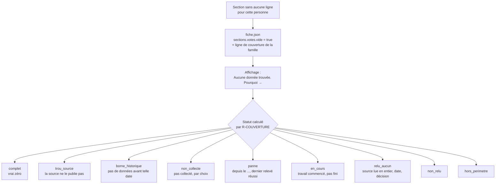

- La couverture a une **portée** (corpus, source, population, fiche, section), une
  **famille** (votes, paroles…), un **statut** et un **détail** (numérateur, dénominateur,
  explication).
- Elle est **calculée**, jamais saisie. Seule exception : l'absence établie à la main
  (« relu, aucun »), qui est une décision `absence_etablie` avec la source lue, la date et ce
  qu'elle ne couvre pas. « Relu, aucun » reste distinct de « non relu ».
- Le contrôle C5 empêche de dire « complet » quand un relevé contributeur ne l'est pas :
  dans ce cas, le statut doit être `panne`.
- Une valeur manquante est `null` avec une raison. **Jamais 0.**

Exemple, d'après la capture d'une candidate ou d'un candidat sans mandat parlementaire :
toutes les sections affichent « Aucune donnée trouvée. Pourquoi → », et « Ce qu'on n'a pas
pu lire » dit : « Nos sources ne connaissent aucun mandat parlementaire de cette personne. Il
n'y a donc ni vote, ni amendement, ni prise de parole à publier. » Avec ce modèle, cette
phrase sort de la couverture de la fiche, pas d'un texte écrit à la main.

---

## 7.6 Comment le modèle évolue

**Ajouter un champ, changer une règle ou ouvrir une législature ne réécrit jamais l'acquis :
on change une entrée, et le recalcul fait le reste.**

### Un champ ajouté (ou une lecture corrigée)

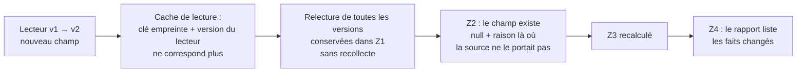

Rien ne bouge dans Z0, Z1 ni dans les décisions. C'est pour ça que l'entrepôt garde les
objets bruts et non les faits : une erreur de lecture découverte dans six mois se corrige
sur tout l'historique.

On relit **toutes les versions conservées**, pas seulement les dernières. C'est ce qui fait
atteindre au champ nouveau les anciennes versions (le siège d'une législature close, par
exemple).

Si la correction fait disparaître des faits publiés, la **note de version** du lecteur doit
l'annoncer (par exemple « R-ORATEUR@3 cesse d'attribuer les identifiants négatifs »). Le
contrôle C1 accepte alors ces pertes, et seulement celles qui correspondent à l'annonce.

### Une règle changée

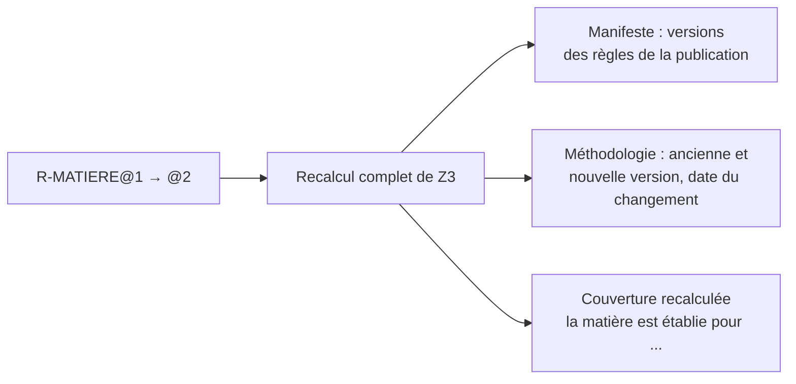

Z2 ne bouge pas. Chaque ligne du graphe garde la règle et la version qui l'ont produite.
Comme pour un lecteur, une perte de faits publiés doit être annoncée dans la note de version
de la règle, sinon C1 bloque.

### La XVIIIe législature

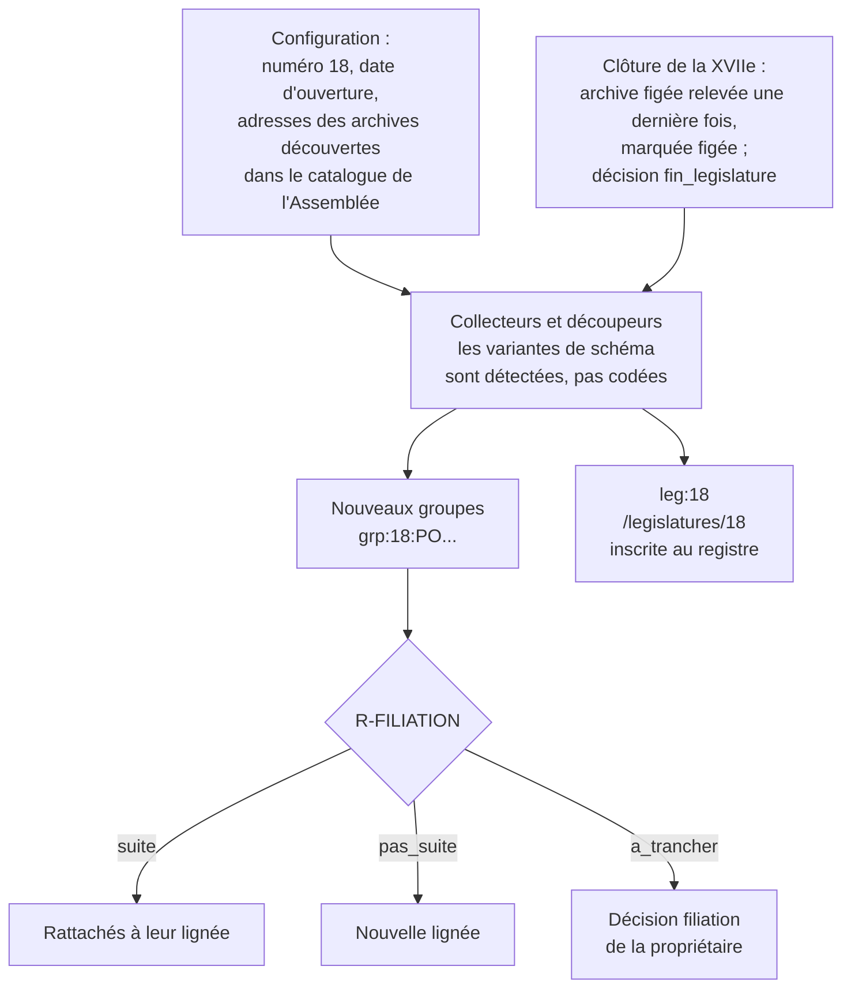

Le code des lecteurs ne change pas pour une législature nouvelle. Les fiches de la XVIIe
gardent leur adresse.

### Récapitulatif

| Changement | Ce qui se passe | Ce qui ne bouge pas |
| --- | --- | --- |
| Champ ajouté, lecture corrigée | nouvelle version du lecteur ; relecture depuis Z1 | Z0, Z1, décisions |
| Règle modifiée | nouvelle version ; recalcul complet de Z3 ; méthodologie publiée | Z2 |
| Source ajoutée | un collecteur, un découpeur, un lecteur ; la couverture déclare son historique | tout le reste |
| Type de fiche ajouté | un composeur et un schéma de fichier | Z0 à Z3 |
| XVIIIe législature | configuration | le code des lecteurs |
| Contrat des données servies | version `majeur.mineur` dans chaque fichier ; un ajout est mineur ; un changement incompatible passe le contrat en `2.0`, publié avec le code qui le lit, dans la même publication | les articles datés, qui embarquent leur copie figée |
| Adresse d'une fiche | jamais changée ; redirection si l'objet fusionne ou disparaît | le registre des adresses |

Un changement incompatible n'a pas besoin d'un dossier à part : chaque publication vit déjà
sous son propre préfixe `/donnees/<id-publication>/`. Le contrat `2.0` et le code qui le lit
partent ensemble ; un navigateur resté sur l'ancienne publication reçoit une 404 et
recharge la page.
